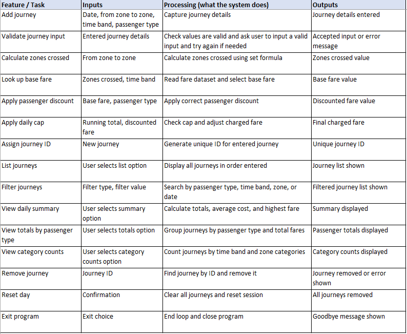
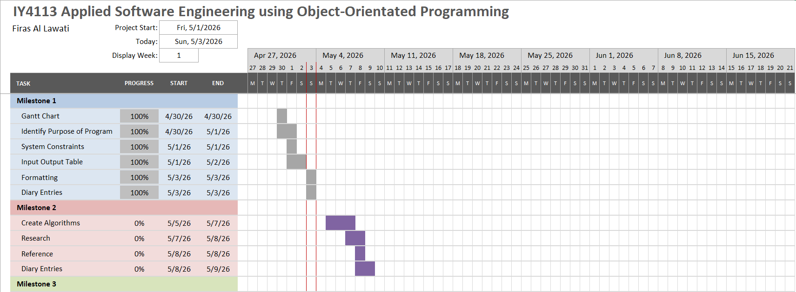

# IY4113 Milestone 1

| Assessment Details | Please Complete All Details                                             |
| ------------------ | ----------------------------------------------------------------------- |
| Group              | A                                                                       |
| Module Title       | IY4113 Applied Software Engineering using Object-Orientated Programming |
| Assessment Type    | Java Fundementals Part 1                                                |
| Module Tutor Name  | Jonathon Shore                                                          |
| Student ID Number  | P466146                                                                 |
| Date of Submission | 05/03/2026                                                              |
| Word Count         | 1247                                                                    |

- [x] *I confirm that this assignment is my own work. Where I have referred to academic sources, I have provided in-text citations and included the sources in
  the final reference list.*

- [x] *Where I have used AI, I have cited and referenced appropriately.

------------------------------------------------------------------------------------------------------------------------------

### Purpose of the Program

------------------------------------------------------------------------------------------------------------------------------

The purpose of the program is to simulate a public transport journey tracking system in a Java application, allowing a user to enter journey details, calculate fares for them to pay, apply discounts and daily caps, and review or remove journeys during a single run of the program.

### **Core program functionality**

- **Add journeys**
  - Enter journey details such as starting zone, destination zone, time band, passenger type, and date.
  - Validate and check the input so only correct values are accepted.
  - Calculate the number of zones crossed in order to calculate the fare.
  - Look up the correct fare from the provided dataset.
  - Apply any passenger discount and daily cap rules.
  - Store the journey in memory.
- **List journeys**
  - Display all journeys entered during the current session/run of the code.
  - Show main journey details such as zones, passenger type, time band, and cost.
- **Filter journeys**
  - Allow the user to filter journeys by passenger type, time band, zone, or date.
  - Only show journeys that match the selected criteria chosen by the user.
- **View summaries**
  - Show the total number of journeys.
  - Show the total amount of money spent.
  - Show the average cost per journey.
  - Show the most expensive journey.
- **Remove journeys**
  - Allow the user to remove a journey using its ID.
  - Confirm when a journey has been deleted.
- **Reset the day**
  - Clear all stored journeys from memory.
  - Restart the session data for a new day.

### **System constraints (limitations / rules)**

- No persistence: journeys are stored only while the program is running and will reset when program is exited from with no file or database saving.
- Console UI only: the program uses text menus and keyboard input only.
- Zone limits: only zones 1 to 5 are valid.
- Time band limits: only peak and off-peak are allowed.
- Passenger type limits: only adult, student, child, and senior citizen are valid.
- Fare rules: the program must use the supplied fare dataset and must not change it.
- Single-day scope: the program only tracks journeys for one day at a time.
- Validation rule: invalid inputs must be rejected, and the user should be given an error message and asked to input a valid input instead.

------------------------------------------------------------------------------------------------------------------------------

### Input Process Output Table

------------------------------------------------------------------------------------------------------------------------------

------------------------------------------------------------------------------------------------------------------------------

### Gantt Chart

------------------------------------------------------------------------------------------------------------------------------

------------------------------------------------------------------------------------------------------------------------------

### Diary Entries

------------------------------------------------------------------------------------------------------------------------------

### **30/04/2026 - Diary Entry 1 – Understanding the Brief and Planning the Gantt Chart**

I began the day by studying the project brief. This allowed me to understand the key elements that needed to be taken into account while working on the CityRide Lite assignment. My goal was to understand the functions of the program. This was essential to enable me to write the purpose part and IPO table without any complications and ensured that I understood what I needed to do.

Furthermore, I started organizing my work according to the milestones and dividing the project timeline into several tasks to be included in the Gantt chart. In particular, the major stages included the creation of the Gantt chart, the development of the purpose statement for the project, limitation identification, creating the IPO table and writing my diary entries. This was necessary to organise my work effectively and ensure that the project could be completed in a reasonable and organised manner to ensure that I get everything done on time.

The challenge I faced was related to the need to establish the level of detail required to present various tasks within the Gantt chart. Initially, the tasks seemed to be too general, therefore, I needed to break them into smaller components.

### **01/05/2026 - Diary Entry 2 – Writing the Purpose Section and Planning the IPO Table**

Today I started writing the purpose section, I formulated the purpose statement of the program in a formal and academic manner since it follows the format provided in the example. The statement is brief, straight to the point, and academic in nature. It briefly describes what the program is supposed to do, mentions the core function of the program and its constraints/limitations.

Moreover, I created the IPO table of the major processes of the application program. Based on the example IPO table given, I followed the same format in organising the information by separating each process in a new row. This way, the system becomes comprehensible, and the program's logic can be easily understood.

One challenge that I faced while creating the IPO table is determining how much information I have to write in each row. At first, I thought that each row only needs to contain minimal information, but later I realized that the example IPO table contains more details than what I initially planned to include. Therefore, I decided to add the process of menu actions, validation, calculation, summary, among others.

### **02/05/2026 - Diary Entry 3 – Developing the IPO Table and Refining the Layout**

Today I worked on the IPO table in more detail and started turning the list of functions into a cleaner table layout. I included the main actions such as adding a journey, listing journeys, filtering journeys and viewing totals. I did this because the table needs to show how the system behaves from the user’s point of view, and the example given showed that each action should be broken down clearly.

I also checked the wording in the table to make sure it stayed simple and did not become too complicated. I wanted the inputs, processing, and outputs to be easy to follow.

One problem I ran into was fitting the table neatly onto one page in a word document. Some of the descriptions were too long and made the table look crowded, so instead of shortening the info which makes the table less detailed I decided to switch to and Excel sheet which allowed me to have the freedom to keep the detail as it is which is something I couldn’t do in a Word document . This made the table clearer, easier to read and keep the amount of detail I want it to have without sacrificing how good it looks.

### **03/05/2026 - Diary Entry 4 – Final Formatting, Organising the Markdown File and Diary Entries**

Today my main aim was to compile the work completed during Milestone 1 into the required markdown file using MarkText. This involved adding the completed sections, including the purpose of the program, basic functionality, system constraints, IPO table, Gantt chart image, and diary entries. The assignment required all of the work to be organised in the correct format and uploaded to GitHub.

As well as compiling the sections, I also worked on making sure the document layout was clear and easy to read. This included checking that the headings were correct, that the tables were visible and easy to understand, and ensured that the spacing didn’t make anything unclear.

I had written the diary entries on the days when the work was actually completed, so at this stage I mainly reviewed them, improved the wording, and made them sound more academic and professional so they matched the style of the rest of the document.

One issue I faced was getting the images to display properly in both the markdown file and on GitHub. At first, I was unsure which path should be used for the images to appear correctly, and I knew that using the wrong path would prevent them from being shown. I resolved this by saving the images in the same folder as the markdown file and using the correct relative path to embed them.

------------------------------------------------------------------------------------------------------------------------------
