# IY4113 Milestone 2

| Assessment Details | Please Complete All Details                                             |
| ------------------ | ----------------------------------------------------------------------- |
| Group              | A                                                                       |
| Module Title       | IY4113 Applied Software Engineering using Object-Orientated Programming |
| Assessment Type    | Java Fundementals Milestone 2                                           |
| Module Tutor Name  | Jonathan Shore                                                          |
| Student ID Number  | P466146                                                                 |
| Date of Submission | 10/05/2026                                                              |
| Word Count         | 1020                                                                    |

- [x] *I confirm that this assignment is my own work. Where I have referred to academic sources, I have provided in-text citations and included the sources in
  the final reference list.*

- [x] *Where I have used AI, I have cited and referenced appropriately.

------------------------------------------------------------------------------------------------------------------------------

### Algorithm Design

------------------------------------------------------------------------------------------------------------------------------

**Full Flowchart**

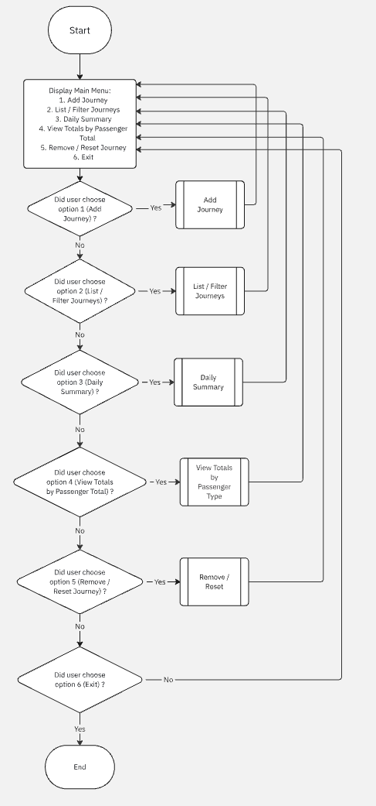

**Subprocesses:**
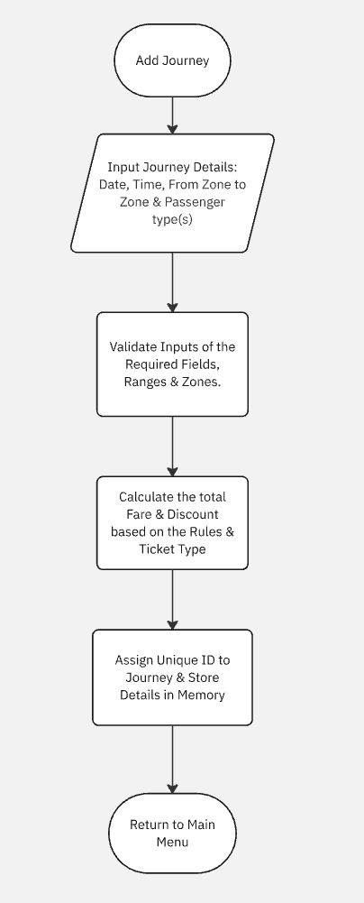

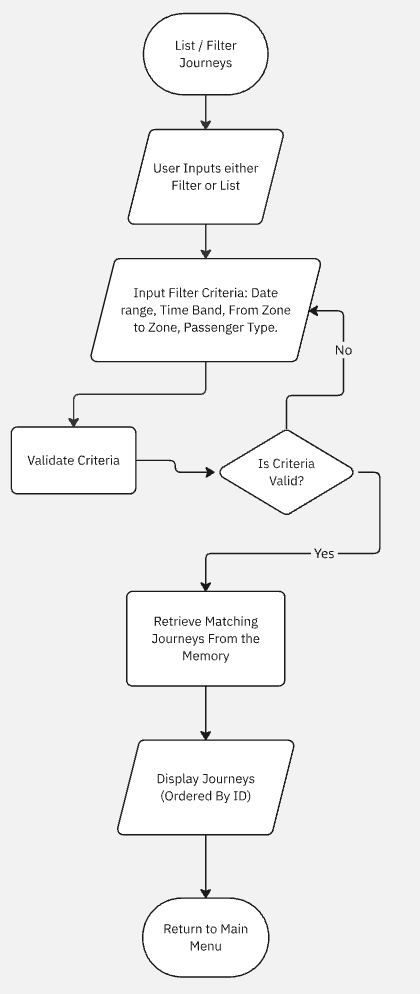

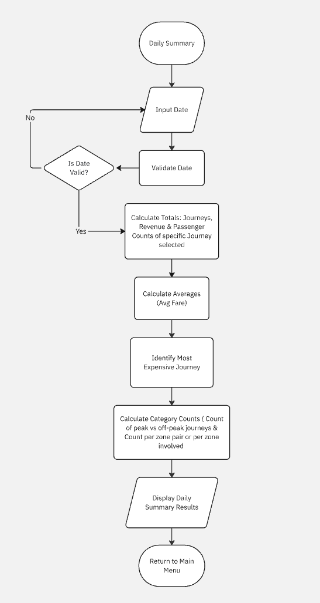

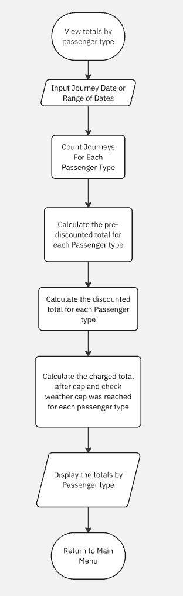

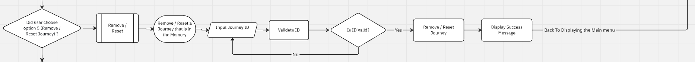

**Class Diagram:**

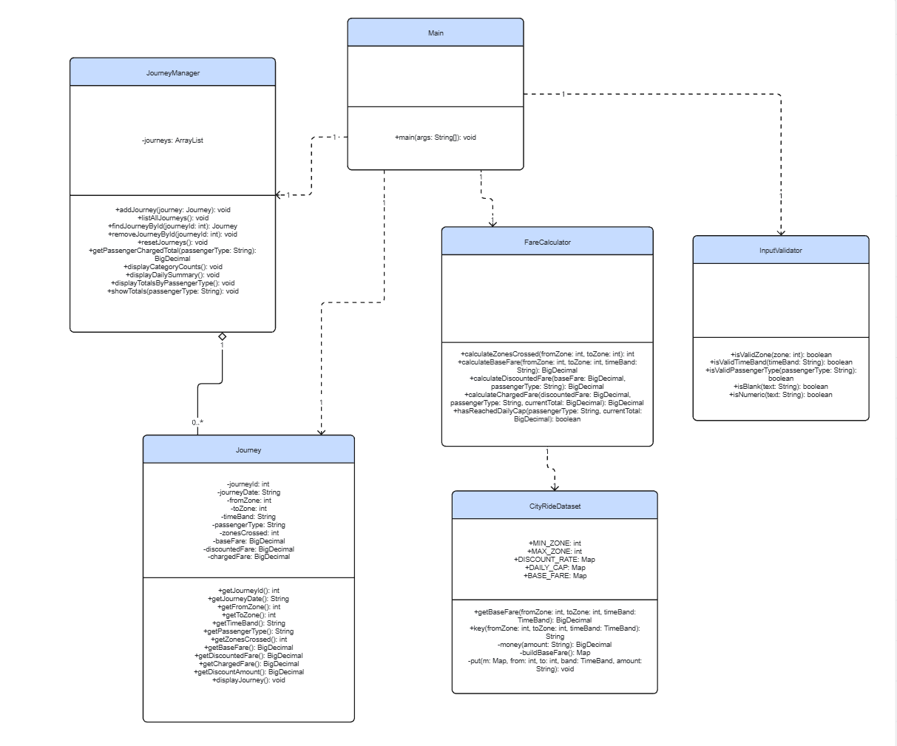

------------------------------------------------------------------------------------------------------------------------------

### Research

------------------------------------------------------------------------------------------------------------------------------

**Example 1:**

Name of program: Ride-Sharing Uber Lyft Android App

Reference (link): https://github.com/SusithD/Travel-Planner-JavaBased-Application 

What it does well (2-3 features that work effectively):

1- It separates the system into 2 main sections user and admin, which makes the structure clearer and easier to navigate. This is useful for this project because the journey tracker also needs clear separation between actions like adding, listing, filtering, and summarising journeys.

2- It supports managing the trip related information in a structured way, such as budgets, packages, bookings, and profile details. This feature makes it very organised and easy to look at and navigate through.

3- It provides step by step options to the user, which helps move through tasks in a logical order instead of seeing everything on one screen all at once.

What it does poorly (at least 1 feature):

1- It includes too many extra features, such as hotel booking, package management, interactive maps, and admin reports, so the system feels crowded and unorganised, therefore, it is harder to use as a quick travel planning tool and would be too complex for a simple journey tracker.

Key design ideas you could reuse (e.g., layout, navigation, input/output, program structure):

1- Use separate sections or menu options for different tasks, so the user is not overloaded with options.

2- Keep related data together in organised modules, like journey details, summaries, and passenger totals.

Screenshot (showing the interface/output):

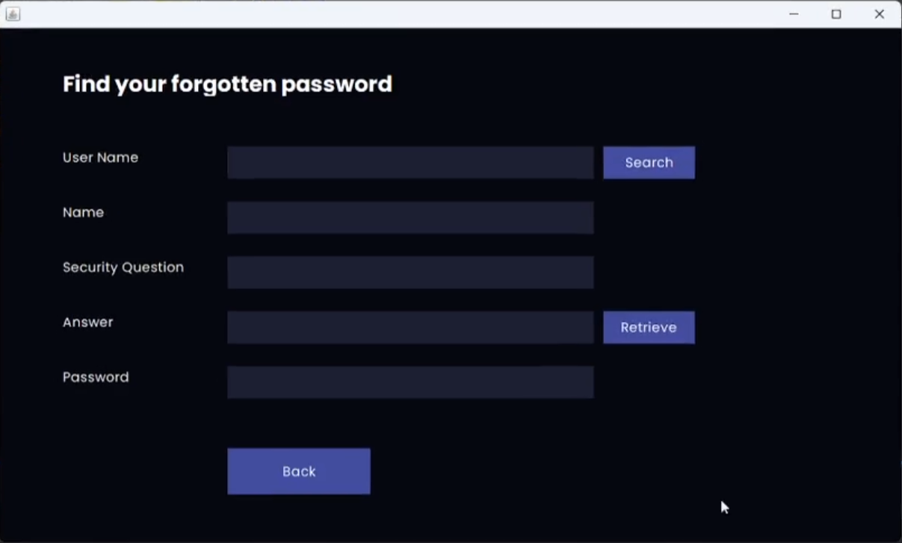

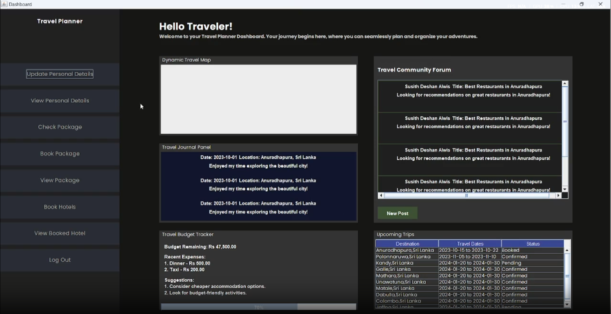

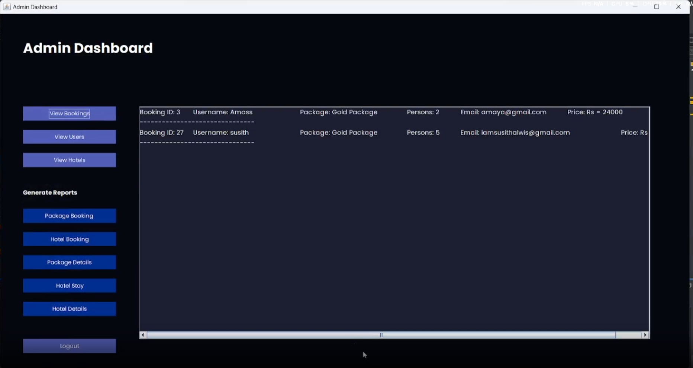

**Example 2:**

Name of program: Mileage Tracker 

Reference (link): https://github.com/CodeByAlbert/Mileage-Tracker 

What it does well (2-3 features that work effectively): 

1- It lets the user log each trip by entering details such as departure, arrival, odometer readings, tolls, and parking, which is similar to this project collecting journey details from the user.

2- It automatically calculates mileage and expenses after the trip details are entered, which is similar to this project calculating zones crossed, fares, discounts, and cap-adjusted charges.

3- It stores the trip data in a structured form and can export it, which shows a clear way of managing journey records after they have been entered. 

What it does poorly (at least 1 feature): 

It depends on Google Maps and spreadsheet export features, which add extra complexity and can result in many external errors.

Key design ideas you could reuse (e.g., layout, navigation, input/output, program structure): 

1- A simple input that leads to the calculation and stores it at the end. 

2- Showing calculated results only after valid journey details have been entered.

Screenshot (showing the interface/output):

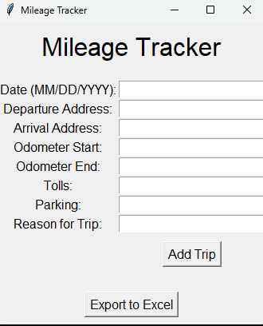

------------------------------------------------------------------------------------------------------------------------------

### Updated Gantt Chart

------------------------------------------------------------------------------------------------------------------------------

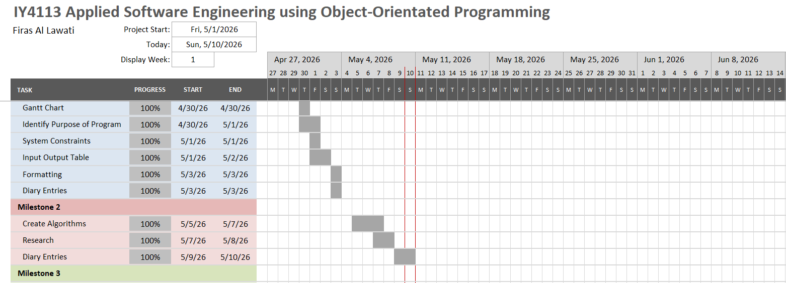

------------------------------------------------------------------------------------------------------------------------------

### Diary Entries

------------------------------------------------------------------------------------------------------------------------------

**05/05/2026 - Diary Entry 1 – Developing the Flowchart and Adding Subprocesses**

Today I started designing the flowchart. I analysed the main structure of the program which is given in the brief, then expanded on each main menu option to show the smaller steps that happen after the user selects it. This included subprocesses which was a new thing to me, it involved separating the flowchart into different functions all attached to the main part such as entering journey details, checking that the data is valid, calculating fares, saving journeys in memory, displaying summaries and removing journeys.

Furthermore, I made sure the flowchart had the functions that were listed in the assignment brief. Doing this helped me understand the how the program is supposed to work more clearly and understood how each part of the program connects back to the main menu.

One issue I faced was that the flowchart was filled with unnecessary processes which I decided to delete as they didn't have much impact on the function itself which made the flowchart much more clearer and easy to follow.

**07/05/2026 - Diary Entry 2 – Researching Similar Programs**  
Today I began the research section for Milestone 2 by looking for programs that solve a similar type of problem. I searched for travel-related, journey-tracking and trip-recording systems so I could compare them with our project and find useful design ideas. I focused on finding examples that had some connection to recording journeys, displaying trip information or organising user input clearly.

While doing this, I realised that not every travel app was a good match for the task as some examples were mainly focused on bookings, maps or route planning, which did not relate well enough to the main idea of storing and managing journeys which our program will be doing.

The main challenge was picking the examples that were similar in logic rather than just similar in theme. Because of this, I had to go through several possible examples before finding the two that were suitable enough to include and analyse for this task.

**08/05/2026 - Diary Entry 3 – Analysing the Chosen Projects**  
Today I worked on analysing the projects I had selected for the research section. I looked at what each program did well, what it did poorly, and which ideas could be reused in the design of CityRide Lite.

I paid particular attention to features such as how journey or trip information was entered, how results were displayed, and how the overall structure of the program or application was organised. This made it easier to compare each example to the project we are tasked to create and identify features that I could use to integrate and help with my design.

One difficulty I had was making sure the analysis stayed specific. At first, some of my points were too general, so I rewrote them to focus more on actual strengths and weaknesses of the selected programs rather than judging them based on how close they were to the project brief and it's similarities.

------------------------------------------------------------------------------------------------------------------------------
