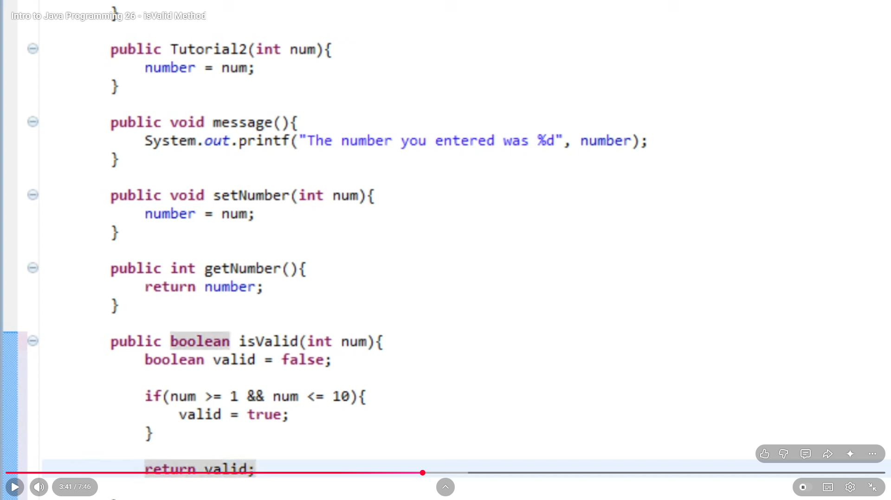
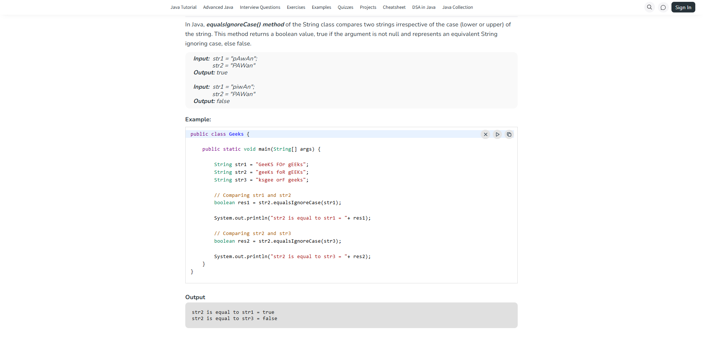
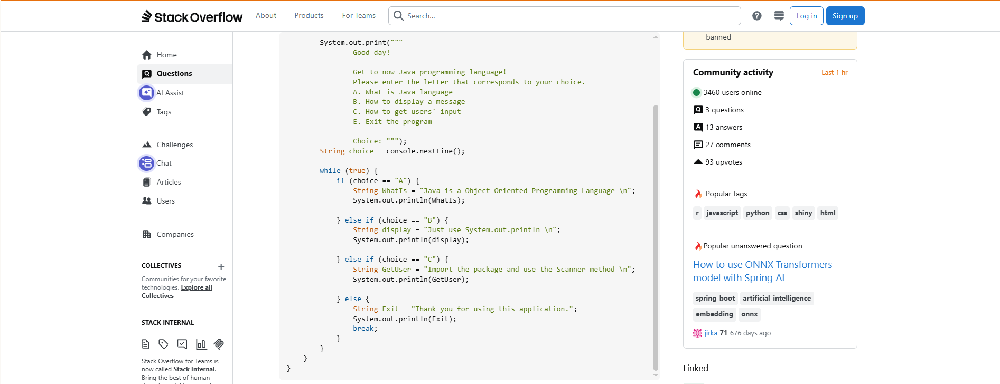
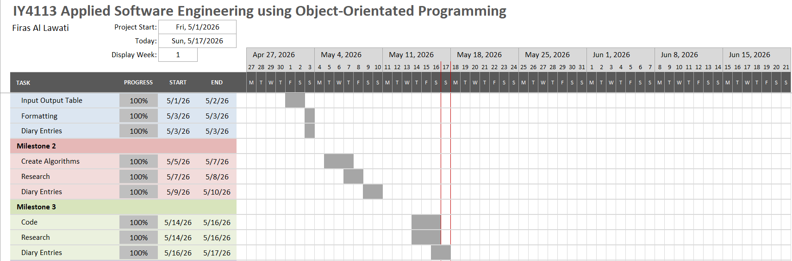

# IY4113 Milestone 3

| Assessment Details | Please Complete All Details                                             |
| ------------------ | ----------------------------------------------------------------------- |
| Group              | A                                                                       |
| Module Title       | IY4113 Applied Software Engineering using Object-Orientated Programming |
| Assessment Type    | Java Fundementals Milestone 3                                           |
| Module Tutor Name  | Jonathan Shore                                                          |
| Student ID Number  | P466146                                                                 |
| Date of Submission | 17/05/2026                                                              |
| Word Count         | 755                                                                     |

- [x] *I confirm that this assignment is my own work. Where I have referred to academic sources, I have provided in-text citations and included the sources in
  the final reference list.*

- [x] *Where I have used AI, I have cited and referenced appropriately.*

------------------------------------------------------------------------------------------------------------------------------

### Research

---

**Title of research:** isValid Method

**Reference (link):** [Intro to Java Programming 26 - isValid Method - YouTube](https://www.youtube.com/watch?v=uzCz_Hom_vE "https://www.youtube.com/watch?v=uzcz_hom_ve")

**How does the research help with coding practise?:**  
It shows how to check user input before the program continues, which is useful for making sure only valid zones, time bands, and passenger types are accepted by the program when entered by the user.**Key coding ideas you could reuse in your program:**

- Use a validation method to check input first.
- Return true or false.

**Screenshot of research:**



---

**Title of research:** equalsIgnoreCase

**Reference (link):** [Java String equalsIgnoreCase() Method - GeeksforGeeks](https://www.geeksforgeeks.org/java/java-string-equalsignorecase-method-with-examples/ "https://www.geeksforgeeks.org/java/java-string-equalsignorecase-method-with-examples/")

**How does the research help with coding practise?:**  
This research helped me understand how to compare strings without case sensitivity, which is useful when checking user input such as time bands and passenger types. It also helped me understand that the method returns false when the compared value does not match, including when it is null, which supports safer input validation.  
**Key coding ideas you could reuse in your program:**

- Use equalsIgnoreCase() to compare text input.
- Use safer string comparison to reduce input errors in validation methods.

**Screenshot of research:**



---

**Title of research:** Menu Creation

**Reference (link):** https://stackoverflow.com/questions/66203431/menu-driven-application-using-if-else-statement-java

**How does the research help with coding practise?:**  
It shows how to build a menu using if and else if, which matches the way my program handles different user choices from 1-6.

**Key coding ideas you could reuse in your program:**

- Use if / else if for menu choices.
- Re-read the user input inside a loop.
- Make sure each option leads to the correct action.

**Screenshot of research:**



------------------------------------------------------------------------------------------------------------------------------

### Program Code

----

```
import java.util.ArrayList;  
import java.util.Scanner;  

class Journey { // Gathers one Journey's details and stores it  
    // Attributes  
    private int journeyId;  
    private String journeyDate;  
    private int fromZone;  
    private int toZone;  
    private String timeBand;  
    private String passengerType;  

    // Constructor  
    public Journey(int journeyId, String
journeyDate, int fromZone, int toZone, String timeBand, String passengerType) {  
        this.journeyId = journeyId;  
        this.journeyDate = journeyDate;  
        this.fromZone = fromZone;  
        this.toZone = toZone;  
        this.timeBand = timeBand;  
        this.passengerType =
passengerType;  
    }  

    // Get Methods  
    public int getJourneyId() {  
        return journeyId;  
    }  

    public String getJourneyDate() {  
        return journeyDate;  
    }  

    public int getFromZone() {  
        return fromZone;  
    }  

    public int getToZone() {  
        return toZone;  
    }  

    public String getTimeBand() {  
        return timeBand;  
    }  

    public String getPassengerType() {  
        return passengerType;  
    }  

    // Set Methods  
    public void setJourneyId(int
journeyId) {  
        this.journeyId = journeyId;  
    }  

    public void setJourneyDate(String
journeyDate) {  
        this.journeyDate = journeyDate;  
    }  

    public void setFromZone(int fromZone)
{  
        this.fromZone = fromZone;  
    }  

    public void setToZone(int toZone) {  
        this.toZone = toZone;  
    }  

    public void setTimeBand(String
timeBand) {  
        this.timeBand = timeBand;  
    }  

    public void setPassengerType(String
passengerType) {  
        this.passengerType =
passengerType;  
    }  
}  
class JourneyManager { // In charge of the whole list of Journeys stored  
    // Attributes  
    private ArrayList<Journey>
journeys;  

    // Constructor  
    public JourneyManager() {  
        journeys = new
ArrayList<>();  
    }  

    public void addJourney(Journey
journey) { // Adds new journey to the array  
        System.*out*.println("Add
Journey"); // Not Finished  
    }  

    public void displayAllJourneys() { //
Display stored journeys  
        System.*out*.println("List
Journeys"); // Not Finished  
    }  

    public void removeJourneyById(int
journeyId) { // Delete Journey using unique ID  
        System.*out*.println("Remove
Journey"); // Not Finished  
    }  

    public void resetJourneys() { //
Delete all stored journeys  
        System.*out*.println("Reset
Day"); // Not Finished  
    }  
}  
class FareCalculator { // Calculates fares for journeys (Calculations not done
yet)  
    // Constructor  
    public FareCalculator() {  
    }  
    public int calculateZonesCrossed(int
fromZone, int toZone) {  
        int zonesCrossed = 0;  
        return zonesCrossed;  
    }  

    public double calculateBaseFare(int
zonesCrossed, String timeBand) {  
        double baseFare = 0.0;  
        return baseFare;  
    }  

    public double
calculateDiscountedFare(double baseFare, String passengerType) {  
        double discountedFare = 0.0;  
        return discountedFare;  
    }  
}  
class InputValidator { // Checks if user input is valid  
    // Constructor  
    public InputValidator() {  
    }  
    public boolean isValidZone(int zone)
{  
        boolean isValid = false;  

        if (zone >= 1 && zone
<= 5) {  
            isValid = true;  
        }  
        return isValid;  
    }  

    public boolean isValidTimeBand(String
timeBand) {  
        boolean isValid = false;  

        if
("Peak".equalsIgnoreCase(timeBand)) {  
            isValid = true;  
        } else if
("Off-Peak".equalsIgnoreCase(timeBand)) {  
            isValid = true;  
        }  
        return isValid;  
    }  

    public boolean
isValidPassengerType(String passengerType) {  
        boolean isValid = false;  

        if
(passengerType.equalsIgnoreCase("Adult")) {  
            isValid = true;  
        } else if
(passengerType.equalsIgnoreCase("Student")) {  
            isValid = true;  
        } else if
(passengerType.equalsIgnoreCase("Child")) {  
            isValid = true;  
        } else if
(passengerType.equalsIgnoreCase("Senior Citizen")) {  
            isValid = true;  
        }  
        return isValid;  
    }  
}  
public class Main {  
    public static void main(String[]
args) {  
        Scanner input = new
Scanner(System.*in*);  
        JourneyManager journeyManager =
new JourneyManager();  
        FareCalculator fareCalculator =
new FareCalculator();  
        InputValidator inputValidator =
new InputValidator();  
        int menuChoice = 0;  

        while (menuChoice != 6) {  
            System.*out*.println("
Welcome to CityRide Lite! Please enter a choice from below: ");  
            System.*out*.println("1.
Add Journey");  
            System.*out*.println("2.
List Journeys");  
            System.*out*.println("3.
View Daily Summary");  
            System.*out*.println("4.
Remove Journey");  
            System.*out*.println("5.
Reset Day");  
            System.*out*.println("6.
Exit");  
            System.*out*.print("Choose
an option: ");  
            menuChoice = input.nextInt();  
            input.nextLine();  

            if (menuChoice == 1) {  
                System.*out*.println("N/A");  
            } else if (menuChoice == 2) {  
                System.*out*.println("N/A");  
            } else if (menuChoice == 3) {  
                System.*out*.println("N/A");  
            } else if (menuChoice == 4) {  
                System.*out*.println("N/A");  
            } else if (menuChoice == 5) {  
                System.*out*.println("N/A");  
            } else if (menuChoice == 6) {  
                System.*out*.println("Thanks for
using CityRide Lite! Until next time!");  
            } else {  
                System.*out*.println("Invalid
choice.");  
            }  
        }  

        input.close();  
    }  
}
```

---

### Updated Gantt Chart

------------------------------------------------------------------------------------------------------------------------------



------------------------------------------------------------------------------------------------------------------------------

### Diary Entries

------------------------------------------------------------------------------------------------------------------------------

**05/14/2026 - Diary Entry 1 – Implementation of Classes**  
Today, I began working on creating all the necessary classes which are Journey, JourneyManager, FareCalculator and Input Validator while mainly focusing on the Journey and JourneyManager classes, which include their attributes, constructors, getters, and setters.  
This is helped very much since the Journey class serves the purpose of storing information for every journey made. On the other hand, the JourneyManager class serves the purpose of storing the journeys made in the memory. This class is also in charge of controlling actions performed on the stored journeys including adding, deleting, resetting the day, and listing the journeys which are in the memory, and together these two classes set the main foundation of the program.  
A challenge that I encountered was translating the flowchart into actual programming codes. The process was challenging in figuring out the appropriate way of translating the flowchart steps into classes and methods.


**05/15/2026 - Diary Entry 2 – Working on Validation and Fare Calculation**  
Today I worked on the InputValidator and FareCalculator classes. I also did research on the isValid method and equalsIgnoreCase() because I needed to understand how to check user input properly and needed to only allow certain inputs by the user and rejecting other ones such as for the passenger types the program should only accept the ones available. This helped me build the validation side of the program.  
This research was important because the program needs to check that the user enters valid zones, time bands, and passenger types before calculating fares which I haven’t done yet, but coded the skeleton of it for now.  
One problem I had was working out how to compare string values correctly without making the code more complicated than needed. I had to think about how the program should handle the user input so that it could accept valid answers and reject invalid ones. I also had to figure out how to handle null inputs which the research helped me to do with the equalsIgnoreCase.


**05/16/2026 - Diary Entry 3 – Building the Menu System**  
Today, I spent time working on the menu part of the application and ensuring that it displays all the options available to the user when the program is executed. I did some research on the best way to design the menu system and came across a method that uses if and else if statements in Java which was much like the way we used to do it in Python in the way of structuring it and the error handling aspect where if the user enters something that isn’t 1-6 it will say invalid input and allow them to input again.

It was good for me to understand how the menu works because it is the most critical part as it enables the interaction between the user and the program, therefore, it was necessary for the menu to work flawlessly with no complications.

------------------------------------------------------------------------------------------------------------------------------
