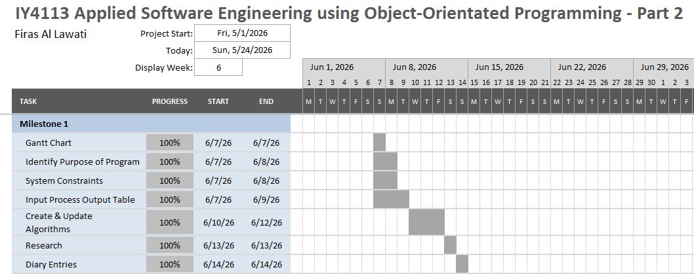
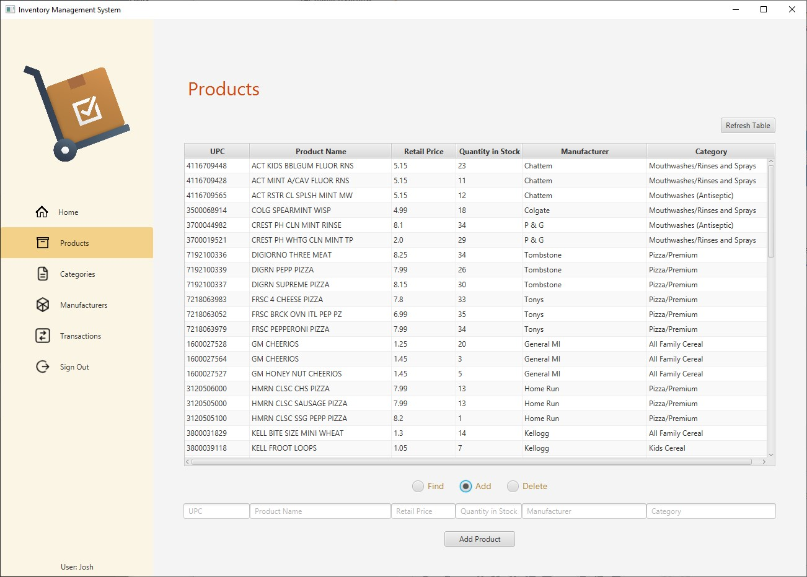
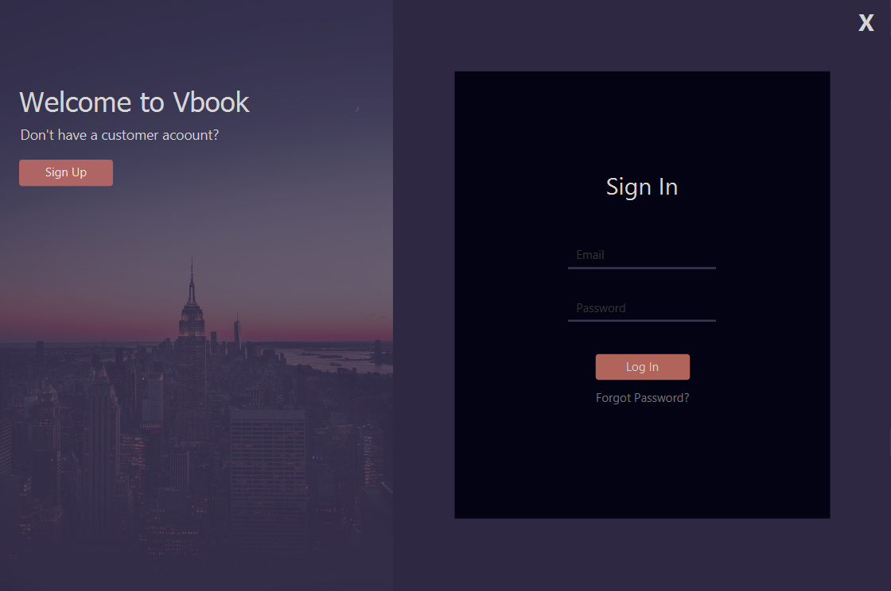

# IY4113 Part 2 - Milestone 1

| Assessment Details | Please Complete All Details                                           |
| ------------------ | --------------------------------------------------------------------- |
| Group              | A                                                                     |
| Module Title       | IY4113 Applied Software Engineering using Object-Oriented Programming |
| Assessment Type    | Java Fundamentals Milestone 1 - Part 2                                |
| Module Tutor Name  | Jonathan Shore                                                        |
| Student ID Number  | P466146                                                               |
| Date of Submission | 14/06/2026                                                            |
| Word Count         | 2320                                                                  |
| GItHub Link        | https://github.com/firasallawati/T0466146_Firas_4113                  |

- [x] *I confirm that this assignment is my own work. Where I have referred to academic sources, I have provided in-text citations and included the sources in  
    the final reference list.*

- [x] Where I have used AI, I have cited and referenced appropriately.

### Purpose of the Program

The purpose of the program is to extend the Part 1 **CityRide Lite** system into a more advanced public transport fare companion application. While Part 1 focused on entering journeys, calculating fares, and managing them during a single run of the program, Part 2 develops this further by adding user profiles, persistent file storage, journey editing, import/export features, and an administrator role. The completed program should allow a rider to manage journeys across multiple sessions using saved profile and journey data, while also allowing an admin user to manage fare-related system settings such as base fares, discounts, caps, and peak windows.

## Core program functionality

### Rider features

- Create, load, and save a rider profile containing name, passenger type, and default payment option.

- Allow multiple rider profiles to be created and loaded, so each rider can log in and access their own saved profile information and journey history.

- Save and load rider profile data using JSON files.

- Add journeys by entering details such as date / time, starting zone, destination zone, time band, and passenger type.

- Edit and delete journeys for the active day, with totals recalculated after changes.

- Read journey records from a CSV file into the application, and also save the journeys currently in the app out to a CSV file.

- View costs per journey, running totals, and whether a cap or travel pass has been applied.

- Generate an end of day summary showing total journeys, total cost, average cost, most expensive journey, cap savings, and category counts.

- Export reports as both a CSV report and a human-readable text summary.

### Fare calculation features

- Calculate the number of zones crossed and use this with the time band to determine the base fare.

- Apply passenger discounts and daily caps, ensuring the total daily fare does not exceed the cap.

### Admin features

- Support a separate Admin role alongside the Rider role.

- Provide a password protected admin log in menu.

- Allow admins to view the active configuration.

- Allow admins to add, update, and delete base fares, passenger discounts, daily caps, and peak time windows.

- Validate admin changes before saving.

### File handling and startup features

- Load configuration information from the config file on program start up.

- Use default values if no configuration file exists.

- Use JSON for storing configuration and profiles and CSV for journeys and reporting.

- When exitting, offer to save the rider’s current day state, including profile and journeys.

## System constraints (limitations / rules)

- The system must implement the journey and fare calculation of part 1 without completely replacing it.

- The system will continue to have a menu-driven system with a console interface, text prompts and keyboard input.

- Only two possible users can be created: Rider and Admin.

- All journeys and riders' profiles will be saved in JSON format, while the journeys import/export and reports must be in CSV files.

- If configuration data cannot be loaded, the program must fall back to safe default values instead of failing.

- The system must respect the supplied zones, passenger types, discounts, caps, and fares rules.

- All invalid IDs, invalid file data, and invalid administration configuration values should generate an error message, and invalid data must not be saved.

- All prompts should include the expected format and example values to help the user enter data correctly.

---

### Input Process Output Table

---

| Feature / Task                | Inputs                                                   | Processing (what the system does)                                                    | Outputs                                  |
| ----------------------------- | -------------------------------------------------------- | ------------------------------------------------------------------------------------ | ---------------------------------------- |
| Load config data              | Config file                                              | Read configuration file on startup and load fares, discounts, caps, and peak windows | Config data loaded or safe defaults used |
| Create rider profile          | Name, passenger type, default payment option             | Validate input and create new rider profile                                          | Rider profile created                    |
| Load rider profile            | Profile file / profile selection                         | Read saved JSON profile data and load rider details and saved journeys               | Rider profile loaded                     |
| Save rider profile            | Current rider profile data                               | Write rider profile and journey data to JSON file                                    | Profile saved successfully               |
| Log into rider profile        | Selected profile                                         | Open the chosen rider account and load saved data                                    | Rider account opened                     |
| Add journey                   | Date/time, from zone, to zone, time band, passenger type | Capture journey details                                                              | Journey details entered                  |
| Validate journey input        | Entered journey details                                  | Check values are valid and ask user to input a valid input and try again if needed   | Accepted input or error message          |
| Calculate zones crossed       | From zone to zone                                        | Calculate zones crossed using set formula                                            | Zones crossed value                      |
| Look up base fare             | Zones crossed, time band                                 | Read fare dataset and select base fare                                               | Base fare value                          |
| Apply passenger discount      | Base fare, passenger type                                | Apply correct passenger discount                                                     | Discounted fare value                    |
| Apply daily cap               | Running total, discounted fare                           | Check cap and adjust charged fare                                                    | Final charged fare                       |
| Assign journey ID             | New journey                                              | Generate unique ID for entered journey                                               | Unique journey ID                        |
| Edit journey                  | Journey ID, updated values                               | Find journey, validate new values, recalculate fare and totals                       | Journey updated                          |
| Delete journey                | Journey ID                                               | Find journey by ID, remove it, and recalculate totals                                | Journey removed or error shown           |
| List journeys                 | User selects list option                                 | Display all journeys in order entered                                                | Journey list shown                       |
| Import journeys from CSV      | CSV file                                                 | Read CSV file, validate each row, and convert rows into journey records              | Imported journeys shown / errors shown   |
| Export journeys to CSV        | Current journey list                                     | Write current journey records to CSV file                                            | CSV journey file created                 |
| View journey costs and totals | Current journey list                                     | Calculate per-journey cost, running total, and whether cap/pass applied              | Journey costs and totals displayed       |
| View daily summary            | User selects summary option                              | Calculate totals, average cost, highest fare, savings, and counts                    | Summary displayed                        |
| Export end-of-day report      | Current summary data                                     | Save report as CSV and text file                                                     | Report files created                     |
| Admin login                   | Password                                                 | Check password and allow or deny access                                              | Admin menu shown or access denied        |
| View config                   | User selects config option                               | Display current fares, discounts, caps, and peak windows                             | Current config shown                     |
| Update config                 | New fare / discount / cap / peak window values           | Validate and save updated configuration values                                       | Config updated or error shown            |
| Reset day                     | Confirmation                                             | Clear all journeys for active rider and reset session totals                         | All journeys removed                     |
| Exit program                  | Exit choice                                              | End loop, offer save if needed, and close program                                    | Goodbye / save confirmation shown        |

---

### Gantt Chart

---

---

### Algorithm Design

---

**Flowchart:**

**Class Diagram:**

---

### Research

---

## Example 1:

**Name of program:** Inventory Management System  
**Reference (link):** [gaut2172/InventoryManagementSys](https://github.com/gaut2172/InventoryManagementSys "https://github.com/gaut2172/inventorymanagementsys")

**What it does well (2–3 features that work effectively):**

1. The application presents the stored information in a clear and readable way, which is one of its strongest features because it helps the user view inventory records, customer invoices, and categories more easily and makes it the whole app more readable and interacting.
2. It includes a secure login system and role based access control, which is very useful because different users can be given different permissions within the system to allow the user and administrator role to be implemented within the application.
3. It uses a structured design with separate models, views, and controllers, which helps keep the application organised and makes the interface easier to follow overall improving how the app looks and feels when used.

**Key design ideas you could reuse (e.g., layout, navigation, input/output, program structure):**

1. Present saved or loaded records in a neat table or structured layout so the user can read the information quickly and clearly.
2. Use separate access levels so different users only see the features they are allowed to use, like the separation between Rider and Admin profiles in the CityRide Lite program.
3. Keep the program organised by separating data handling, interface logic, and displayed output, so the system is easier to design and maintain.
4. Reuse the idea of showing stored file data in a consistent and readable format after it has been loaded.

**Screenshot (showing the interface/output):**

The image of the application here shows how the stored data is presented in a neat and easy to read table which enhances the readability for the user.

---

## Example 2:

**Name of program:** Hotel Reservation System  
**Reference (link):** [SameetAsadullah/Hotel-Reservation-System](https://github.com/SameetAsadullah/Hotel-Reservation-System "https://github.com/sameetasadullah/hotel-reservation-system")

**What it does well (2–3 features that work effectively):**

1. It uses a clear role based system by separating the application into four different user types: Administrator, Receptionist, Vendor, and Customer. This works well because each user only gets access to the features that match their role.
2. It includes login and sign up features for users such as for customers and vendors, which is useful because it shows how a profile style access system can be applied and managed in an application.
3. It gives the Admin control over viewing, editing, and deleting different user records, which shows how permissions can be handled for different profiles in the system.

**Key design ideas you could reuse (e.g., layout, navigation, input/output, program structure):**

1. Use separate roles in the program so different users only see the options and features relevant to them which are the Admin and Rider profiles.

2. Use a shared base user structure and extend it for different roles using inheritance in order to compress the code and avoid repeating the same code which takes up unnecessary memory in the program.

3. Give the admin role extra permissions for managing other user data, while keeping normal user features more limited

4. Reuse the idea of role based navigation so that the flow of the program changes depending on which type of user is active.

**Screenshot (showing the interface/output):**

This screenshot shows the start of application menu that allows the user to select a profile page in order to login to which is important as it’s not complicated as it is presented in a clear way to the user when choosing.

In this screenshot of the application, after selecting the desired profile the user is presented with a sign in screen to input his login details, and if the user doesn’t have a login, he is also given the option to register a new account. The user is not given this option for most of the other profiles as for example the login details for the administrator should already be imbedded within the code as only people who have administrative access can login to the administrator role which is very important as it displays the safety, security and logic of the profile system.

---

### Diary Entries

---

**07/06/2026 - Diary Entry 1 – Analysis & Planning**

Today, I completed the analysis and planning stage of the CityRide Lite project. I reviewed the assignment brief carefully to identify the new key functional requirements, including the rider and admin roles, profile handling, journey management, fare calculation, and file handling. This stage was important because it gave me a clear understanding of what the system requires before the coding begins. The main requirements that are asked in Part 2 is to extend the application from Part 1 into a more advanced version with persistent storage and admin functionality.

The main purpose of this planning stage was to break the system down into small manageable parts so that the later design and implementation work would be more organised. I considered how the rider profile, journeys, configuration data, and reporting features would need to interact with each other.

A problem I encountered during the analysis & planning stage was making sure I did not miss any new requirements from the brief as new requirements could get confused with the requirements I did in Part 1 of the project and especially the smaller details such as validation, file formats, and summary output. To solve this, I made sure to read the brief several times and grouped the requirements into logical sections while taking notes throughout.

**10/06/2026 - Diary Entry 2 – Create Algorithms**

Today, I created both the flowchart and the class diagram for the program in order to visualise the working and coding process of the program before actually starting. Using the flowchart created in Part 1, which already included the Main Menu used for entering the information about the Rider's journey, I added three additional subprocesses, such as Role Selection Menu, Admin Login Menu, and Rider Menu. It helped greatly when visualising how decisions and loops could be used in my program in the implementation stage of the project.

Furthermore, I created the class diagram that would help me better understand what classes I will need in the future and how they will relate to each other within the application.

One of the problems I had while creating my diagrams was determining the amount of detail in them in order not to overload them and making them too complex and hard to read and understand. I solved this by focusing on the main features required by the assignment and keeping the diagrams clear and readable.

**13/06/2026 - Diary Entry 3 – Research**

For the research stage, I looked at examples of programs that were relevant to the design of CityRide Lite Part 2. One example was a Register & Login system which allowed the user to create a new profile then log into it, which is beneficial for my project as it has the base concept that it needs which is to have different saved profiles that a user can log into and use. I also looked at a Java CSV writing example using PrintWriter, which was useful for understanding how journey data and reports could be exported in CSV format.

The reason for carrying out this research was to support my design decisions with examples that related directly to the assignment brief. The role-based login example helped me think about the separation between Rider and Admin features, while the CSV example helped me plan how reports and journey records could be stored clearly in files.

One problem I encountered was finding good examples on GitHub as most of the ones I looked at were either too simple that they don’t save profiles or too advanced using android in their code to store data, I overcame this by going to different websites such as YouTube to find more examples that will help the implementation stage for the project.

---
