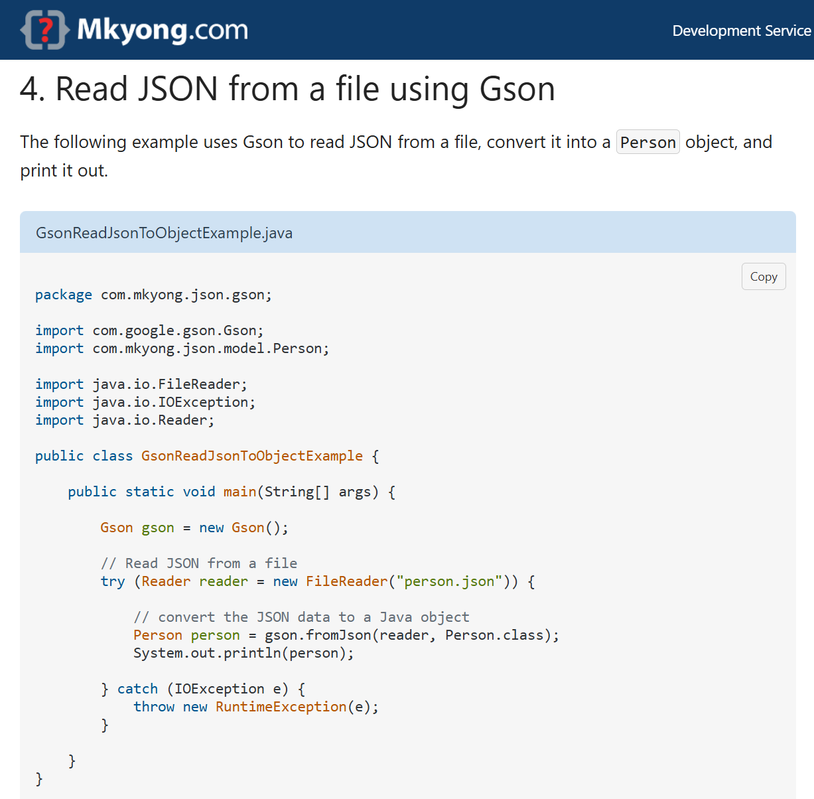
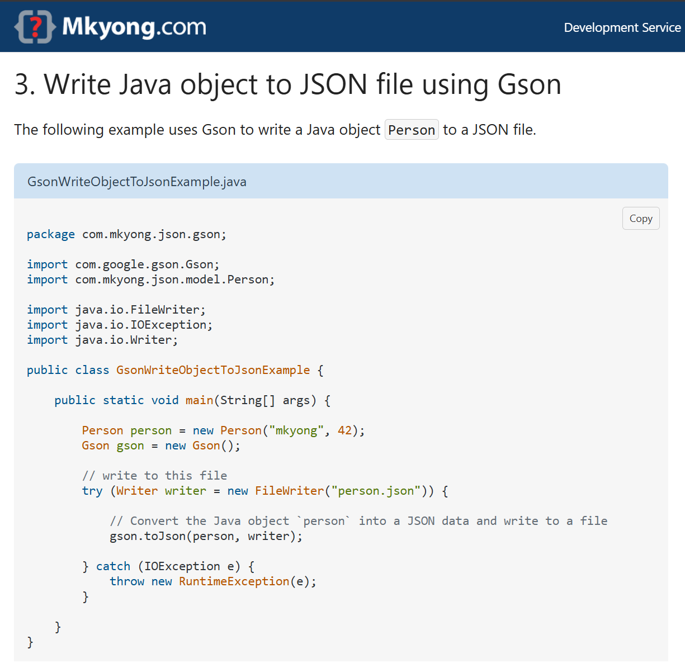
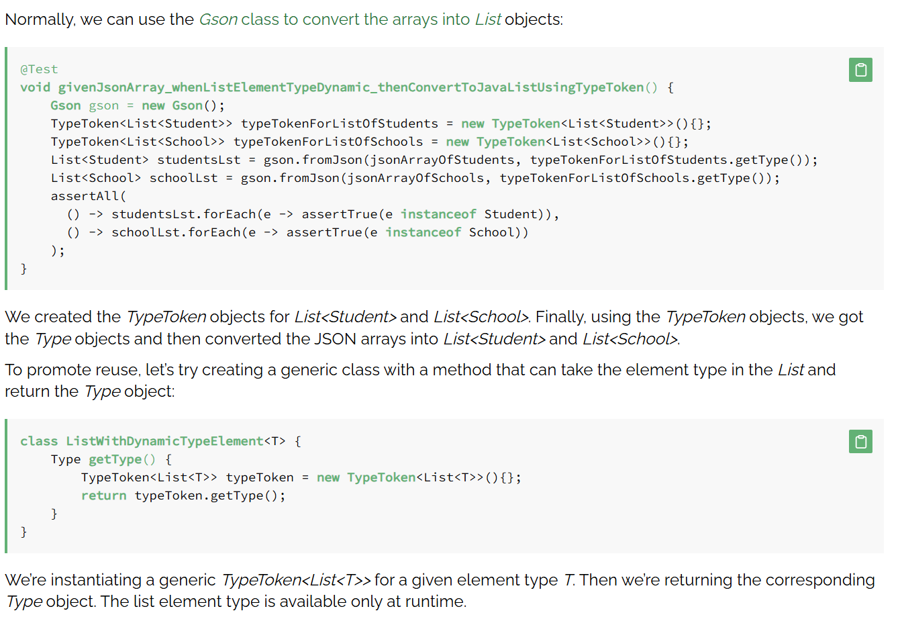
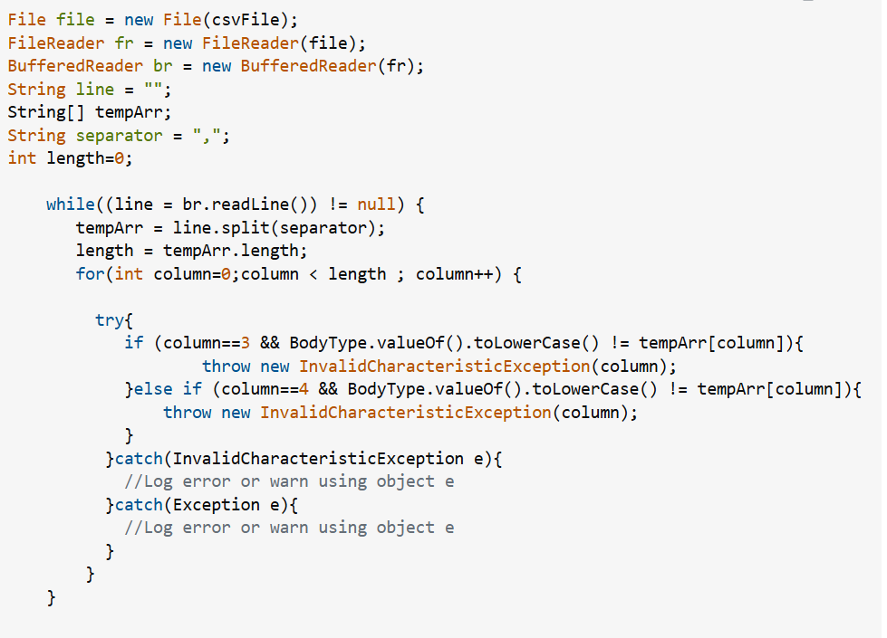
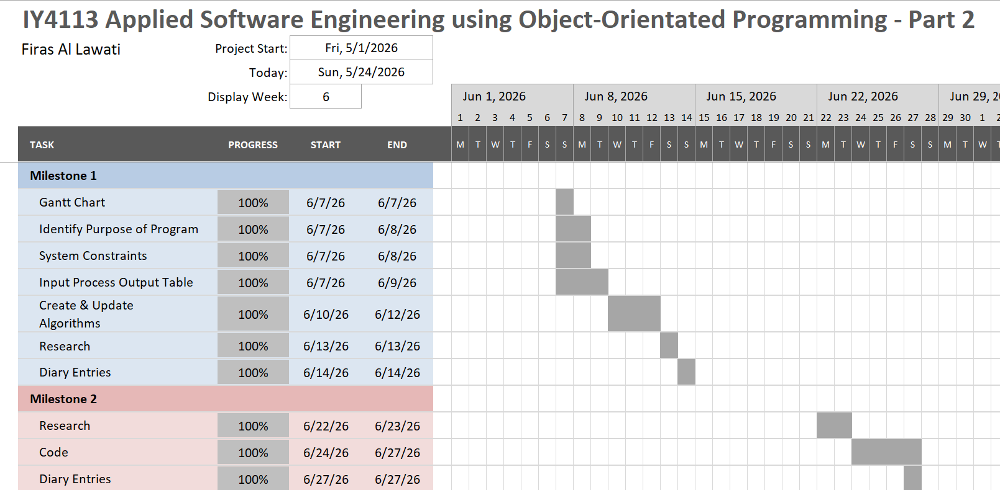

# IY4113 Part 2 Milestone 3

| Assessment Details | Please Complete All Details                                           |
| ------------------ | --------------------------------------------------------------------- |
| Group              | A                                                                     |
| Module Title       | IY4113 Applied Software Engineering using Object-Oriented Programming |
| Assessment Type    | P466146                                                               |
| Module Tutor Name  | Jonathan Shore                                                        |
| Student ID Number  | P466146                                                               |
| Date of Submission |                                                                       |
| Word Count         |                                                                       |
| GitHub Link        | https://github.com/firasallawati/T0466146_Firas_4113                  |

- [x] *I confirm that this assignment is my own work. Where I have referred to academic sources, I have provided in-text citations and included the sources in
  the final reference list.*

- [x] Where I have used AI, I have cited and referenced appropriately.

---

### Research

---

Conduct research to support your coding process, including use of code examples, tutortials, documentation and AI tools (if used).

Use the structure below to capture your evidence:

---

**Research 1 -**

**Title of research:** Writing / Reading JSON Files using .Gson & .GsonBuilder

**Reference (link):** [Read and Write JSON to File using Gson - Mkyong.com](https://mkyong.com/java/read-and-write-json-to-file-using-gson/)

**How does the research help with coding practise?:**

This research is helpful because it provides a great insight & demonstration on how to use the code required to save and load a rider's profile in CityRide Lite. It explains how a Java object can be turned to JSON and stored in a file before being retrieved from the file and turned back to a Java object, which matches the profile save / load requirement that the program must have in the brief. It also helps with file persistence, which should be met according to the brief of the project. This is also helpful regarding persistence of files, which is a crucial aspect since the project is not in-memory any more as it used to be during Part 1.

**Key coding ideas you could reuse in your program:**

- Creating a 'RiderProfile' object and converting it to JSON when the user saves their profile.

- Reading the JSON file back into a 'RiderProfile' object when the user loads a saved profile.

- Using 'GsonBuilder' with 'setPrettyPrinting()'' so the JSON file is easier to read and debug if needed.

- Storing profile details such as name, passenger type, and default payment option in one structured file.

- Reusing the same pattern later for config data or saved journey data if needed.

**Screenshot of research:**

---

**Research 2 -**

**Title of research:** .TypeToken

**Reference (link):** [Gson TypeToken With Dynamic List Item Type | Baeldung](https://www.baeldung.com/gson-typetoken-dynamic-list-item-type)

**How does the research help with coding practise?:**

This research is very helpful and important since it describes the way 'TypeToken' is used by Gson during loading JSON into generic Java collections like lists / arrays. In Java, generic type information is removed at runtime, therefore, Gson library could not determine the actual types of objects which should be created when reading a JSON array without a 'TypeToken'. This makes the research relevant to CityRide Lite since it may be needed to load the lists of journeys or any other records from JSON files instead of a single object.

It also improves coding practice because it goes beyond basic JSON reading and introduces a more object-oriented way of handling saved data. With the help of 'TypeToken', it is possible to convert JSON arrays into Java collections like 'List' without manually rebuilding the records. This is useful for Milestone 2 because the project requires the rider’s journeys and settings to be stored between sessions, and that kind of data is likely to be easier to manage in a collection.

**Key coding ideas you could reuse in your program:**

- Use 'TypeToken' when reading a JSON array into a 'List'' or 'List'.

- Combine 'Gson' with 'TypeToken' to load multiple saved records from one file instead of only one object at a time.

- Store journeys in a collection so they can be added, edited and deleted much more easier.

- Use typed lists to support summary calculations such as totals, averages, and category counts after the JSON file has been read.

**Screenshot of research:**

---

**Research 3:**

**Title of research:** Error Handling For Corrupted Or Broken CSV Files

**Reference (link):** https://stackoverflow.com/questions/62452458/how-can-i-handle-invalid-data-rows-using-custom-exceptions-in-java

**How does the research help with coding practise?:**

The research is very useful since it provides ways to detect and handle the invalid rows in a CSV file and to not make the entire program fail in the process of doing so. It applies to the CityRide Lite program since it requires importing journeys through CSV and there is always a possibility that a file may contain missing values, unexpected formats, or invalid data such as incorrect zones or passenger types. It also demonstrates and shows how custom exceptions can be used to make the error handling more specific and easier to understand, which is helpful when building a fully functioning and professional program.

It helps with coding practice since it is not just about reading the file but also about making the process of importing safer. Instead of assuming that all the rows of the CSV are valid, the code can detect them and react accordingly.

**Key coding ideas you could reuse in your program:**

- Create a custom exception for invalid CSV journey rows.

- Validate each row during import before turning it into a 'Journey' object.

- Show where and in which specific line the error was caused so that the user knows what went wrong and where.

- Decide whether the program should stop the import immediately or skip the bad row and continue with valid rows.

- Use the same validation logic for fields such as zones, passenger type, date/time, and other journey data.

**Screenshot of research:**

---

### Program Code

---

**Main:**

import java.math.BigDecimal;  
import java.util.Scanner;  

public class Main {  

public static void main(String[] args) {  
    Scanner input = new Scanner(System.in);  
    InputValidator inputValidator = new InputValidator();  
    JourneyManager journeyManager = new JourneyManager();  
    FareCalculator fareCalculator = new FareCalculator();  
    ProfileFileManager profileFileManager = new ProfileFileManager();  
    ConfigFileManager configFileManager = new ConfigFileManager();  
    JourneyCSVHandler journeyCSVHandler = new JourneyCSVHandler();  
    ReportGenerator reportGenerator = new ReportGenerator();  
    AdminService adminService = new AdminService();  

Config config = configFileManager.loadConfig("config.json");  
RiderProfile riderProfile = null;  

int roleChoice = 0;  

while (roleChoice != 3) {  
    System.out.println("Welcome to CityRide Lite");  
    System.out.println("1. Rider");  
    System.out.println("2. Admin");  
    System.out.println("3. Exit");  
    System.out.print("Choose an option: ");  

    while (!input.hasNextInt()) {  
        System.out.println("Invalid choice.");  
        input.nextLine();  
        System.out.print("Choose an option: ");  
    }  
    roleChoice = input.nextInt();  
    input.nextLine();  
    
    if (roleChoice == 1) {  
        int riderChoice = 0;  
    
        while (riderChoice != 12) {  
            System.out.println("Rider Menu");  
            System.out.println("1. Create Profile");  
            System.out.println("2. Load Profile");  
            System.out.println("3. Save Profile");  
            System.out.println("4. Add Journey");  
            System.out.println("5. Edit Journey");  
            System.out.println("6. List Journeys");  
            System.out.println("7. Remove Journey");  
            System.out.println("8. Import Journeys CSV");  
            System.out.println("9. Export Journeys CSV");  
            System.out.println("10. Export Reports");  
            System.out.println("11. View Daily Summary");  
            System.out.println("12. Back");  
            System.out.print("Choose an option: ");  
    
            while (!input.hasNextInt()) {  
                System.out.println("Invalid choice.");  
                input.nextLine();  
                System.out.print("Choose an option: ");  
            }  
            riderChoice = input.nextInt();  
            input.nextLine();  
    
            if (riderChoice == 1) {  
                String name;  
                String passengerType;  
                String paymentOption;  
    
                System.out.print("Enter rider name: ");  
                name = input.nextLine();  
                while (inputValidator.isBlank(name)) {  
                    System.out.println("Name cannot be blank.");  
                    System.out.print("Enter rider name: ");  
                    name = input.nextLine();  
                }  
    
                System.out.print("Enter passenger type exactly as shown (Adult, Student, Child, Senior Citizen): ");  
                passengerType = input.nextLine();  
                while (!inputValidator.isValidPassengerType(passengerType)) {  
                    System.out.println("Invalid passenger type. Use exactly: Adult, Student, Child, or Senior Citizen.");  
                    System.out.print("Enter passenger type exactly as shown (Adult, Student, Child, Senior Citizen): ");  
                    passengerType = input.nextLine();  
                }  
    
                System.out.print("Enter default payment option exactly as shown (Cash or Card): ");  
                paymentOption = input.nextLine();  
                while (!inputValidator.isValidPaymentOption(paymentOption)) {  
                    System.out.println("Invalid payment option. Use exactly: Cash or Card.");  
                    System.out.print("Enter default payment option exactly as shown (Cash or Card): ");  
                    paymentOption = input.nextLine();  
                }  
    
                riderProfile = new RiderProfile(name, passengerType, paymentOption);  
                journeyManager.resetJourneys();  
                System.out.println("Profile created successfully.");  
            }  
            else if (riderChoice == 2) {  
                String fileName;  
    
                System.out.print("Enter profile JSON file name: ");  
                fileName = input.nextLine();  
                riderProfile = profileFileManager.loadProfile(fileName);  
    
                if (riderProfile != null) {  
                    journeyManager.setJourneys(riderProfile.getJourneys());  
                    System.out.println("Profile loaded successfully.");  
                }  
            }  
            else if (riderChoice == 3) {  
                String fileName;  
    
                if (riderProfile == null) {  
                    System.out.println("Create or load a profile first.");  
                }  
                else {  
                    riderProfile.setJourneys(journeyManager.getJourneys());  
                    System.out.print("Enter profile JSON file name: ");  
                    fileName = input.nextLine();  
                    profileFileManager.saveProfile(riderProfile, fileName);  
                }  
            }  
            else if (riderChoice == 4) {  
                String journeyDate;  
                String timeBand;  
                String fromZoneText;  
                String toZoneText;  
                int fromZone;  
                int toZone;  
                int zonesCrossed;  
                BigDecimal baseFare;  
                BigDecimal discountedFare;  
                BigDecimal currentTotal;  
                BigDecimal chargedFare;  
                int nextJourneyId;  
    
                if (riderProfile == null) {  
                    System.out.println("Create or load a profile first.");  
                }  
                else {  
                    nextJourneyId = journeyManager.getJourneys().size() + 1;  
    
                    System.out.print("Enter date/time (example 22/06/2026 18:30): ");  
                    journeyDate = input.nextLine();  
                    while (inputValidator.isBlank(journeyDate)) {  
                        System.out.println("Date/time cannot be blank.");  
                        System.out.print("Enter date/time (example 22/06/2026 18:30): ");  
                        journeyDate = input.nextLine();  
                    }  
    
                    System.out.print("Enter time band (Peak or Off-Peak): ");  
                    timeBand = input.nextLine();  
                    while (!inputValidator.isValidTimeBand(timeBand)) {  
                        System.out.println("Invalid time band.");  
                        System.out.print("Enter time band (Peak or Off-Peak): ");  
                        timeBand = input.nextLine();  
                    }  
    
                    System.out.print("Enter from zone (1 to 5): ");  
                    fromZoneText = input.nextLine();  
                    while (!inputValidator.isNumeric(fromZoneText) || !inputValidator.isValidZone(Integer.parseInt(fromZoneText))) {  
                        System.out.println("Invalid zone.");  
                        System.out.print("Enter from zone (1 to 5): ");  
                        fromZoneText = input.nextLine();  
                    }  
                    fromZone = Integer.parseInt(fromZoneText);  
    
                    System.out.print("Enter to zone (1 to 5): ");  
                    toZoneText = input.nextLine();  
                    while (!inputValidator.isNumeric(toZoneText) || !inputValidator.isValidZone(Integer.parseInt(toZoneText))) {  
                        System.out.println("Invalid zone.");  
                        System.out.print("Enter to zone (1 to 5): ");  
                        toZoneText = input.nextLine();  
                    }  
                    toZone = Integer.parseInt(toZoneText);  
    
                    zonesCrossed = fareCalculator.calculateZonesCrossed(fromZone, toZone);  
                    baseFare = fareCalculator.calculateBaseFare(fromZone, toZone, timeBand, config);  
                    discountedFare = fareCalculator.calculateDiscountedFare(baseFare, riderProfile.getPassengerType(), config);  
                    currentTotal = journeyManager.getPassengerChargedTotal(riderProfile.getPassengerType());  
                    chargedFare = fareCalculator.calculateChargedFare(discountedFare, riderProfile.getPassengerType(), currentTotal, config);  
    
                    Journey newJourney = new Journey(nextJourneyId, journeyDate, fromZone, toZone, timeBand,  
                            riderProfile.getPassengerType(), zonesCrossed, baseFare, discountedFare, chargedFare);  
    
                    journeyManager.addJourney(newJourney);  
                    System.out.println("Journey added successfully.");  
                }  
            }  
            else if (riderChoice == 5) {  
                String journeyIdText;  
                int journeyId;  
                Journey oldJourney;  
                String journeyDate;  
                String timeBand;  
                String fromZoneText;  
                String toZoneText;  
                int fromZone;  
                int toZone;  
                int zonesCrossed;  
                BigDecimal baseFare;  
                BigDecimal discountedFare;  
                BigDecimal currentTotalWithoutOld;  
                BigDecimal chargedFare;  
                Journey updatedJourney;  
    
                if (riderProfile == null) {  
                    System.out.println("Create or load a profile first.");  
                }  
                else {  
                    System.out.print("Enter journey ID to edit: ");  
                    journeyIdText = input.nextLine();  
                    while (!inputValidator.isNumeric(journeyIdText)) {  
                        System.out.println("Invalid ID.");  
                        System.out.print("Enter journey ID to edit: ");  
                        journeyIdText = input.nextLine();  
                    }  
                    journeyId = Integer.parseInt(journeyIdText);  
    
                    oldJourney = journeyManager.findJourneyById(journeyId);  
    
                    if (oldJourney == null) {  
                        System.out.println("Journey ID not found.");  
                    }  
                    else {  
                        System.out.print("Enter new date/time (example 22/06/2026 18:30): ");  
                        journeyDate = input.nextLine();  
                        while (inputValidator.isBlank(journeyDate)) {  
                            System.out.println("Date/time cannot be blank.");  
                            System.out.print("Enter new date/time (example 22/06/2026 18:30): ");  
                            journeyDate = input.nextLine();  
                        }  
    
                        System.out.print("Enter new time band (Peak or Off-Peak): ");  
                        timeBand = input.nextLine();  
                        while (!inputValidator.isValidTimeBand(timeBand)) {  
                            System.out.println("Invalid time band.");  
                            System.out.print("Enter new time band (Peak or Off-Peak): ");  
                            timeBand = input.nextLine();  
                        }  
    
                        System.out.print("Enter new from zone (1 to 5): ");  
                        fromZoneText = input.nextLine();  
                        while (!inputValidator.isNumeric(fromZoneText) || !inputValidator.isValidZone(Integer.parseInt(fromZoneText))) {  
                            System.out.println("Invalid zone.");  
                            System.out.print("Enter new from zone (1 to 5): ");  
                            fromZoneText = input.nextLine();  
                        }  
                        fromZone = Integer.parseInt(fromZoneText);  
    
                        System.out.print("Enter new to zone (1 to 5): ");  
                        toZoneText = input.nextLine();  
                        while (!inputValidator.isNumeric(toZoneText) || !inputValidator.isValidZone(Integer.parseInt(toZoneText))) {  
                            System.out.println("Invalid zone.");  
                            System.out.print("Enter new to zone (1 to 5): ");  
                            toZoneText = input.nextLine();  
                        }  
                        toZone = Integer.parseInt(toZoneText);  
    
                        zonesCrossed = fareCalculator.calculateZonesCrossed(fromZone, toZone);  
                        baseFare = fareCalculator.calculateBaseFare(fromZone, toZone, timeBand, config);  
                        discountedFare = fareCalculator.calculateDiscountedFare(baseFare, riderProfile.getPassengerType(), config);  
    
                        currentTotalWithoutOld = journeyManager.getPassengerChargedTotal(riderProfile.getPassengerType())  
                                .subtract(oldJourney.getChargedFare());  
    
                        chargedFare = fareCalculator.calculateChargedFare(  
                                discountedFare,  
                                riderProfile.getPassengerType(),  
                                currentTotalWithoutOld,  
                                config  
                        );  
    
                        updatedJourney = new Journey(  
                                journeyId,  
                                journeyDate,  
                                fromZone,  
                                toZone,  
                                timeBand,  
                                riderProfile.getPassengerType(),  
                                zonesCrossed,  
                                baseFare,  
                                discountedFare,  
                                chargedFare  
                        );  
    
                        if (journeyManager.editJourney(journeyId, updatedJourney)) {  
                            System.out.println("Journey updated successfully.");  
                        }  
                        else {  
                            System.out.println("Journey update failed.");  
                        }  
                    }  
                }  
            }  
            else if (riderChoice == 6) {  
                journeyManager.displayAllJourneys();  
            }  
            else if (riderChoice == 7) {  
                String journeyIdText;  
                int journeyId;  
    
                System.out.print("Enter journey ID to remove: ");  
                journeyIdText = input.nextLine();  
                while (!inputValidator.isNumeric(journeyIdText)) {  
                    System.out.println("Invalid ID.");  
                    System.out.print("Enter journey ID to remove: ");  
                    journeyIdText = input.nextLine();  
                }  
                journeyId = Integer.parseInt(journeyIdText);  
    
                if (journeyManager.findJourneyById(journeyId) == null) {  
                    System.out.println("Journey ID not found.");  
                }  
                else {  
                    journeyManager.removeJourneyById(journeyId);  
                    System.out.println("Journey removed successfully.");  
                }  
            }  
            else if (riderChoice == 8) {  
                String fileName;  
    
                System.out.print("Enter CSV file name to import: ");  
                fileName = input.nextLine();  
                journeyCSVHandler.importJourneys(fileName, journeyManager);  
            }  
            else if (riderChoice == 9) {  
                String fileName;  
    
                System.out.print("Enter CSV file name to export: ");  
                fileName = input.nextLine();  
                journeyCSVHandler.exportJourneys(fileName, journeyManager);  
            }  
            else if (riderChoice == 10) {  
                String reportLabel;  
                String reportDate;  
                String riderNameSafe;  
                String csvFileName;  
                String textFileName;  
    
                if (riderProfile == null) {  
                    System.out.println("Create or load a profile first.");  
                }  
                else {  
                    System.out.print("Enter report label (example day1): ");  
                    reportLabel = input.nextLine();  
                    while (inputValidator.isBlank(reportLabel)) {  
                        System.out.println("Report label cannot be blank.");  
                        System.out.print("Enter report label (example day1): ");  
                        reportLabel = input.nextLine();  
                    }  
    
                    System.out.print("Enter report date (example 23-06-2026): ");  
                    reportDate = input.nextLine();  
                    while (inputValidator.isBlank(reportDate)) {  
                        System.out.println("Report date cannot be blank.");  
                        System.out.print("Enter report date (example 23-06-2026): ");  
                        reportDate = input.nextLine();  
                    }  
    
                    riderNameSafe = riderProfile.getName().replace(" ", "_");  
    
                    csvFileName = "reports/" + reportLabel + ".csv";  
                    textFileName = "reports/" + riderNameSafe + "_" + reportDate + "_" + reportLabel + ".txt";  
    
                    reportGenerator.exportSummaryCsv(csvFileName, riderProfile, journeyManager);  
                    reportGenerator.exportSummaryText(textFileName, riderProfile, journeyManager);  
                }  
            }  
            else if (riderChoice == 11) {  
                journeyManager.displayDailySummary();  
                journeyManager.displayTotalsByPassengerType();  
                journeyManager.displayCategoryCounts();  
            }  
            else if (riderChoice == 12) {  
                String saveChoice;  
    
                if (riderProfile != null) {  
                    System.out.print("Save current profile and journeys before leaving rider menu? (yes/no): ");  
                    saveChoice = input.nextLine();  
    
                    while (!inputValidator.isYesNo(saveChoice)) {  
                        System.out.println("Invalid answer. Enter yes or no.");  
                        System.out.print("Save current profile and journeys before leaving rider menu? (yes/no): ");  
                        saveChoice = input.nextLine();  
                    }  
    
                    if (saveChoice.equalsIgnoreCase("yes")) {  
                        riderProfile.setJourneys(journeyManager.getJourneys());  
                        profileFileManager.saveProfile(riderProfile, riderProfile.getName() + ".json");  
                    }  
                }  
            }  
            else {  
                System.out.println("Invalid choice.");  
            }  
        }  
    }  
    else if (roleChoice == 2) {  
        String password;  
        int adminChoice = 0;  
    
        System.out.print("Enter admin password (admin123) : ");  
        password = input.nextLine();  
    
        if (adminService.login(password, config)) {  
            while (adminChoice != 7) {  
                System.out.println("Admin Menu");  
                System.out.println("1. View Config");  
                System.out.println("2. Update Passenger Discount");  
                System.out.println("3. Update Daily Cap");  
                System.out.println("4. Update Base Fare");  
                System.out.println("5. Add Peak Window");  
                System.out.println("6. Save Config");  
                System.out.println("7. Back");  
                System.out.print("Choose an option: ");  
    
                while (!input.hasNextInt()) {  
                    System.out.println("Invalid choice.");  
                    input.nextLine();  
                    System.out.print("Choose an option: ");  
                }  
                adminChoice = input.nextInt();  
                input.nextLine();  
    
                if (adminChoice == 1) {  
                    adminService.displayConfig(config);  
                }  
                else if (adminChoice == 2) {  
                    String passengerType;  
                    String discountText;  
    
                    System.out.print("Enter passenger type exactly as shown (Adult, Student, Child, Senior Citizen): ");  
                    passengerType = input.nextLine();  
                    while (!inputValidator.isValidPassengerType(passengerType)) {  
                        System.out.println("Invalid passenger type. Use exactly: Adult, Student, Child, or Senior Citizen.");  
                        System.out.print("Enter passenger type exactly as shown (Adult, Student, Child, Senior Citizen): ");  
                        passengerType = input.nextLine();  
                    }  
    
                    System.out.print("Enter discount as decimal (example 0.25): ");  
                    discountText = input.nextLine();  
                    while (!inputValidator.isValidDiscountDecimal(discountText)) {  
                        System.out.println("Invalid discount value. Enter a number from 0 to 1.");  
                        System.out.print("Enter discount as decimal (example 0.25): ");  
                        discountText = input.nextLine();  
                    }  
    
                    adminService.updatePassengerDiscount(config, passengerType, new BigDecimal(discountText));  
                }  
                else if (adminChoice == 3) {  
                    String passengerType;  
                    String capText;  
    
                    System.out.print("Enter passenger type exactly as shown (Adult, Student, Child, Senior Citizen): ");  
                    passengerType = input.nextLine();  
                    while (!inputValidator.isValidPassengerType(passengerType)) {  
                        System.out.println("Invalid passenger type. Use exactly: Adult, Student, Child, or Senior Citizen.");  
                        System.out.print("Enter passenger type exactly as shown (Adult, Student, Child, Senior Citizen): ");  
                        passengerType = input.nextLine();  
                    }  
    
                    System.out.print("Enter daily cap (example 8.00): ");  
                    capText = input.nextLine();  
                    while (!inputValidator.isPositiveDecimal(capText)) {  
                        System.out.println("Invalid daily cap.");  
                        System.out.print("Enter daily cap (example 8.00): ");  
                        capText = input.nextLine();  
                    }  
    
                    adminService.updateDailyCap(config, passengerType, new BigDecimal(capText));  
                }  
                else if (adminChoice == 4) {  
                    String fareKey;  
                    String fareText;  
    
                    System.out.print("Enter fare key (example 1-2-Peak or 1-2-Off-Peak): ");  
                    fareKey = input.nextLine();  
                    while (!inputValidator.isValidFareKey(fareKey)) {  
                        System.out.println("Invalid fare key.");  
                        System.out.print("Enter fare key (example 1-2-Peak or 1-2-Off-Peak): ");  
                        fareKey = input.nextLine();  
                    }  
    
                    System.out.print("Enter fare amount (example 3.20): ");  
                    fareText = input.nextLine();  
                    while (!inputValidator.isPositiveDecimal(fareText)) {  
                        System.out.println("Invalid fare.");  
                        System.out.print("Enter fare amount (example 3.20): ");  
                        fareText = input.nextLine();  
                    }  
    
                    adminService.updateBaseFare(config, fareKey, new BigDecimal(fareText));  
                }  
                else if (adminChoice == 5) {  
                    String peakWindow;  
    
                    System.out.print("Enter peak window (example 06:30-09:30): ");  
                    peakWindow = input.nextLine();  
                    while (!inputValidator.isValidPeakWindow(peakWindow)) {  
                        System.out.println("Invalid peak window.");  
                        System.out.print("Enter peak window (example 06:30-09:30): ");  
                        peakWindow = input.nextLine();  
                    }  
    
                    adminService.addPeakWindow(config, peakWindow);  
                }  
                else if (adminChoice == 6) {  
                    configFileManager.saveConfig(config, "config.json");  
                }  
                else if (adminChoice == 7) {  
                    System.out.println("Leaving admin menu.");  
                }  
                else {  
                    System.out.println("Invalid choice.");  
                }  
            }  
        }  
        else {  
            System.out.println("Incorrect password.");  
        }  
    }  
    else if (roleChoice == 3) {  
        if (riderProfile != null) {  
            String saveChoice;  
            System.out.print("Save current day state before exit? (yes/no): ");  
            saveChoice = input.nextLine();  
    
            while (!inputValidator.isYesNo(saveChoice)) {  
                System.out.println("Invalid answer. Enter yes or no.");  
                System.out.print("Save current day state before exit? (yes/no): ");  
                saveChoice = input.nextLine();  
            }  
    
            if (saveChoice.equalsIgnoreCase("yes")) {  
                riderProfile.setJourneys(journeyManager.getJourneys());  
                profileFileManager.saveProfile(riderProfile, riderProfile.getName() + ".json");  
            }  
        }  
    
        System.out.println("Thanks for using CityRide Lite! Until next time!");  
    }  
    else {  
        System.out.println("Invalid choice.");  
    }  

}  

input.close();  

}  

}

**Journey:**

import java.math.BigDecimal;  

public class Journey {  

private int journeyId;  
private String journeyDate;  
private int fromZone;  
private int toZone;  
private String timeBand;  
private String passengerType;  
private int zonesCrossed;  
private BigDecimal baseFare;  
private BigDecimal discountedFare;  
private BigDecimal chargedFare;  

public Journey(int journeyId, String journeyDate, int fromZone, int toZone, String timeBand,  
               String passengerType, int zonesCrossed, BigDecimal baseFare,  
               BigDecimal discountedFare, BigDecimal chargedFare) {  
    this.journeyId = journeyId;  
    this.journeyDate = journeyDate;  
    this.fromZone = fromZone;  
    this.toZone = toZone;  
    this.timeBand = timeBand;  
    this.passengerType = passengerType;  
    this.zonesCrossed = zonesCrossed;  
    this.baseFare = baseFare;  
    this.discountedFare = discountedFare;  
    this.chargedFare = chargedFare;  
}  

public int getJourneyId() {  
    return journeyId;  
}  

public String getJourneyDate() {  
    return journeyDate;  
}  

public int getFromZone() {  
    return fromZone;  
}  

public int getToZone() {  
    return toZone;  
}  

public String getTimeBand() {  
    return timeBand;  
}  

public String getPassengerType() {  
    return passengerType;  
}  

public int getZonesCrossed() {  
    return zonesCrossed;  
}  

public BigDecimal getBaseFare() {  
    return baseFare;  
}  

public BigDecimal getDiscountedFare() {  
    return discountedFare;  
}  

public BigDecimal getChargedFare() {  
    return chargedFare;  
}  

public BigDecimal getDiscountAmount() {  
    return baseFare.subtract(discountedFare);  
}  

public void displayJourney() {  
    System.out.println("Journey ID: " + journeyId);  
    System.out.println("Date: " + journeyDate);  
    System.out.println("From Zone: " + fromZone);  
    System.out.println("To Zone: " + toZone);  
    System.out.println("Time Band: " + timeBand);  
    System.out.println("Passenger Type: " + passengerType);  
    System.out.println("Zones Crossed: " + zonesCrossed);  
    System.out.println("Base Fare: £" + baseFare);  
    System.out.println("Discount Applied: £" + getDiscountAmount());  
    System.out.println("Charged Fare: £" + chargedFare);  
    System.out.println();  
}  

}

**JourneyManager:**

import java.math.BigDecimal;  
import java.math.RoundingMode;  
import java.util.ArrayList;  

public class JourneyManager { // In charge of the whole list of Journeys stored  

// Attributes    private ArrayList<Journey> journeys;  

// Constructor  
public JourneyManager() {  
    journeys = new ArrayList<>();  
}  

// Get Methods  
public ArrayList<Journey> getJourneys() {  
    return journeys;  
}  

public Journey findJourneyById(int journeyId) {  
    int i;  
    for (i = 0; i < journeys.size(); i++) {  
        if (journeys.get(i).getJourneyId() == journeyId) {  
            return journeys.get(i);  
        }  
    }  
    return null;  
}  

public BigDecimal getPassengerChargedTotal(String passengerType) {  
    BigDecimal total = BigDecimal.ZERO;  
    int i;  
    for (i = 0; i < journeys.size(); i++) {  
        if (journeys.get(i).getPassengerType().equalsIgnoreCase(passengerType)) {  
            total = total.add(journeys.get(i).getChargedFare());  
        }  
    }  
    return total;  
}  

// Set Methods  
public void setJourneys(ArrayList<Journey> journeys) {  
    this.journeys = journeys;  
}  

public void addJourney(Journey journey) { // Adds new journey to the array  
    journeys.add(journey);  
}  

public boolean editJourney(int journeyId, Journey updatedJourney) {  
    int i;  
    for (i = 0; i < journeys.size(); i++) {  
        if (journeys.get(i).getJourneyId() == journeyId) {  
            journeys.set(i, updatedJourney);  
            return true;  
        }  
    }  
    return false;  
}  

public void displayAllJourneys() { // Display stored journeys  
    int i;  
    if (journeys.size() == 0) {  
        System.out.println("No journeys stored.");  
    }  
    else {  
        for (i = 0; i < journeys.size(); i++) {  
            journeys.get(i).displayJourney();  
        }  
    }  
}  

public void removeJourneyById(int journeyId) { // Delete Journey using unique ID  
    Journey journey;  
    journey = findJourneyById(journeyId);  
    if (journey != null) {  
        journeys.remove(journey);  
    }  
}  

public void resetJourneys() { // Delete all stored journeys  
    journeys.clear();  
}  

public void displayCategoryCounts() {  
    int peakCount = 0;  
    int offPeakCount = 0;  
    int zone1Count = 0;  
    int zone2Count = 0;  
    int zone3Count = 0;  
    int zone4Count = 0;  
    int zone5Count = 0;  
    int i;  
    if (journeys.size() == 0) {  
        System.out.println("No journeys stored.");  
    }  
    else {  
        for (i = 0; i < journeys.size(); i++) {  
            if (journeys.get(i).getTimeBand().equalsIgnoreCase("Peak")) {  
                peakCount++;  
            }  
            else {  
                offPeakCount++;  
            }  
            if (journeys.get(i).getFromZone() == 1 || journeys.get(i).getToZone() == 1) {  
                zone1Count++;  
            }  
            if (journeys.get(i).getFromZone() == 2 || journeys.get(i).getToZone() == 2) {  
                zone2Count++;  
            }  
            if (journeys.get(i).getFromZone() == 3 || journeys.get(i).getToZone() == 3) {  
                zone3Count++;  
            }  
            if (journeys.get(i).getFromZone() == 4 || journeys.get(i).getToZone() == 4) {  
                zone4Count++;  
            }  
            if (journeys.get(i).getFromZone() == 5 || journeys.get(i).getToZone() == 5) {  
                zone5Count++;  
            }  
        }  
        System.out.println("Category Counts");  
        System.out.println("Peak Journeys: " + peakCount);  
        System.out.println("Off-Peak Journeys: " + offPeakCount);  
        System.out.println("Journeys Involving Zone 1: " + zone1Count);  
        System.out.println("Journeys Involving Zone 2: " + zone2Count);  
        System.out.println("Journeys Involving Zone 3: " + zone3Count);  
        System.out.println("Journeys Involving Zone 4: " + zone4Count);  
        System.out.println("Journeys Involving Zone 5: " + zone5Count);  
    }  
}  

public void displayDailySummary() {  
    BigDecimal total = BigDecimal.ZERO;  
    BigDecimal average = BigDecimal.ZERO;  
    Journey mostExpensive = null;  
    int i;  
    if (journeys.size() == 0) {  
        System.out.println("No journeys stored.");  
    }  
    else {  
        mostExpensive = journeys.get(0);  
        for (i = 0; i < journeys.size(); i++) {  
            total = total.add(journeys.get(i).getChargedFare());  
            if (journeys.get(i).getChargedFare().compareTo(mostExpensive.getChargedFare()) > 0) {  
                mostExpensive = journeys.get(i);  
            }  
        }  
        average = total.divide(new BigDecimal(journeys.size()), 2, RoundingMode.HALF_UP);  
        System.out.println("Daily Summary");  
        System.out.println("Total Journeys: " + journeys.size());  
        System.out.println("Total Cost Charged: £" + total);  
        System.out.println("Average Cost Per Journey: £" + average);  
        System.out.println("Most Expensive Journey ID: " + mostExpensive.getJourneyId());  
    }  
}  

public void displayTotalsByPassengerType() {  
    showTotals("Adult");  
    showTotals("Student");  
    showTotals("Child");  
    showTotals("Senior Citizen");  
}  

public void showTotals(String passengerType) {  
    int count = 0;  
    BigDecimal total = BigDecimal.ZERO;  
    int i;  
    for (i = 0; i < journeys.size(); i++) {  
        if (journeys.get(i).getPassengerType().equalsIgnoreCase(passengerType)) {  
            count++;  
            total = total.add(journeys.get(i).getChargedFare());  
        }  
    }  
    System.out.println(passengerType + " Journeys: " + count + " | Total: £" + total);  
}  

}

**RiderProfile:**

import java.util.ArrayList;  
import java.util.List;  

public class RiderProfile {  
    private String name;  
    private String passengerType;  
    private String defaultPaymentOption;  
    private ArrayList<Journey> journeys;  

public RiderProfile() {  
    this.journeys = new ArrayList<>();  
}  

public RiderProfile(String name, String passengerType, String defaultPaymentOption) {  
    this.name = name;  
    this.passengerType = passengerType;  
    this.defaultPaymentOption = defaultPaymentOption;  
    this.journeys = new ArrayList<>();  
}  

public String getName() {  
    return name;  
}  

public String getPassengerType() {  
    return passengerType;  
}  

public String getDefaultPaymentOption() {  
    return defaultPaymentOption;  
}  

public ArrayList<Journey> getJourneys() {  
    return journeys;  
}  

public void setName(String name) {  
    this.name = name;  
}  

public void setPassengerType(String passengerType) {  
    this.passengerType = passengerType;  
}  

public void setDefaultPaymentOption(String defaultPaymentOption) {  
    this.defaultPaymentOption = defaultPaymentOption;  
}  

public void setJourneys(ArrayList<Journey> journeys) {  
    this.journeys = journeys;  
}  

public void addJourney(Journey journey) {  
    journeys.add(journey);  
}  

public boolean removeJourneyById(int journeyId) {  
    for (int i = 0; i < journeys.size(); i++) {  
        if (journeys.get(i).getJourneyId() == journeyId) {  
            journeys.remove(i);  
            return true;  
        }  
    }  
    return false;  
}  

public Journey findJourneyById(int journeyId) {  
    for (Journey journey : journeys) {  
        if (journey.getJourneyId() == journeyId) {  
            return journey;  
        }  
    }  
    return null;  
}  

}

**FareCalculator:**

import java.math.BigDecimal;  
import java.math.RoundingMode;  

public class FareCalculator {  

public FareCalculator() {  
}  

public int calculateZonesCrossed(int fromZone, int toZone) {  
    int zonesCrossed;  
    zonesCrossed = Math.abs(toZone - fromZone) + 1;  
    return zonesCrossed;  
}  

public BigDecimal calculateBaseFare(int fromZone, int toZone, String timeBand, Config config) {  
    String fareKey;  
    BigDecimal baseFare;  

if (timeBand.equalsIgnoreCase("Peak")) {  
    timeBand = "Peak";  
}  
else if (timeBand.equalsIgnoreCase("Off-Peak")) {  
    timeBand = "Off-Peak";  
}  

fareKey = fromZone + "-" + toZone + "-" + timeBand;  
baseFare = config.getBaseFares().get(fareKey);  

if (baseFare == null) {  
    baseFare = BigDecimal.ZERO;  
}  

return baseFare.setScale(2, RoundingMode.HALF_UP);  

}  

public BigDecimal calculateDiscountedFare(BigDecimal baseFare, String passengerType, Config config) {  
    BigDecimal discountRate;  
    BigDecimal discountAmount;  
    BigDecimal discountedFare;  

discountRate = config.getPassengerDiscounts().get(passengerType);  

if (discountRate == null) {  
    discountRate = BigDecimal.ZERO;  
}  

discountAmount = baseFare.multiply(discountRate).setScale(2, RoundingMode.HALF_UP);  
discountedFare = baseFare.subtract(discountAmount).setScale(2, RoundingMode.HALF_UP);  

return discountedFare;  

}  

public BigDecimal calculateChargedFare(BigDecimal discountedFare, String passengerType, BigDecimal currentTotal, Config config) {  
    BigDecimal chargedFare;  
    BigDecimal dailyCap;  
    BigDecimal remainingCap;  

chargedFare = BigDecimal.ZERO;  
dailyCap = config.getDailyCaps().get(passengerType);  

if (dailyCap == null) {  
    dailyCap = BigDecimal.ZERO;  
}  

remainingCap = dailyCap.subtract(currentTotal).setScale(2, RoundingMode.HALF_UP);  

if (remainingCap.compareTo(BigDecimal.ZERO) <= 0) {  
    chargedFare = BigDecimal.ZERO;  
}  
else if (discountedFare.compareTo(remainingCap) > 0) {  
    chargedFare = remainingCap;  
}  
else {  
    chargedFare = discountedFare;  
}  

return chargedFare.setScale(2, RoundingMode.HALF_UP);  

}  

public boolean hasReachedDailyCap(String passengerType, BigDecimal currentTotal, Config config) {  
    boolean hasReachedCap;  
    BigDecimal dailyCap;  

hasReachedCap = false;  
dailyCap = config.getDailyCaps().get(passengerType);  

if (dailyCap == null) {  
    dailyCap = BigDecimal.ZERO;  
}  

if (currentTotal.compareTo(dailyCap) >= 0) {  
    hasReachedCap = true;  
}  

return hasReachedCap;  

}  

}

**Config:**

import java.math.BigDecimal;  
import java.util.ArrayList;  
import java.util.HashMap; 

public class Config { // Stores system fare configuration  

// Attributes

// **(Oracle, n.d.)**

<mark>private HashMap<String, BigDecimal> baseFares;</mark>  
<mark>private HashMap<String, BigDecimal> passengerDiscounts;</mark>  
<mark>private HashMap<String, BigDecimal> dailyCaps;</mark>  
private ArrayList<String> peakWindows;  
private String adminPassword;  

// Constructor  
public Config() {

// **(Oracle, n.d.)**  
    <mark>baseFares = new HashMap<>();</mark>  
    <mark>passengerDiscounts = new HashMap<>();</mark>  
    <mark>dailyCaps = new HashMap<>();</mark>  
    peakWindows = new ArrayList<>();  
    adminPassword = "admin123";  
    loadDefaultValues();  
}  

// Get Methods

// **(Oracle, n.d.)**  
<mark>public HashMap<String, BigDecimal> getBaseFares() {</mark>  
    <mark>return baseFares;</mark>  
}  

<mark>public HashMap<String, BigDecimal> getPassengerDiscounts() {</mark>  
    <mark>return passengerDiscounts;</mark>  
}  

<mark>public HashMap<String, BigDecimal> getDailyCaps() {</mark>  
    <mark>return dailyCaps;</mark>  
}  

public ArrayList<String> getPeakWindows() {  
    return peakWindows;  
}  

public String getAdminPassword() {  
    return adminPassword;  
}  

// Set Methods

// **(Oracle, n.d.)**  
<mark>public void setBaseFares(HashMap<String, BigDecimal> baseFares) {</mark>  
    <mark>this.baseFares = baseFares;</mark>  
}  

<mark>public void setPassengerDiscounts(HashMap<String, BigDecimal></mark> <mark>passengerDiscounts) {</mark>  
    <mark>this.passengerDiscounts = passengerDiscounts;</mark>  
}  

<mark>public void setDailyCaps(HashMap<String, BigDecimal> dailyCaps) {</mark>  
    <mark>this.dailyCaps = dailyCaps;</mark>  
}  

public void setPeakWindows(ArrayList<String> peakWindows) {  
    this.peakWindows = peakWindows;  
}  

public void setAdminPassword(String adminPassword) {  
    this.adminPassword = adminPassword;  
}  

public void loadDefaultValues() {  
    baseFares.clear();  
    passengerDiscounts.clear();  
    dailyCaps.clear();  
    peakWindows.clear();  

addFarePair(1, 1, "2.50", "2.00");  
addFarePair(1, 2, "3.20", "2.70");  
addFarePair(1, 3, "3.80", "3.20");  
addFarePair(1, 4, "4.40", "3.70");  
addFarePair(1, 5, "5.10", "4.30");  
addFarePair(2, 2, "2.30", "1.90");  
addFarePair(2, 3, "2.90", "2.40");  
addFarePair(2, 4, "3.50", "2.90");  
addFarePair(2, 5, "4.10", "3.40");  
addFarePair(3, 3, "2.20", "1.80");  
addFarePair(3, 4, "2.80", "2.30");  
addFarePair(3, 5, "3.40", "2.80");  
addFarePair(4, 4, "2.10", "1.70");  
addFarePair(4, 5, "2.70", "2.20");  
addFarePair(5, 5, "2.00", "1.60");  

passengerDiscounts.put("Adult", new BigDecimal("0.00"));  
passengerDiscounts.put("Student", new BigDecimal("0.25"));  
passengerDiscounts.put("Child", new BigDecimal("0.50"));  
passengerDiscounts.put("Senior Citizen", new BigDecimal("0.30"));  

dailyCaps.put("Adult", new BigDecimal("8.00"));  
dailyCaps.put("Student", new BigDecimal("6.00"));  
dailyCaps.put("Child", new BigDecimal("4.00"));  
dailyCaps.put("Senior Citizen", new BigDecimal("7.00"));  

peakWindows.add("06:30-09:30");  
peakWindows.add("16:00-19:00");  

}  

public void addFarePair(int zoneA, int zoneB, String peakFare, String offPeakFare) {  
    baseFares.put(zoneA + "-" + zoneB + "-Peak", new BigDecimal(peakFare));  
    baseFares.put(zoneA + "-" + zoneB + "-Off-Peak", new BigDecimal(offPeakFare));  

if (zoneA != zoneB) {  
    baseFares.put(zoneB + "-" + zoneA + "-Peak", new BigDecimal(peakFare));  
    baseFares.put(zoneB + "-" + zoneA + "-Off-Peak", new BigDecimal(offPeakFare));  
}  

}  

}

**ReportGenerator:**

import java.io.File;  
import java.io.PrintWriter;  
import java.math.BigDecimal;  
import java.math.RoundingMode;  

public class ReportGenerator { // Creates CSV and text reports  

// Constructor    

public ReportGenerator() {  
}  

public void exportSummaryCsv(String fileName, RiderProfile profile, JourneyManager journeyManager) {  
    int i;  
    BigDecimal totalCost = BigDecimal.ZERO;  
    BigDecimal totalBaseCost = BigDecimal.ZERO;  
    BigDecimal totalSavings = BigDecimal.ZERO;  

**// (Oracle, 2010)**

<mark>try {</mark>  
    <mark>File folder = new File("reports");  </mark>
    <mark>if (!folder.exists()) {</mark>  
        <mark>folder.mkdirs();</mark>  
    }  

    PrintWriter writer = new PrintWriter(fileName);  
    writer.println("RiderName,PassengerType,JourneyId,Date,FromZone,ToZone,TimeBand,ZonesCrossed,BaseFare,DiscountApplied,ChargedFare");  
    
    for (i = 0; i < journeyManager.getJourneys().size(); i++) {  
        Journey journey = journeyManager.getJourneys().get(i);  
        BigDecimal discountApplied = journey.getBaseFare().subtract(journey.getChargedFare());  
    
        totalCost = totalCost.add(journey.getChargedFare());  
        totalBaseCost = totalBaseCost.add(journey.getBaseFare());  
    
        writer.println(  
                profile.getName() + "," +  
                        profile.getPassengerType() + "," +  
                        journey.getJourneyId() + "," +  
                        journey.getJourneyDate() + "," +  
                        journey.getFromZone() + "," +  
                        journey.getToZone() + "," +  
                        journey.getTimeBand() + "," +  
                        journey.getZonesCrossed() + "," +  
                        journey.getBaseFare() + "," +  
                        discountApplied + "," +  
                        journey.getChargedFare()  
        );  
    }  
    
    totalSavings = totalBaseCost.subtract(totalCost);  
    
    writer.println();  
    writer.println("Total Journeys," + journeyManager.getJourneys().size());  
    writer.println("Total Cost," + totalCost);  
    writer.println("Savings," + totalSavings);  
    
    writer.close();  
    System.out.println("CSV report exported successfully.");  

}  
catch (Exception e) {  
    System.out.println("Error exporting CSV report.");  
}  

}  

public void exportSummaryText(String fileName, RiderProfile profile, JourneyManager journeyManager) {  
    int i;  
    int peakCount = 0;  
    int offPeakCount = 0;  
    int zone1Count = 0;  
    int zone2Count = 0;  
    int zone3Count = 0;  
    int zone4Count = 0;  
    int zone5Count = 0;  
    BigDecimal totalCost = BigDecimal.ZERO;  
    BigDecimal totalBaseCost = BigDecimal.ZERO;  
    BigDecimal averageCost = BigDecimal.ZERO;  
    BigDecimal totalSavings = BigDecimal.ZERO;  
    Journey mostExpensive = null;  

try {  
    File folder = new File("reports");  
    if (!folder.exists()) {  
        folder.mkdirs();  
    }  

    PrintWriter writer = new PrintWriter(fileName);  
    
    if (journeyManager.getJourneys().size() > 0) {  
        mostExpensive = journeyManager.getJourneys().get(0);  
    }  
    
    for (i = 0; i < journeyManager.getJourneys().size(); i++) {  
        Journey journey = journeyManager.getJourneys().get(i);  
    
        totalCost = totalCost.add(journey.getChargedFare());  
        totalBaseCost = totalBaseCost.add(journey.getBaseFare());  
    
        if (journey.getTimeBand().equalsIgnoreCase("Peak")) {  
            peakCount++;  
        }  
        else {  
            offPeakCount++;  
        }  
    
        if (journey.getFromZone() == 1 || journey.getToZone() == 1) {  
            zone1Count++;  
        }  
        if (journey.getFromZone() == 2 || journey.getToZone() == 2) {  
            zone2Count++;  
        }  
        if (journey.getFromZone() == 3 || journey.getToZone() == 3) {  
            zone3Count++;  
        }  
        if (journey.getFromZone() == 4 || journey.getToZone() == 4) {  
            zone4Count++;  
        }  
        if (journey.getFromZone() == 5 || journey.getToZone() == 5) {  
            zone5Count++;  
        }  
    
        if (mostExpensive != null && journey.getChargedFare().compareTo(mostExpensive.getChargedFare()) > 0) {  
            mostExpensive = journey;  
        }  
    }  
    
    if (journeyManager.getJourneys().size() > 0) {  
        averageCost = totalCost.divide(new BigDecimal(journeyManager.getJourneys().size()), 2, RoundingMode.HALF_UP);  
    }  
    
    totalSavings = totalBaseCost.subtract(totalCost);  
    
    writer.println("CityRide Lite End-of-Day Summary");  
    writer.println("Rider Name: " + profile.getName());  
    writer.println("Passenger Type: " + profile.getPassengerType());  
    writer.println("Default Payment Option: " + profile.getDefaultPaymentOption());  
    writer.println("Number of Journeys: " + journeyManager.getJourneys().size());  
    writer.println("Total Cost: £" + totalCost);  
    writer.println("Average Cost Per Journey: £" + averageCost);  
    
    if (mostExpensive != null) {  
        writer.println("Most Expensive Journey ID: " + mostExpensive.getJourneyId());  
        writer.println("Most Expensive Journey Fare: £" + mostExpensive.getChargedFare());  
    }  
    
    writer.println("Peak Journeys: " + peakCount);  
    writer.println("Off-Peak Journeys: " + offPeakCount);  
    writer.println("Journeys Involving Zone 1: " + zone1Count);  
    writer.println("Journeys Involving Zone 2: " + zone2Count);  
    writer.println("Journeys Involving Zone 3: " + zone3Count);  
    writer.println("Journeys Involving Zone 4: " + zone4Count);  
    writer.println("Journeys Involving Zone 5: " + zone5Count);  
    writer.println("Savings Compared To Base Fares: £" + totalSavings);  
    
    if (totalSavings.compareTo(BigDecimal.ZERO) > 0) {  
        writer.println("Cap or discount savings were applied.");  
    }  
    else {  
        writer.println("No cap or discount savings were applied.");  
    }  
    
    writer.close();  
    System.out.println("Text summary exported successfully.");  

}  
catch (Exception e) {  
    System.out.println("Error exporting text summary.");  
}  

}  

}

**ConfigFileManager:**

import com.google.gson.Gson;  
import com.google.gson.GsonBuilder;  
import java.io.FileReader;  
import java.io.FileWriter;  
import java.io.IOException;  

public class ConfigFileManager { // Saves and loads system config JSON files  

// Attributes    

private Gson gson;  

// Constructor  
public ConfigFileManager() {  
    gson = new GsonBuilder().setPrettyPrinting().create();  
}  

// Get Methods  
public Config loadConfig(String fileName) {  
    Config config = null;  
    try {  
        FileReader reader = new FileReader(fileName);  
        config = gson.fromJson(reader, Config.class);  
        reader.close();  
        System.out.println("Config loaded successfully.");  
    }  
    catch (IOException e) {  
        config = new Config();  
        System.out.println("Config file not found. Safe defaults loaded.");  
    }  
    return config;  
}  

// Set Methods  
public void saveConfig(Config config, String fileName) {  
    try {  
        FileWriter writer = new FileWriter(fileName);  
        gson.toJson(config, writer);  
        writer.close();  
        System.out.println("Config saved successfully.");  
    }  
    catch (IOException e) {  
        System.out.println("Error saving config.");  
    }  
}  

}

**ProfileFileManager:**

import com.google.gson.Gson;  
import com.google.gson.GsonBuilder;  
import java.io.FileReader;  
import java.io.FileWriter;  
import java.io.IOException;  

public class ProfileFileManager { // Saves and loads RiderProfile JSON files  

// Attributes    

private Gson gson;  

// Constructor  
public ProfileFileManager() {  
    gson = new GsonBuilder().setPrettyPrinting().create();  
}  

// Get Methods  
public RiderProfile loadProfile(String fileName) {  
    RiderProfile profile = null;  
    try {  
        FileReader reader = new FileReader(fileName);  
        profile = gson.fromJson(reader, RiderProfile.class);  
        reader.close();  
    }  
    catch (IOException e) {  
        System.out.println("Error loading profile.");  
    }  
    return profile;  
}  

// Set Methods  
public void saveProfile(RiderProfile profile, String fileName) {  
    try {  
        FileWriter writer = new FileWriter(fileName);  
        gson.toJson(profile, writer);  
        writer.close();  
        System.out.println("Profile saved successfully.");  
    }  
    catch (IOException e) {  
        System.out.println("Error saving profile.");  
    }  
}  

}

**JourneyCSVHandler:**

import java.io.File;  
import java.io.PrintWriter;  
import java.math.BigDecimal;  
import java.util.Scanner;  

public class JourneyCSVHandler { // Imports and exports journeys in CSV format  

// Constructor    

public JourneyCSVHandler() {  
}  

public void exportJourneys(String fileName, JourneyManager journeyManager) {  
    int i;  
    try {  
        PrintWriter writer = new PrintWriter(fileName);  
        writer.println("JourneyId,Date,FromZone,ToZone,TimeBand,PassengerType,ZonesCrossed,BaseFare,DiscountApplied,ChargedFare");  
        for (i = 0; i < journeyManager.getJourneys().size(); i++) {  
            Journey journey = journeyManager.getJourneys().get(i);  
            writer.println(  
                    journey.getJourneyId() + "," +  
                            journey.getJourneyDate() + "," +  
                            journey.getFromZone() + "," +  
                            journey.getToZone() + "," +  
                            journey.getTimeBand() + "," +  
                            journey.getPassengerType() + "," +  
                            journey.getZonesCrossed() + "," +  
                            journey.getBaseFare() + "," +  
                            journey.getDiscountedFare() + "," +  
                            journey.getChargedFare()  
            );  
        }  
        writer.close();  
        System.out.println("Journeys exported successfully.");  
    }  
    catch (Exception e) {  
        System.out.println("Error exporting journeys.");  
    }  
}  

public void importJourneys(String fileName, JourneyManager journeyManager) {  
    try {  
        File file = new File(fileName);  
        Scanner reader = new Scanner(file);  

if (reader.hasNextLine()) {  
        reader.nextLine();  
    }  

    while (reader.hasNextLine()) {  
        String line = reader.nextLine();  
        String[] data = line.split(",");  
    
        if (data.length == 10) {  
            int journeyId = Integer.parseInt(data[0]);  
            String journeyDate = data[1];  
            int fromZone = Integer.parseInt(data[2]);  
            int toZone = Integer.parseInt(data[3]);  
            String timeBand = data[4];  
            String passengerType = data[5];  
            int zonesCrossed = Integer.parseInt(data[6]);  
            BigDecimal baseFare = new BigDecimal(data[7]);  
            BigDecimal discountedFare = new BigDecimal(data[8]);  
            BigDecimal chargedFare = new BigDecimal(data[9]);  
    
            Journey journey = new Journey(journeyId, journeyDate, fromZone, toZone, timeBand, passengerType,  
                    zonesCrossed, baseFare, discountedFare, chargedFare);  
    
            journeyManager.addJourney(journey);  
        }  
    }  
    
    reader.close();  
    System.out.println("Journeys imported successfully.");  

}  
catch (Exception e) {  
    System.out.println("Error importing journeys.");  
}  

}  

}

**InputValidator:**

public class InputValidator {  

public InputValidator() {  
}  

public boolean isValidZone(int zone) {  
    boolean isValidZone;  

if (zone >= 1 && zone <= 5) {  
    isValidZone = true;  
}  
else {  
    isValidZone = false;  
}  

return isValidZone;  

}  

public boolean isValidTimeBand(String timeBand) {  
    boolean isValidTimeBand;  

if (timeBand.equalsIgnoreCase("Peak")) {  
    isValidTimeBand = true;  
}  
else if (timeBand.equalsIgnoreCase("Off-Peak")) {  
    isValidTimeBand = true;  
}  
else if (timeBand.equalsIgnoreCase("Off Peak")) {  
    isValidTimeBand = true;  
}  
else {  
    isValidTimeBand = false;  
}  

return isValidTimeBand;  

}  

public boolean isValidPassengerType(String passengerType) {  
    boolean isValidPassengerType;  

if (passengerType.equals("Adult")) {  
    isValidPassengerType = true;  
}  
else if (passengerType.equals("Student")) {  
    isValidPassengerType = true;  
}  
else if (passengerType.equals("Child")) {  
    isValidPassengerType = true;  
}  
else if (passengerType.equals("Senior Citizen")) {  
    isValidPassengerType = true;  
}  
else {  
    isValidPassengerType = false;  
}  

return isValidPassengerType;  

}  

public boolean isValidPaymentOption(String paymentOption) {  
    boolean isValidPaymentOption;  

if (paymentOption.equals("Cash")) {  
    isValidPaymentOption = true;  
}  
else if (paymentOption.equals("Card")) {  
    isValidPaymentOption = true;  
}  
else {  
    isValidPaymentOption = false;  
}  

return isValidPaymentOption;  

}  

public boolean isBlank(String text) {  
    boolean isBlankText;  

if (text == null || text.trim().equals("")) {  
    isBlankText = true;  
}  
else {  
    isBlankText = false;  
}  

return isBlankText;  

}  

public boolean isNumeric(String text) {  
    boolean isNumericText;  

try {  
    Integer.parseInt(text);  
    isNumericText = true;  
}  
catch (Exception e) {  
    isNumericText = false;  
}  

return isNumericText;  

}  

public boolean isDecimal(String text) {  
    boolean isDecimalText;  

try {  
    Double.parseDouble(text);  
    isDecimalText = true;  
}  
catch (Exception e) {  
    isDecimalText = false;  
}  

return isDecimalText;  

}  

public boolean isPositiveDecimal(String text) {  
    boolean isPositiveDecimal;  
    double decimalNumber;  

if (isDecimal(text)) {  
    decimalNumber = Double.parseDouble(text);  

    if (decimalNumber >= 0) {  
        isPositiveDecimal = true;  
    }  
    else {  
        isPositiveDecimal = false;  
    }  

}  
else {  
    isPositiveDecimal = false;  
}  

return isPositiveDecimal;  

}  

public boolean isValidDiscountDecimal(String text) {  
    boolean isValidDiscount;  
    double discountValue;  

if (isDecimal(text)) {  
    discountValue = Double.parseDouble(text);  

    if (discountValue >= 0 && discountValue <= 1) {  
        isValidDiscount = true;  
    }  
    else {  
        isValidDiscount = false;  
    }  

}  
else {  
    isValidDiscount = false;  
}  

return isValidDiscount;  

}  

public boolean isYesNo(String text) {  
    boolean isYesNoAnswer;  

if (text.equalsIgnoreCase("yes")) {  
    isYesNoAnswer = true;  
}  
else if (text.equalsIgnoreCase("no")) {  
    isYesNoAnswer = true;  
}  
else {  
    isYesNoAnswer = false;  
}  

return isYesNoAnswer;  

}  

public boolean isValidFareKey(String fareKey) {  
    boolean isValidFareKey;  
    String[] fareKeyParts;  
    int fromZone;  
    int toZone;  
    String timeBand;  

if (fareKey == null || fareKey.trim().equals("")) {  
    isValidFareKey = false;  
}  
else {  
    fareKeyParts = fareKey.split("-", 3);  

    if (fareKeyParts.length != 3) {  
        isValidFareKey = false;  
    }  
    else if (!isNumeric(fareKeyParts[0]) || !isNumeric(fareKeyParts[1])) {  
        isValidFareKey = false;  
    }  
    else {  
        fromZone = Integer.parseInt(fareKeyParts[0]);  
        toZone = Integer.parseInt(fareKeyParts[1]);  
        timeBand = fareKeyParts[2];  
    
        if (!isValidZone(fromZone) || !isValidZone(toZone)) {  
            isValidFareKey = false;  
        }  
        else if (!isValidTimeBand(timeBand)) {  
            isValidFareKey = false;  
        }  
        else {  
            isValidFareKey = true;  
        }  
    }  

}  

return isValidFareKey;  

}  

public boolean isValidPeakWindow(String peakWindow) {  
    boolean isValidPeakWindow;  
    String[] peakWindowParts;  
    String[] startTimeParts;  
    String[] endTimeParts;  
    int startHour;  
    int startMinute;  
    int endHour;  
    int endMinute;  

if (peakWindow == null || peakWindow.trim().equals("")) {  
    isValidPeakWindow = false;  
}  
else {  
    peakWindowParts = peakWindow.split("-");  

    if (peakWindowParts.length != 2) {  
        isValidPeakWindow = false;  
    }  
    else {  
        startTimeParts = peakWindowParts[0].split(":");  
        endTimeParts = peakWindowParts[1].split(":");  
    
        if (startTimeParts.length != 2 || endTimeParts.length != 2) {  
            isValidPeakWindow = false;  
        }  
        else if (!isNumeric(startTimeParts[0]) || !isNumeric(startTimeParts[1])) {  
            isValidPeakWindow = false;  
        }  
        else if (!isNumeric(endTimeParts[0]) || !isNumeric(endTimeParts[1])) {  
            isValidPeakWindow = false;  
        }  
        else {  
            startHour = Integer.parseInt(startTimeParts[0]);  
            startMinute = Integer.parseInt(startTimeParts[1]);  
            endHour = Integer.parseInt(endTimeParts[0]);  
            endMinute = Integer.parseInt(endTimeParts[1]);  
    
            if (startHour < 0 || startHour > 23) {  
                isValidPeakWindow = false;  
            }  
            else if (endHour < 0 || endHour > 23) {  
                isValidPeakWindow = false;  
            }  
            else if (startMinute < 0 || startMinute > 59) {  
                isValidPeakWindow = false;  
            }  
            else if (endMinute < 0 || endMinute > 59) {  
                isValidPeakWindow = false;  
            }  
            else {  
                isValidPeakWindow = true;  
            }  
        }  
    }  

}  

return isValidPeakWindow;  

}  

}

**AdminService:**

import java.math.BigDecimal;  

public class AdminService {  

public AdminService() {  
}  

public boolean login(String password, Config config) {  
    boolean isCorrectPassword;  

if (config.getAdminPassword().equals(password)) {  
    isCorrectPassword = true;  
}  
else {  
    isCorrectPassword = false;  
}  

return isCorrectPassword;  

}  

public void displayConfig(Config config) {  
    System.out.println("Active Configuration");  
    System.out.println("Admin Password: " + config.getAdminPassword());  
    System.out.println("Passenger Discounts: " + config.getPassengerDiscounts());  
    System.out.println("Daily Caps: " + config.getDailyCaps());  
    System.out.println("Peak Windows: " + config.getPeakWindows());  
    System.out.println("Base Fares: " + config.getBaseFares());  
}  

public void updatePassengerDiscount(Config config, String passengerType, BigDecimal discountValue) {  
    if (discountValue.compareTo(BigDecimal.ZERO) < 0 || discountValue.compareTo(BigDecimal.ONE) > 0) {  
        System.out.println("Invalid discount value. Enter a value between 0 and 1.");  
    }  
    else {  
        config.getPassengerDiscounts().put(passengerType, discountValue);  
        System.out.println("Passenger discount updated successfully.");  
    }  
}  

public void deletePassengerDiscount(Config config, String passengerType) {  
    if (config.getPassengerDiscounts().containsKey(passengerType)) {  
        config.getPassengerDiscounts().remove(passengerType);  
        System.out.println("Passenger discount deleted successfully.");  
    }  
    else {  
        System.out.println("Passenger discount not found.");  
    }  
}  

public void updateDailyCap(Config config, String passengerType, BigDecimal dailyCapValue) {  
    if (dailyCapValue.compareTo(BigDecimal.ZERO) < 0) {  
        System.out.println("Invalid daily cap value.");  
    }  
    else {  
        config.getDailyCaps().put(passengerType, dailyCapValue);  
        System.out.println("Daily cap updated successfully.");  
    }  
}  

public void deleteDailyCap(Config config, String passengerType) {  
    if (config.getDailyCaps().containsKey(passengerType)) {  
        config.getDailyCaps().remove(passengerType);  
        System.out.println("Daily cap deleted successfully.");  
    }  
    else {  
        System.out.println("Daily cap not found.");  
    }  
}  

public void updateBaseFare(Config config, String fareKey, BigDecimal fareAmount) {  
    if (fareAmount.compareTo(BigDecimal.ZERO) < 0) {  
        System.out.println("Invalid base fare amount.");  
    }  
    else {  
        config.getBaseFares().put(fareKey, fareAmount);  
        System.out.println("Base fare updated successfully.");  
    }  
}  

public void deleteBaseFare(Config config, String fareKey) {  
    if (config.getBaseFares().containsKey(fareKey)) {  
        config.getBaseFares().remove(fareKey);  
        System.out.println("Base fare deleted successfully.");  
    }  
    else {  
        System.out.println("Base fare key not found.");  
    }  
}  

public void addPeakWindow(Config config, String peakWindow) {  
    if (config.getPeakWindows().contains(peakWindow)) {  
        System.out.println("Peak window already exists.");  
    }  
    else {  
        config.getPeakWindows().add(peakWindow);  
        System.out.println("Peak window added successfully.");  
    }  
}  

public void deletePeakWindow(Config config, String peakWindow) {  
    if (config.getPeakWindows().contains(peakWindow)) {  
        config.getPeakWindows().remove(peakWindow);  
        System.out.println("Peak window deleted successfully.");  
    }  
    else {  
        System.out.println("Peak window not found.");  
    }  
}  

}

**CityRideDataSet:**

import java.math.BigDecimal;  
import java.math.RoundingMode; 

 import java.util.HashMap;  
import java.util.Map;  

final class CityRideDataset {  

private CityRideDataset() {}  

public static final int MIN_ZONE = 1;  
public static final int MAX_ZONE = 5;  

public enum TimeBand {  
    PEAK,  
    OFF_PEAK  
}  

public enum PassengerType {  
    ADULT,  
    STUDENT,  
    CHILD,  
    SENIOR_CITIZEN  
}  

public static final Map<PassengerType, BigDecimal> DISCOUNT_RATE = Map.of(  
        PassengerType.ADULT, new BigDecimal("0.00"),  
        PassengerType.STUDENT, new BigDecimal("0.25"),  
        PassengerType.CHILD, new BigDecimal("0.50"),  
        PassengerType.SENIOR_CITIZEN, new BigDecimal("0.30")  
);  

public static final Map<PassengerType, BigDecimal> DAILY_CAP = Map.of(  
        PassengerType.ADULT, new BigDecimal("8.00"),  
        PassengerType.STUDENT, new BigDecimal("6.00"),  
        PassengerType.CHILD, new BigDecimal("4.00"),  
        PassengerType.SENIOR_CITIZEN, new BigDecimal("7.00")  
);  

public static final Map<String, BigDecimal> BASE_FARE = buildBaseFare();  

public static BigDecimal getBaseFare(int fromZone, int toZone, TimeBand timeBand) {  
    return BASE_FARE.get(key(fromZone, toZone, timeBand));  
}  

public static String key(int fromZone, int toZone, TimeBand timeBand) {  
    return fromZone + "-" + toZone + "-" + timeBand.name();  
}  

private static BigDecimal money(String amount) {  
    return new BigDecimal(amount).setScale(2, RoundingMode.HALF_UP);  
}  

private static Map<String, BigDecimal> buildBaseFare() {  
    Map<String, BigDecimal> m = new HashMap<>();  

// Peak fares  
put(m,1,1,TimeBand.PEAK,"2.50"); put(m,1,2,TimeBand.PEAK,"3.20");  
put(m,1,3,TimeBand.PEAK,"3.80"); put(m,1,4,TimeBand.PEAK,"4.40");  
put(m,1,5,TimeBand.PEAK,"5.00");  

put(m,2,1,TimeBand.PEAK,"3.20"); put(m,2,2,TimeBand.PEAK,"2.30");  
put(m,2,3,TimeBand.PEAK,"3.10"); put(m,2,4,TimeBand.PEAK,"3.80");  
put(m,2,5,TimeBand.PEAK,"4.50");  

put(m,3,1,TimeBand.PEAK,"3.80"); put(m,3,2,TimeBand.PEAK,"3.10");  
put(m,3,3,TimeBand.PEAK,"2.10"); put(m,3,4,TimeBand.PEAK,"3.00");  
put(m,3,5,TimeBand.PEAK,"3.70");  

put(m,4,1,TimeBand.PEAK,"4.40"); put(m,4,2,TimeBand.PEAK,"3.80");  
put(m,4,3,TimeBand.PEAK,"3.00"); put(m,4,4,TimeBand.PEAK,"2.00");  
put(m,4,5,TimeBand.PEAK,"2.90");  

put(m,5,1,TimeBand.PEAK,"5.00"); put(m,5,2,TimeBand.PEAK,"4.50");  
put(m,5,3,TimeBand.PEAK,"3.70"); put(m,5,4,TimeBand.PEAK,"2.90");  
put(m,5,5,TimeBand.PEAK,"1.90");  

// Off-peak fares  
put(m,1,1,TimeBand.OFF_PEAK,"2.00"); put(m,1,2,TimeBand.OFF_PEAK,"2.70");  
put(m,1,3,TimeBand.OFF_PEAK,"3.20"); put(m,1,4,TimeBand.OFF_PEAK,"3.70");  
put(m,1,5,TimeBand.OFF_PEAK,"4.20");  

put(m,2,1,TimeBand.OFF_PEAK,"2.70"); put(m,2,2,TimeBand.OFF_PEAK,"1.90");  
put(m,2,3,TimeBand.OFF_PEAK,"2.60"); put(m,2,4,TimeBand.OFF_PEAK,"3.20");  
put(m,2,5,TimeBand.OFF_PEAK,"3.80");  

put(m,3,1,TimeBand.OFF_PEAK,"3.20"); put(m,3,2,TimeBand.OFF_PEAK,"2.60");  
put(m,3,3,TimeBand.OFF_PEAK,"1.70"); put(m,3,4,TimeBand.OFF_PEAK,"2.50");  
put(m,3,5,TimeBand.OFF_PEAK,"3.10");  

put(m,4,1,TimeBand.OFF_PEAK,"3.70"); put(m,4,2,TimeBand.OFF_PEAK,"3.20");  
put(m,4,3,TimeBand.OFF_PEAK,"2.50"); put(m,4,4,TimeBand.OFF_PEAK,"1.60");  
put(m,4,5,TimeBand.OFF_PEAK,"2.40");  

put(m,5,1,TimeBand.OFF_PEAK,"4.20"); put(m,5,2,TimeBand.OFF_PEAK,"3.80");  
put(m,5,3,TimeBand.OFF_PEAK,"3.10"); put(m,5,4,TimeBand.OFF_PEAK,"2.40");  
put(m,5,5,TimeBand.OFF_PEAK,"1.50");  

return Map.copyOf(m);  

}  

private static void put(Map<String, BigDecimal> m, int from, int to, TimeBand band, String amount) {  
    m.put(key(from, to, band), money(amount));  
}  

}

**config.json:**

{  
  "baseFares": {  
    "1-1-Peak": 2.50,  
    "1-2-Peak": 3.20,  
    "1-3-Peak": 3.80,  
    "1-4-Peak": 4.40,  
    "1-5-Peak": 5.00,  

    "2-1-Peak": 3.20,  
"2-2-Peak": 2.30,  
"2-3-Peak": 3.10,  
"2-4-Peak": 3.80,  
"2-5-Peak": 4.50,  

"3-1-Peak": 3.80,  
"3-2-Peak": 3.10,  
"3-3-Peak": 2.10,  
"3-4-Peak": 3.00,  
"3-5-Peak": 3.70,  

"4-1-Peak": 4.40,  
"4-2-Peak": 3.80,  
"4-3-Peak": 3.00,  
"4-4-Peak": 2.00,  
"4-5-Peak": 2.90,  

"5-1-Peak": 5.00,  
"5-2-Peak": 4.50,  
"5-3-Peak": 3.70,  
"5-4-Peak": 2.90,  
"5-5-Peak": 1.90,  

"1-1-Off-Peak": 2.00,  
"1-2-Off-Peak": 2.70,  
"1-3-Off-Peak": 3.20,  
"1-4-Off-Peak": 3.70,  
"1-5-Off-Peak": 4.20,  

"2-1-Off-Peak": 2.70,  
"2-2-Off-Peak": 1.90,  
"2-3-Off-Peak": 2.60,  
"2-4-Off-Peak": 3.20,  
"2-5-Off-Peak": 3.80,  

"3-1-Off-Peak": 3.20,  
"3-2-Off-Peak": 2.60,  
"3-3-Off-Peak": 1.70,  
"3-4-Off-Peak": 2.50,  
"3-5-Off-Peak": 3.10,  

"4-1-Off-Peak": 3.70,  
"4-2-Off-Peak": 3.20,  
"4-3-Off-Peak": 2.50,  
"4-4-Off-Peak": 1.60,  
"4-5-Off-Peak": 2.40,  

"5-1-Off-Peak": 4.20,  
"5-2-Off-Peak": 3.80,  
"5-3-Off-Peak": 3.10,  
"5-4-Off-Peak": 2.40,  
"5-5-Off-Peak": 1.50  

  },  
  "passengerDiscounts": {  
    "Adult": 0.00,  
    "Student": 0.25,  
    "Child": 0.50,  
    "Senior Citizen": 0.30  
  },  
  "dailyCaps": {  
    "Adult": 8.00,  
    "Student": 6.00,  
    "Child": 4.00,  
    "Senior Citizen": 7.00  
  },  
  "peakWindows": [  
    "06: 30-09 :30",  
    "16: 00-19 :00"  
  ],  
  "adminPassword": "admin123"  
}

---

### Updated Gantt Chart

---

---

### Diary Entries

---

**Diary Entry 1 - Research on Coding Practices**

Today, I concentrated on the research part of milestone 2 that would help me to write the code for Part 2 of the CityRide Lite project. The areas of research that were chosen were because of how they relate to the practices of coding that may be implemented in my project in relation to file handling and data persistence. In particular, I looked into such aspects such as writing and reading JSON files using Gson and GsonBuilder, the implementation of TypeToken when loading generic lists, and how invalid CSV files can be handled safely without breaking the whole program.

This research was important for me since it was necessary to implement the functionality of saving and loading rider profiles, storing journeys in collections, and importing data from files in Part 2. With this information at hand, I managed to come up with an idea of storing rider details in files, rebuilding journeys list based on the information that is from saved JSON data, and how to make the CSV import process more reliable and reduce the chance of errors when reading or writing files.

The first challenge that I faced was choosing appropriate points from the research that can be used in the project, where some of the examples were too advanced or unnecessary when put side to side to the CityRide Lite program. In some examples I found when researching, the concepts explained and portrayed were not directly relevant to the program and involved a higher understanding of certain functions and libraries, therefore, I had to solely focus on the parts that matched the assignment requirements in the brief. The issue I was facing was solved through only selecting coding ideas that I believe could be applied in my project implementation, if necessary, for example, structured files, typed collections, and safe error handling.

**Diary Entry 2 - Fixing Missing Features and Menus**

Today I began working on the code by addressing the issues and functionalities that were missing in Part 1 such as the category counts and using the feedback to make improvements throughout the code. Additionally, I added the new menus for Rider and Admin roles so the application would support the additional functions required for Part 2. The new menus are necessary for the user to be able to access such options as profile management, journeys management, reports, administrative control, and to separate the admin section of the system and the rider section.

This was done to make the application more comprehensive and allow the user to navigate the system better. Furthermore, the new menus allowed me to structure the additional functionalities into certain sections, and overall making the application easier to use, to code and to test.

One issue I encountered while working on the application was ensuring that the newly added menus worked well with the rest of the code. Therefore, I had to make sure that all the options of the menu led to the appropriate classes/methods and nothing from the previous code was lost during the process of implementing the new menus.

**Diary Entry 3 - Input Validation and Edit Journey**

Today, I have finished implementing the validation for the classes and have corrected them, so they all now work properly in connection with each other. Moreover, today I have written the code for editing journeys that was missing in Part 1. The validation part of the code is very important because the system had to provide safe processing of invalid user input to prevent crashes.

This part of the code was necessary because the system is required to guide the user through the correct input and reject invalid values in a way that is easy to understand and prevent the code from accepting invalid values that can cause a crash or a logical error in the system. Adding edit journey functionality also made the program more complete since the users need to have the ability and choice to edit already existing journeys rather than to just only create new ones.

The main difficulty was getting all of the validation rules to work consistently across different classes. Some input checks had to be matched with the correct menu option, and I had to make sure the edit journey process recalculated the journey details correctly after changes were made.

**Diary Entry 4 - File Handling, Reports, and Final Testing**

I worked on file handling and creating the reports required by the brief. This included saving and loading files properly, as well as generating summary reports for the rider data. I also fixed an issue with file reading and writing, which was causing problems when the program tried to save or load information.

This was necessary because the project had to store data externally and produce report files that could be used after the program closed. After fixing the file issue, I finalised the code and tested it to make sure it completed all the required tasks from the brief, including menu options, validation, file handling, and generating reports in a reports folder.

The main problem I encountered was getting the file paths and writing process to work reliably. Once I corrected that, I was able to confirm that the final version ran properly and met the assignment requirements. I also asked a friend of mine to test the program like a real person would do when using an application like this, he acted as the rider while I acted as the administrator changing the config around and seeing him interact with the system afterwards to simulate an actual situation that could happen.

---

### References

---

Oracle. n.d. *Java Platform, Standard Edition 8 API Specification: java.util.HashMap*. Retrieved from [HashMap (Java Platform SE 8 )](https://docs.oracle.com/javase/8/docs/api/java/util/HashMap.html "https://docs.oracle.com/javase/8/docs/api/java/util/hashmap.html") Accessed 23 June 2026.

Oracle. 2010. *oracle.adfnmc.java.io Class File*. Retrieved from https://docs.oracle.com/cd/E16162_01/apirefs.1112/e17503/oracle/adfnmc/java/io/File.html Accessed 23 June 2026.
