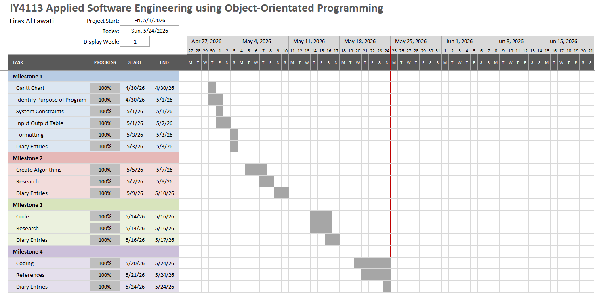

# IY4113 - Part 1 Final Submission

| Assessment Details | Please Complete All Details                                           |
| ------------------ | --------------------------------------------------------------------- |
| Group              | A                                                                     |
| Module Title       | IY4113 Applied Software Engineering using Object-Oriented Programming |
| Assessment Type    | Java Fundamentals Part 1 Final Submission                             |
| Module Tutor Name  | Jonathan Shore                                                        |
| Student ID Number  | P466146                                                               |
| Date of Submission | 31/05/2026                                                            |
| Word Count         | 860                                                                   |
| GItHub Link        | https://github.com/firasallawati/T0466146_Firas_4113                  |

- [x] *I confirm that this assignment is my own work. Where I have referred to academic sources, I have provided in-text citations and included the sources in  
    the final reference list.*

- [x] *Where I have used AI, I have cited and referenced appropriately.*

---

## Introduction

The task requires developing a console application that helps a user in keeping track of their public transportation trips during one day. In this regard, the application should provide users with an ability to input journey data such as starting zone, destination zone, peak or off-peak time band, and type of passenger. Based off of the info inputted by the user, the application will determine the number of zones passed, find the base fare rate using a provided dataset, and apply discounts based on passengers' discounts. The application should also impose daily spending caps for different types of passengers, and charge as necessary.

All trip data should only be held in memory and not stored anywhere else such as on a file. Users will navigate the application through a numbered menu system that will run repeatedly until a user decides to close it. The application should have capabilities of adding, listing, searching, deleting, resetting and summarizing journeys as well as determining total and category counts within a day. Input validation is very important since the application should only accept valid input otherwise the process should be repeated without exiting the application.

By the end of this assignment, the aim is to have produced a fully working travel companion software that accurately computes fare prices, applies discounts and caps, stores the journey data in its memory, and generates useful data for the user which is all done within a single day's session. The software should be a good demonstration of the principles of object-oriented programming in the Java language, which will make use of many classes.

---

## Analysis

The major requirement of this project is to build a console-based Java application that records, manages, and summarises public transport journeys for a single day using information inputted by the user. The system must be entirely menu-driven, storing all data in memory during the session with no file handling required.

The following key functional requirements were identified from the assignment brief:

- The system must display a main menu with eight options: add journey, list journeys, filter journeys, view daily summary, view totals by passenger type, remove journey, reset day, and exit and has to be looping until the user selects exit.

- When adding a journey, the system must capture: date, time band (peak or off-peak), passenger type (adult, student, child, or senior citizen), from zone, and to zone (zones 1–5). Each journey must be assigned a unique session ID.

- The system must calculate zones crossed using the formula: abs(toZone − fromZone) + 1, look up the correct base fare from the CityRideDataset, and apply the relevant passenger discount (Adult 0%, Student 25%, Child 50%, Senior Citizen 30%).

- The system must enforce daily spending caps (Adult £8.00, Student £6.00, Child £4.00, Senior Citizen £7.00). If a journey would exceed the cap, the fare is reduced to meet it exactly. Any further journeys for that passenger type are charged £0.

- The system must allow filtering of journeys by passenger type, time band, zone, and date.

- The system must display a daily summary showing total journeys, total cost charged, average cost per journey, and the most expensive journey, as well as category counts for peak vs off-peak and per zone.

- The system must display totals broken down by each passenger type, including journey count and whether the daily cap was reached.

- The system must allow a journey to be removed by ID (with error handling for invalid IDs) and allow a full day reset, both requiring a confirmation prompt.

- All inputs must be validated, with the program re-prompting on invalid entries rather than crashing. All monetary values must be rounded to 2 decimal places.  

  

---

## Algorithm Design

**FlowChart:**


**Subprocesses:**


**Class Diagram:**


---

## Testing

**Testing Table:**

| Test Number | Item to Test                      | Test Description (With example)                 | Expected Result                                                                                                                                            | Actual Result                                                         | Comments                                                                                        |
| ----------- | --------------------------------- | ----------------------------------------------- | ---------------------------------------------------------------------------------------------------------------------------------------------------------- | --------------------------------------------------------------------- | ----------------------------------------------------------------------------------------------- |
| 1           | menuChoice = input.nextInt();     | Valid data: enter 1                             | System accepts the input and opens the Add Journey section.                                                                                                | System accepted the input and opened the Add Journey section.         | No comment                                                                                      |
| 2           | menuChoice = input.nextInt();     | Invalid data: enter 9                           | System rejects the input and displays “Invalid choice.”                                                                                                    | System rejected the input and displayed “Invalid choice.”             | No comment                                                                                      |
| 3           | menuChoice = input.nextInt();     | Erroneous data: enter abc                       | System should not crash and should ask the user to enter a valid number.                                                                                   | System displayed an invalid choice error and asked for another input. | No comment                                                                                      |
| 4           | menuChoice = input.nextInt();     | Edge case: enter 8                              | System exits the program.                                                                                                                                  | System exited the program successfully.                               | No comment                                                                                      |
| 5           | journeyDate = input.nextLine();   | Valid data: enter 31/05/2026                    | System accepts the date and continues to the next input.                                                                                                   | System accepted the date and continued.                               | No comment                                                                                      |
| 6           | journeyDate = input.nextLine();   | Invalid data: enter a blank input               | System displays “Date cannot be blank.” and re-prompts.                                                                                                    | System displayed the blank input error and re-prompted.               | No comment                                                                                      |
| 7           | journeyDate = input.nextLine();   | Erroneous data: enter !@#                       | System should accept only a non-blank value and continue.                                                                                                  | System accepted the text as input.                                    | Weak validation: the program accepts non-date text because it only checks for blank input.      |
| 8           | journeyDate = input.nextLine();   | Edge case: enter a very long date string        | System should still store the input without crashing.                                                                                                      | System stored the input without crashing.                             | The program accepts long text, but it does not validate whether the date is in a proper format. |
| 9           | timeBand = input.nextLine();      | Valid data: enter Peak                          | System accepts the input as a valid time band.                                                                                                             | System accepted the input.                                            | No comment                                                                                      |
| 10          | timeBand = input.nextLine();      | Invalid data: enter Morning                     | System displays “Invalid time band.” and re-prompts.                                                                                                       | System displayed the invalid time band message and re-prompted.       | No comment                                                                                      |
| 11          | timeBand = input.nextLine();      | Erroneous data: enter 123                       | System rejects the input and asks again.                                                                                                                   | System rejected the input and asked again.                            | No comment                                                                                      |
| 12          | timeBand = input.nextLine();      | Edge case: enter off-peak                       | System accepts the input regardless of case.                                                                                                               | System accepted the input regardless of case.                         | No comment                                                                                      |
| 13          | passengerType = input.nextLine(); | Valid data: enter Adult                         | System accepts the passenger type.                                                                                                                         | System accepted the passenger type.                                   | No comment                                                                                      |
| 14          | passengerType = input.nextLine(); | Invalid data: enter Worker                      | System displays “Invalid passenger type.” and re-prompts.                                                                                                  | System displayed the invalid passenger type message and re-prompted.  | No comment                                                                                      |
| 15          | passengerType = input.nextLine(); | Erroneous data: enter ###                       | System rejects the input and asks again.                                                                                                                   | System rejected the input and asked again.                            | No comment                                                                                      |
| 16          | passengerType = input.nextLine(); | Edge case: enter senior citizen                 | System accepts the input regardless of letter case.                                                                                                        | System accepted the input regardless of letter case.                  | No comment                                                                                      |
| 17          | fromZoneText = input.nextLine();  | Valid data: enter 1                             | System accepts the input and stores the from zone.                                                                                                         | System accepted the input and stored the from zone.                   | No comment                                                                                      |
| 18          | fromZoneText = input.nextLine();  | Invalid data: enter 6                           | System displays “Invalid zone.” and re-prompts.                                                                                                            | System displayed the invalid zone message and re-prompted.            | No comment                                                                                      |
| 19          | fromZoneText = input.nextLine();  | Erroneous data: enter A                         | System rejects the input and asks for a numeric zone.                                                                                                      | System rejected the input and asked again.                            | No comment                                                                                      |
| 20          | fromZoneText = input.nextLine();  | Edge case: enter 5                              | System accepts the highest valid zone value.                                                                                                               | System accepted the highest valid zone value.                         | No comment                                                                                      |
| 21          | toZoneText = input.nextLine();    | Valid data: enter 3                             | System accepts the input and stores the to zone.                                                                                                           | System accepted the input and stored the to zone.                     | No comment                                                                                      |
| 22          | toZoneText = input.nextLine();    | Invalid data: enter 0                           | System displays “Invalid zone.” and re-prompts.                                                                                                            | System displayed the invalid zone message and re-prompted.            | No comment                                                                                      |
| 23          | toZoneText = input.nextLine();    | Erroneous data: enter xyz                       | System rejects the input and asks for a numeric zone.                                                                                                      | System rejected the input and asked again.                            | No comment                                                                                      |
| 24          | toZoneText = input.nextLine();    | Edge case: enter 5                              | System accepts the highest valid zone value.                                                                                                               | System accepted the highest valid zone value.                         | No comment                                                                                      |
| 25          | journeyIdText = input.nextLine(); | Valid data: enter 2                             | System accepts the journey ID for removal.                                                                                                                 | System accepted the journey ID.                                       | No comment                                                                                      |
| 26          | journeyIdText = input.nextLine(); | Invalid/Valid data: enter 99                    | System displays “Journey ID not found”, however, if the Journey ID "99" was entered when adding a journey then it would accept it, otherwise it would not. | System displayed “Journey ID not found.”                              | No comment                                                                                      |
| 27          | journeyIdText = input.nextLine(); | Erroneous data: enter !!!                       | System rejects the input and re-prompts for a valid number.                                                                                                | System rejected the input and re-prompted.                            | No comment                                                                                      |
| 28          | journeyIdText = input.nextLine(); | Edge case: enter 1 when only one journey exists | System removes the journey if the user confirms.                                                                                                           | System removed the journey after confirmation.                        | No comment                                                                                      |
| 29          | confirmRemove = input.nextLine(); | Valid data: enter yes                           | System removes the selected journey.                                                                                                                       | System removed the selected journey.                                  | No comment                                                                                      |
| 30          | confirmRemove = input.nextLine(); | Invalid data: enter no                          | System cancels the removal.                                                                                                                                | System cancelled the removal.                                         | No comment                                                                                      |
| 31          | confirmRemove = input.nextLine(); | Erroneous data: enter maybe                     | System should reject the response and ask again, but the program may treat it as cancellation.                                                             | System treated the response as cancellation.                          | The program does not properly validate confirmation responses beyond “yes”.                     |
| 32          | confirmRemove = input.nextLine(); | Erroneous data: enter 123                       | System should reject the response and ask again.                                                                                                           | System treated the response as cancellation.                          | The program does not properly validate confirmation responses beyond “yes”.                     |
| 33          | confirmReset = input.nextLine();  | Valid data: enter yes                           | System clears all journeys from memory.                                                                                                                    | System cleared all journeys from memory.                              | No comment                                                                                      |
| 34          | confirmReset = input.nextLine();  | Invalid data: enter no                          | System cancels the reset.                                                                                                                                  | System cancelled the reset.                                           | No comment                                                                                      |
| 35          | confirmReset = input.nextLine();  | Erroneous data: enter maybe                     | System should reject the response and ask again, but the program may treat it as cancellation.                                                             | System treated the response as cancellation.                          | The program does not properly validate confirmation responses beyond “yes”.                     |
| 36          | confirmReset = input.nextLine();  | Erroneous data: enter 123                       | System should reject the response and ask again.                                                                                                           | System treated the response as cancellation.                          | The program does not properly validate confirmation responses beyond “yes”.                     |

---

## Evaluation

The program fulfills almost all of the essential needs of the task assignment, especially the core aspects which include managing journeys and calculating their fares. The program allows the user to create a journey, save it in memory, calculate the fare, apply discounts and caps, show summaries, deletes a specified journey, and can reset the whole session. However, it does not fully meet the filtering requirement because the completed code only filters journeys by peak/off-peak and zone areas used, rather than all the required filter categories.

##### Strengths

1. **Journey management works well.**    
   The program can add, store, list, and remove journeys during the session, which matches the main purpose of the application.

2. **Fare calculation is implemented correctly.**    
   The program uses the dataset to calculate fares, apply discounts, and respect the daily cap, which is one of the most important parts of the assignment.

3. **The summary output is useful.**    
   The program gives totals and passenger-type breakdowns, which helps the user understand spending and journey patterns.

##### Weaknesses

- **The Main class is too large and handles too much of the program logic.**    
  This is a weakness because input handling, menu control, validation flow, and program actions are all placed inside one class, which makes the code harder to read, test, and maintain.

##### Areas For Improvement

- Add full filtering by passenger type, time band, zone, and date.

- Expand totals by passenger type to show pre-discount totals, discounted totals, charged totals after cap, and cap reached status.

---

## Code Listing

**Main.java:**

import java.math.BigDecimal;

import java.util.Scanner;

public class Main {

    public static void  
main(String[] args) {

        Scanner input  
= new Scanner(System.in);

        JourneyManager  
journeyManager = new JourneyManager();

        FareCalculator  
fareCalculator = new FareCalculator();

        InputValidator  
inputValidator = new InputValidator();

        int menuChoice  
= 0;

        int  
nextJourneyId = 1;

        while  
(menuChoice != 8) {

            System.out.println(" Welcome to CityRide Lite! Please enter a  
choice from below: ");

            System.out.println("1. Add Journey");

            System.out.println("2. List Journeys");

            System.out.println("3. Display Category Counts");

            System.out.println("4. View Daily Summary");

            System.out.println("5. View Totals by Passenger Type");

            System.out.println("6. Remove Journey");

            System.out.println("7. Reset Day");

            System.out.println("8. Exit");

            System.out.print("Choose an option: ");

            while  
(!input.hasNextInt()) {

                System.out.println("Invalid choice.");

                input.nextLine();

                System.out.print("Choose an option: ");

            }

            menuChoice  
= input.nextInt();

            input.nextLine();

            if  
(menuChoice == 1) {

                String journeyDate;

                String timeBand;

                String passengerType;

                String fromZoneText;

                String toZoneText;

                int fromZone;

                int toZone;

                int zonesCrossed;

                BigDecimal baseFare;

                BigDecimal discountedFare;

                BigDecimal currentTotal;

                BigDecimal chargedFare;

                System.out.print("Enter date: ");

                journeyDate = input.nextLine();

                while  
(inputValidator.isBlank(journeyDate)) {

                    System.out.println("Date cannot be blank.");

                    System.out.print("Enter date: ");

                    journeyDate = input.nextLine();

                }

                System.out.print("Enter time band (Peak or Off-Peak): ");

                timeBand = input.nextLine();

                while  
(!inputValidator.isValidTimeBand(timeBand)) {

                    System.out.println("Invalid time band.");

                    System.out.print("Enter time band (Peak or Off-Peak): ");

                    timeBand = input.nextLine();

                }

                System.out.print("Enter passenger type (Adult, Student, Child,  
Senior Citizen): ");

                passengerType = input.nextLine();

                while  
(!inputValidator.isValidPassengerType(passengerType)) {

                    System.out.println("Invalid passenger type.");

                    System.out.print("Enter passenger type (Adult, Student, Child,  
Senior Citizen): ");

                    passengerType = input.nextLine();

                }

                System.out.print("Enter from zone: ");

                fromZoneText = input.nextLine();

                while

// **Runestone (n.d.)**  
(!inputValidator.isNumeric(fromZoneText) <mark>||</mark>

// **Oracle (n.d.) Integer.parseInt()**

                        !inputValidator.isValidZone<mark>(Integer.parseInt</mark>(fromZoneText))) {

                    System.out.println("Invalid zone.");

                    System.out.print("Enter from zone: ");

                    fromZoneText = input.nextLine();

                }

// **Oracle (n.d.) Integer.parseInt()**

                fromZone = <mark>Integer.parseInt</mark>(fromZoneText);

                System.out.print("Enter to zone: ");

                toZoneText = input.nextLine();

                while

**// Runestone (n.d.)**  
(!inputValidator.isNumeric(toZoneText) <mark>||</mark>

// **Oracle (n.d.) Integer.parseInt()**

                        !inputValidator.isValidZone(<mark>Integer.parseInt</mark>(toZoneText))) {

                    System.out.println("Invalid zone.");

                    System.out.print("Enter to zone: ");

                    toZoneText = input.nextLine();

                }

                toZone

//  **Oracle (n.d.) Integer.parseInt()**  
= <mark>Integer.parseInt</mark>(toZoneText);

                zonesCrossed = fareCalculator.calculateZonesCrossed(fromZone, toZone);

                baseFare = fareCalculator.calculateBaseFare(fromZone, toZone, timeBand);

                discountedFare = fareCalculator.calculateDiscountedFare(baseFare, passengerType);

                currentTotal = journeyManager.getPassengerChargedTotal(passengerType);

                chargedFare = fareCalculator.calculateChargedFare(discountedFare,  
passengerType, currentTotal);

                Journey newJourney = new Journey(nextJourneyId, journeyDate, fromZone,  
toZone, timeBand, passengerType, zonesCrossed, baseFare, discountedFare, chargedFare);

                journeyManager.addJourney(newJourney);

                System.out.println("Journey added successfully.");

                nextJourneyId++;

            }

            else if  
(menuChoice == 2) {

                journeyManager.listAllJourneys();

            }

            else if  
(menuChoice == 3) {

                journeyManager.displayCategoryCounts();

            }

            else if  
(menuChoice == 4) {

                journeyManager.displayDailySummary();

            }

            else if  
(menuChoice == 5) {

                journeyManager.displayTotalsByPassengerType();

            }

            else if  
(menuChoice == 6) {

                String  
journeyIdText;

                int  
journeyId;

                String  
confirmRemove;

                System.out.print("Enter journey ID to remove: ");

                journeyIdText = input.nextLine();

                while  
(!inputValidator.isNumeric(journeyIdText)) {

                    System.out.println("Invalid ID.");

                    System.out.print("Enter journey ID to remove: ");

                    journeyIdText = input.nextLine();

                }

// **Oracle (n.d.) Integer.parseInt()**

                journeyId = <mark>Integer.parseInt</mark>(journeyIdText);

                if  
(journeyManager.findJourneyById(journeyId) == null) {

                    System.out.println("Journey ID not found.");

                }

                else {

                    System.out.print("Are you sure? (yes/no): ");

                    confirmRemove = input.nextLine();

                    if  
(confirmRemove.equalsIgnoreCase("yes")) {

                        journeyManager.removeJourneyById(journeyId);

                        System.out.println("Journey removed successfully.");

                    }

                    else {

                        System.out.println("Remove cancelled.");

                    }

                }

            }

            else if  
(menuChoice == 7) {

                String  
confirmReset;

                System.out.print("Are you sure you want to reset all journeys?  
(yes/no): ");

                confirmReset = input.nextLine();

                if  
(confirmReset.equalsIgnoreCase("yes")) {

                    journeyManager.resetJourneys();

                    System.out.println("All journeys have been removed.");

                }

                else {

                    System.out.println("Reset cancelled.");

                }

            }

            else if  
(menuChoice == 8) {

                System.out.println("Thanks for using CityRide Lite! Until next  
time!");

            }

            else {

                System.out.println("Invalid choice.");

            }

        }

        input.close();

    }

}

#### **Journey.java:**

import java.math.BigDecimal;  

public class Journey {  

    private int journeyId;    
    private String journeyDate;    
    private int fromZone;    
    private int toZone;    
    private String timeBand;    
    private String passengerType;    
    private int zonesCrossed;    
    private BigDecimal baseFare;    
    private BigDecimal discountedFare;    
    private BigDecimal chargedFare;  

    public Journey(int journeyId, String  
journeyDate, int fromZone, int toZone, String timeBand,    
                   String passengerType,  
int zonesCrossed, BigDecimal baseFare,    
                   BigDecimal discountedFare, BigDecimal chargedFare) {    
        this.journeyId = journeyId;    
        this.journeyDate = journeyDate;    
        this.fromZone = fromZone;    
        this.toZone = toZone;    
        this.timeBand = timeBand;    
        this.passengerType = passengerType;    
        this.zonesCrossed = zonesCrossed;    
        this.baseFare = baseFare;    
        this.discountedFare = discountedFare;    
        this.chargedFare = chargedFare;    
    }  

    public int getJourneyId() {    
        return journeyId;    
    }  

    public String getJourneyDate() {    
        return journeyDate;    
    }  

    public int getFromZone() {    
        return fromZone;    
    }  

    public int getToZone() {    
        return toZone;    
    }  

    public String getTimeBand() {    
        return timeBand;    
    }  

    public String getPassengerType() {    
        return passengerType;    
    }  

    public int getZonesCrossed() {    
        return zonesCrossed;    
    }  

    public BigDecimal getBaseFare() {    
        return baseFare;    
    }  

    public BigDecimal getDiscountedFare()  
{    
        return discountedFare;    
    }  

    public BigDecimal getChargedFare() {    
        return chargedFare;    
    }  

    public BigDecimal getDiscountAmount()  
{    
        return  
baseFare.subtract(discountedFare);    
    }  

    public void displayJourney() {    
        System.*out*.println("Journey ID: " + journeyId);    
        System.*out*.println("Date: " + journeyDate);    
        System.*out*.println("From Zone: " + fromZone);    
        System.*out*.println("To Zone: " + toZone);    
        System.*out*.println("Time Band: " + timeBand);    
        System.*out*.println("Passenger Type: " + passengerType);    
        System.*out*.println("Zones Crossed: " + zonesCrossed);    
        System.*out*.println("Base Fare: £" + baseFare);    
        System.*out*.println("Discount Applied: £" + getDiscountAmount());    
        System.*out*.println("Charged Fare: £" + chargedFare);    
        System.*out*.println();    
    }    
}

#### **JourneyManager.java:**

import java.math.BigDecimal;

import java.math.RoundingMode;

import java.util.ArrayList;

// **Oracle (n.d.) BigDecimal and RoundingMode are used in this class for fare totals and average rounding**

public class JourneyManager {

public class JourneyManager {

    private  
ArrayList<Journey> journeys;

    public  
JourneyManager() {

        journeys = new  
ArrayList<>();

    }

    public void  
addJourney(Journey journey) {

        journeys.add(journey);

    }

    public void  
listAllJourneys() {

        int i;

        if  
(journeys.size() == 0) {

            System.out.println("No journeys stored.");

        }

        else {

            for (i =  
0; i < journeys.size(); i++) {

                journeys.get(i).displayJourney();

            }

        }

    }

// **Baeldung (2018) and Oracle (n.d.) show searching through an ArrayList with a loop**

    public Journey findJourneyById(int journeyId) {

        int i;

        for (i = 0; i < journeys.size(); i++) {

            if  
(journeys.get(i).getJourneyId() == journeyId) {

                return journeys.get(i);

            }

        }

        return null;

    }

    public void removeJourneyById(int journeyId) {

        Journey  
journey;

        journey =  
findJourneyById(journeyId);

        if (journey !=  
null) {

            journeys.remove(journey);

        }

    }

    public void resetJourneys() {

        journeys.clear();

    }

    public BigDecimal  
getPassengerChargedTotal(String passengerType) {

        BigDecimal  
total = BigDecimal.ZERO;

        int i;

        for (i = 0; i  
< journeys.size(); i++) {

            if  
(journeys.get(i).getPassengerType().equalsIgnoreCase(passengerType)) {

                total  
= total.add(journeys.get(i).getChargedFare());

            }

        }

        return total;

    }

    public void  
displayCategoryCounts() {

        int peakCount = 0;

        int offPeakCount = 0;

        int zone1Count = 0;

        int zone2Count = 0;

        int zone3Count = 0;

        int zone4Count = 0;

        int zone5Count = 0;

        int i;

        if  
(journeys.size() == 0) {

            System.out.println("No journeys stored.");

        }

        else {

            for (i =  
0; i < journeys.size(); i++) {

                if  
(journeys.get(i).getTimeBand().equalsIgnoreCase("Peak")) {

                    peakCount++;

                }

                else {

                    offPeakCount++;

                }

                if  
(journeys.get(i).getFromZone() == 1) {

                    zone1Count++;

                }

                else  
if (journeys.get(i).getToZone() == 1) {

                    zone1Count++;

                }

                if  
(journeys.get(i).getFromZone() == 2) {

                    zone2Count++;

                }

                else  
if (journeys.get(i).getToZone() == 2) {

                    zone2Count++;

                }

                if  
(journeys.get(i).getFromZone() == 3) {

                    zone3Count++;

                }

                else  
if (journeys.get(i).getToZone() == 3) {

                    zone3Count++;

                }

                if  
(journeys.get(i).getFromZone() == 4) {

                    zone4Count++;

                }

                else  
if (journeys.get(i).getToZone() == 4) {

                    zone4Count++;

                }

                if  
(journeys.get(i).getFromZone() == 5) {

                    zone5Count++;

                }

                else  
if (journeys.get(i).getToZone() == 5) {

                    zone5Count++;

                }

            }

            System.out.println("Category Counts");

            System.out.println("Peak Journeys: " + peakCount);

            System.out.println("Off-Peak Journeys: " + offPeakCount);

            System.out.println("Journeys Involving Zone 1: " +  
zone1Count);

            System.out.println("Journeys Involving Zone 2: " +  
zone2Count);

            System.out.println("Journeys Involving Zone 3: " +  
zone3Count);

            System.out.println("Journeys Involving Zone 4: " +  
zone4Count);

            System.out.println("Journeys Involving Zone 5: " +  
zone5Count);

        }

    }

    public void  
displayDailySummary() {

        BigDecimal  
total = BigDecimal.ZERO;

        BigDecimal  
average = BigDecimal.ZERO;

        Journey  
mostExpensive = null;

        int i;

        if  
(journeys.size() == 0) {

            System.out.println("No journeys stored.");

        }

// **Oracle (n.d.) BigDecimal compareTo() used to total fares and find the highest fare**

        else {

            mostExpensive = journeys.get(0);

            for (i = 0; i < journeys.size(); i++) {

                total = total.add(journeys.get(i).getChargedFare());

                if  
(journeys.get(i).getChargedFare()<mark>.compareTo</mark>(mostExpensive.getChargedFare())

        {

                    mostExpensive = journeys.get(i);

                }

            }

            average =  
total.divide(new BigDecimal(journeys.size()), 2, RoundingMode.HALF_UP);

            System.out.println("Daily Summary");

            System.out.println("Total Journeys: " + journeys.size());

            System.out.println("Total Cost Charged: £" + total);

            System.out.println("Average Cost Per Journey: £" + average);

            System.out.println("Most Expensive Journey ID: " +  
mostExpensive.getJourneyId());

        }

    }

    public void displayTotalsByPassengerType() {

        showTotals("Adult");

        showTotals("Student");

        showTotals("Child");

        showTotals("Senior Citizen");

    }

    public void showTotals(String passengerType) {

        int count = 0;

        BigDecimal total = BigDecimal.ZERO;

        int i;

        for (i = 0; i < journeys.size(); i++) {

            if  
(journeys.get(i).getPassengerType().equalsIgnoreCase(passengerType)) {

                count++;

                total = total.add(journeys.get(i).getChargedFare());

            }

        }

        System.out.println(passengerType + " Journeys: " + count + " | Total: £" + total);

    }

}

#### **InputValidator.java:**

public class InputValidator {  

    public InputValidator() {    
    }  

    public boolean isValidZone(int zone)  
{    
        if (zone >= 1 && zone <= 5) {    
            return true;    
        }    
        else {    
            return false;    
        }    
    }  

    public boolean isValidTimeBand(String timeBand) {    
        if  
(timeBand.equalsIgnoreCase("Peak")) {    
            return true;    
        }    
        else if  
(timeBand.equalsIgnoreCase("Off-Peak")) {    
            return true;    
        }    
        else if (timeBand.equalsIgnoreCase("Off Peak")) {    
            return true;    
        }    
        else {    
            return false;    
        }    
    }  

    public boolean  
isValidPassengerType(String passengerType) {    
        if  
(passengerType.equalsIgnoreCase("Adult")) {    
            return true;    
        }    
        else if  
(passengerType.equalsIgnoreCase("Student")) {    
            return true;    
        }    
        else if  
(passengerType.equalsIgnoreCase("Child")) {    
            return true;    
        }    
        else if  
(passengerType.equalsIgnoreCase("Senior Citizen")) {    
            return true;    
        }    
        else {    
            return false;    
        }    
    }  

// **(Baeldung, 2024)**

    <mark>public boolean isBlank(String text) {  </mark>  
<mark>if (text == null ||text.trim().equals(" ")) { </mark>    
            return true;    
        }    
        else {    
            return false;    
        }    
    }

// **Abdul D. (2024)**

    <mark>public boolean isNumeric(String text)</mark>  
<mark>{</mark>    
    <mark>try {</mark>    
        <mark>Integer.*parseInt*(text);</mark>    
        <mark>return true;</mark>    
<mark>}</mark>    
<mark>catch (Exception e) {</mark>    
    <mark>return false;</mark>    
        <mark>}</mark>    
    <mark>}</mark>    
}

#### **FareCalculator.java:**

import java.math.BigDecimal;

import java.math.RoundingMode;

// **Oracle (n.d.) BigDecimal documentation used for currency arithmetic and comparisons**

public class FareCalculator { // Calculates fares for  
journeys

    // Constructor

    public  
FareCalculator() {

    }

    public int  
calculateZonesCrossed(int fromZone, int toZone) { // Calculates the number of  
zones crossed.

        int zonesCrossed = 0;

// **Oracle (n.d.) Math.abs() returns the absolute value**

        zonesCrossed = <mark>Math.abs</mark>(toZone - fromZone) + 1;

        return zonesCrossed;

    }

    public BigDecimal  
calculateBaseFare(int fromZone, int toZone, String timeBand) {

        // Calculates  
the base fare of the journey using timeband & zones crossed

        CityRideDataset.TimeBand selectedTimeBand;

        BigDecimal  
baseFare;

        if  
(timeBand.equalsIgnoreCase("Peak")) {

            selectedTimeBand = CityRideDataset.TimeBand.PEAK;

        }

        else {

            selectedTimeBand = CityRideDataset.TimeBand.OFF_PEAK;

        }

        baseFare =  
CityRideDataset.getBaseFare(fromZone, toZone, selectedTimeBand);

        return

// **(Oracle, n.d.)**  
baseFare<mark>.setScale(2, RoundingMode.HALF_UP);</mark>

    }

    public BigDecimal  
calculateDiscountedFare(BigDecimal baseFare, String passengerType) { // Applies  
passenger discount to the base fare

        BigDecimal  
discountRate = BigDecimal.ZERO;

        BigDecimal  
discountAmount;

        BigDecimal  
discountedFare;

        if  
(passengerType.equalsIgnoreCase("Adult")) {

            discountRate =  
CityRideDataset.DISCOUNT_RATE.get(CityRideDataset.PassengerType.ADULT);

        }

        else if  
(passengerType.equalsIgnoreCase("Student")) {

            discountRate =  
CityRideDataset.DISCOUNT_RATE.get(CityRideDataset.PassengerType.STUDENT);

        }

        else if  
(passengerType.equalsIgnoreCase("Child")) {

            discountRate =  
CityRideDataset.DISCOUNT_RATE.get(CityRideDataset.PassengerType.CHILD);

        }

        else if  
(passengerType.equalsIgnoreCase("Senior Citizen")) {

            discountRate =  
CityRideDataset.DISCOUNT_RATE.get(CityRideDataset.PassengerType.SENIOR_CITIZEN);

        }

// **(Oracle, n.d.) RoundingMode**

        discountAmount = baseFare.multiply(discountRate)<mark>.setScale(2, RoundingMode.HALF_UP</mark>);

// **(Oracle, n.d.) RoundingMode**

        discountedFare = baseFare.subtract(discountAmount)<mark>.setScale(2, RoundingMode.HALF_UP);</mark>

        return  
discountedFare;

    }

    public BigDecimal  
calculateChargedFare(BigDecimal discountedFare, String passengerType,  
BigDecimal currentTotal) {

        // Calculates  
how much should be charged after considering how much the passenger has spent  
today (cap).

        BigDecimal  
chargedFare = BigDecimal.ZERO;

        BigDecimal  
dailyCap = BigDecimal.ZERO;

        BigDecimal  
remainingCap;

        if  
(passengerType.equalsIgnoreCase("Adult")) {

            dailyCap =  
CityRideDataset.DAILY_CAP.get(CityRideDataset.PassengerType.ADULT);

        }

        else if  
(passengerType.equalsIgnoreCase("Student")) {

            dailyCap =  
CityRideDataset.DAILY_CAP.get(CityRideDataset.PassengerType.STUDENT);

        }

        else if  
(passengerType.equalsIgnoreCase("Child")) {

            dailyCap =  
CityRideDataset.DAILY_CAP.get(CityRideDataset.PassengerType.CHILD);

        }

        else if  
(passengerType.equalsIgnoreCase("Senior Citizen")) {

            dailyCap =  
CityRideDataset.DAILY_CAP.get(CityRideDataset.PassengerType.SENIOR_CITIZEN);

        }

// **(Oracle, n.d.) RoundingMode() & BigDecimal compareTo()**

        remainingCap = dailyCap.subtract(currentTotal)<mark>.setScale(2, RoundingMode.HALF_UP</mark>);

        if  
(remainingCap<mark>.compareTo</mark>(BigDecimal.ZERO) <= 0) {

            chargedFare = BigDecimal.ZERO;

        }

        else if  
(discountedFare<mark>.compareTo</mark>(remainingCap) > 0) {

            chargedFare = remainingCap;

        }

        else {

            chargedFare = discountedFare;

        }

// **(Oracle, n.d.) RoundingMode**

        return chargedFare<mark>.setScale(2, RoundingMode.HALF_UP);</mark>

    }

    public boolean  
hasReachedDailyCap(String passengerType, BigDecimal currentTotal) {

        // Checks if  
passenger has already reached daily cap

        boolean  
hasReachedCap = false;

        BigDecimal  
dailyCap = BigDecimal.ZERO;

        if  
(passengerType.equalsIgnoreCase("Adult")) {

            dailyCap =  
CityRideDataset.DAILY_CAP.get(CityRideDataset.PassengerType.ADULT);

        }

        else if  
(passengerType.equalsIgnoreCase("Student")) {

            dailyCap =  
CityRideDataset.DAILY_CAP.get(CityRideDataset.PassengerType.STUDENT);

        }

        else if  
(passengerType.equalsIgnoreCase("Child")) {

            dailyCap =  
CityRideDataset.DAILY_CAP.get(CityRideDataset.PassengerType.CHILD);

        }

        else if  
(passengerType.equalsIgnoreCase("Senior Citizen")) {

            dailyCap =  
CityRideDataset.DAILY_CAP.get(CityRideDataset.PassengerType.SENIOR_CITIZEN);

        }

        if

// **(Oracle, n.d.) BigDecimal compareTo() used to compare current total to daily cap**  
(currentTotal<mark>.compareTo</mark>(dailyCap) >= 0) { // Compares passenger type cap to  
total

            hasReachedCap = true;

        }

        return  
hasReachedCap;

    }

}

---

## Refrences

- Baeldung. (2024). *Java Blank vs Empty Strings*. Retrieved from: [Checking for Empty or Blank Strings in Java | Baeldung](https://www.baeldung.com/java-blank-empty-strings "https://www.baeldung.com/java-blank-empty-strings") [Accessed 23 May 2026].

- Abdul D. (2024). *How to check if a String is numeric in Java?* Retrieved from: [How to check if a String is numeric in Java? | Sentry](https://sentry.io/answers/how-to-check-if-a-string-is-numeric-in-java/ "https://sentry.io/answers/how-to-check-if-a-string-is-numeric-in-java/") [Accessed 23 May 2026].

- Singh, C. (2022). *Java String equals() and equalsIgnoreCase() Methods Example*. Retrieved from: [Java String equals() and equalsIgnoreCase() Methods example](https://beginnersbook.com/2013/12/java-string-equals-and-equalsignorecase-methods-example/ "https://beginnersbook.com/2013/12/java-string-equals-and-equalsignorecase-methods-example/") [Accessed 23 May 2026].

- Oracle. (n.d.). *RoundingMode (Java Platform SE 8).* Retrieved from: [RoundingMode (Java Platform SE 8 )](https://docs.oracle.com/javase/8/docs/api/java/math/RoundingMode.html "https://docs.oracle.com/javase/8/docs/api/java/math/roundingmode.html") [Accessed 23 May 2026].

- Oracle. (n.d.). *BigDecimal (Java Platform SE 8).* Retrieved from: [BigDecimal (Java Platform SE 8 )](https://docs.oracle.com/javase/8/docs/api/java/math/BigDecimal.html "https://docs.oracle.com/javase/8/docs/api/java/math/bigdecimal.html") [Accessed 23 May 2026].

- Oracle. (n.d.). *Math (Java Platform SE 8).* Retrieved from: [Math (Java Platform SE 8 )](https://docs.oracle.com/javase/8/docs/api/java/lang/Math.html "https://docs.oracle.com/javase/8/docs/api/java/lang/math.html") [Accessed 23 May 2026].

- Oracle. (n.d.). *Integer (Java Platform SE 8).* Retrieved from: [Integer (Java Platform SE 8 )](https://docs.oracle.com/javase/8/docs/api/java/lang/Integer.html "https://docs.oracle.com/javase/8/docs/api/java/lang/integer.html") [Accessed 23 May 2026].

- Runestone Interactive / University of New Hampshire. (n.d.). *Logical Operators*. Retrieved from: [4. Logical Operators — Runestone Interactive Overview](https://www.cs.unh.edu/~cs415/lab_manual/labs/conditionals/logical_operators.html "https://www.cs.unh.edu/~cs415/lab_manual/labs/conditionals/logical_operators.html") [Accessed 23 May 2026].

- Bro Code. (2024). *Code a simple banking program with Java!* [YouTube video]. Available at: [Code a simple banking program with Java! 💰 - YouTube](https://www.youtube.com/watch?v=49bIIa6id08 "https://www.youtube.com/watch?v=49biia6id08") [Accessed 24 May 2026].

---

## Appendices:

### Milestone 1:

# IY4113 Milestone 1

| Assessment Details | Please Complete All Details                                             |
| ------------------ | ----------------------------------------------------------------------- |
| Group              | A                                                                       |
| Module Title       | IY4113 Applied Software Engineering using Object-Orientated Programming |
| Assessment Type    | Java Fundementals Milestone 1                                           |
| Module Tutor Name  | Jonathon Shore                                                          |
| Student ID Number  | P466146                                                                 |
| Date of Submission | 05/03/2026                                                              |
| Word Count         | 1247                                                                    |

- [x] *I confirm that this assignment is my own work. Where I have referred to academic sources, I have provided in-text citations and included the sources in
  the final reference list.*

- [x] *Where I have used AI, I have cited and referenced appropriately.

------------------------------------------------------------------------------------------------------------------------------

### Purpose of the Program

------------------------------------------------------------------------------------------------------------------------------

The purpose of the program is to simulate a public transport journey tracking system in a Java application, allowing a user to enter journey details, calculate fares for them to pay, apply discounts and daily caps, and review or remove journeys during a single run of the program.

### **Core program functionality**

- **Add journeys**
  - Enter journey details such as starting zone, destination zone, time band, passenger type, and date.
  - Validate and check the input so only correct values are accepted.
  - Calculate the number of zones crossed in order to calculate the fare.
  - Look up the correct fare from the provided dataset.
  - Apply any passenger discount and daily cap rules.
  - Store the journey in memory.
- **List journeys**
  - Display all journeys entered during the current session/run of the code.
  - Show main journey details such as zones, passenger type, time band, and cost.
- **Filter journeys**
  - Allow the user to filter journeys by passenger type, time band, zone, or date.
  - Only show journeys that match the selected criteria chosen by the user.
- **View summaries**
  - Show the total number of journeys.
  - Show the total amount of money spent.
  - Show the average cost per journey.
  - Show the most expensive journey.
- **Remove journeys**
  - Allow the user to remove a journey using its ID.
  - Confirm when a journey has been deleted.
- **Reset the day**
  - Clear all stored journeys from memory.
  - Restart the session data for a new day.

### **System constraints (limitations / rules)**

- No persistence: journeys are stored only while the program is running and will reset when program is exited from with no file or database saving.
- Console UI only: the program uses text menus and keyboard input only.
- Zone limits: only zones 1 to 5 are valid.
- Time band limits: only peak and off-peak are allowed.
- Passenger type limits: only adult, student, child, and senior citizen are valid.
- Fare rules: the program must use the supplied fare dataset and must not change it.
- Single-day scope: the program only tracks journeys for one day at a time.
- Validation rule: invalid inputs must be rejected, and the user should be given an error message and asked to input a valid input instead.

------------------------------------------------------------------------------------------------------------------------------

### Input Process Output Table

------------------------------------------------------------------------------------------------------------------------------


------------------------------------------------------------------------------------------------------------------------------

### Gantt Chart

------------------------------------------------------------------------------------------------------------------------------


------------------------------------------------------------------------------------------------------------------------------

### Diary Entries

------------------------------------------------------------------------------------------------------------------------------

### **30/04/2026 - Diary Entry 1 – Understanding the Brief and Planning the Gantt Chart**

I began the day by studying the project brief. This allowed me to understand the key elements that needed to be taken into account while working on the CityRide Lite assignment. My goal was to understand the functions of the program. This was essential to enable me to write the purpose part and IPO table without any complications and ensured that I understood what I needed to do.

Furthermore, I started organizing my work according to the milestones and dividing the project timeline into several tasks to be included in the Gantt chart. In particular, the major stages included the creation of the Gantt chart, the development of the purpose statement for the project, limitation identification, creating the IPO table and writing my diary entries. This was necessary to organise my work effectively and ensure that the project could be completed in a reasonable and organised manner to ensure that I get everything done on time.

The challenge I faced was related to the need to establish the level of detail required to present various tasks within the Gantt chart. Initially, the tasks seemed to be too general, therefore, I needed to break them into smaller components.

### **01/05/2026 - Diary Entry 2 – Writing the Purpose Section and Planning the IPO Table**

Today I started writing the purpose section, I formulated the purpose statement of the program in a formal and academic manner since it follows the format provided in the example. The statement is brief, straight to the point, and academic in nature. It briefly describes what the program is supposed to do, mentions the core function of the program and its constraints/limitations.

Moreover, I created the IPO table of the major processes of the application program. Based on the example IPO table given, I followed the same format in organising the information by separating each process in a new row. This way, the system becomes comprehensible, and the program's logic can be easily understood.

One challenge that I faced while creating the IPO table is determining how much information I have to write in each row. At first, I thought that each row only needs to contain minimal information, but later I realized that the example IPO table contains more details than what I initially planned to include. Therefore, I decided to add the process of menu actions, validation, calculation, summary, among others.

### **02/05/2026 - Diary Entry 3 – Developing the IPO Table and Refining the Layout**

Today I worked on the IPO table in more detail and started turning the list of functions into a cleaner table layout. I included the main actions such as adding a journey, listing journeys, filtering journeys and viewing totals. I did this because the table needs to show how the system behaves from the user’s point of view, and the example given showed that each action should be broken down clearly.

I also checked the wording in the table to make sure it stayed simple and did not become too complicated. I wanted the inputs, processing, and outputs to be easy to follow.

One problem I ran into was fitting the table neatly onto one page in a word document. Some of the descriptions were too long and made the table look crowded, so instead of shortening the info which makes the table less detailed I decided to switch to and Excel sheet which allowed me to have the freedom to keep the detail as it is which is something I couldn’t do in a Word document . This made the table clearer, easier to read and keep the amount of detail I want it to have without sacrificing how good it looks.

### **03/05/2026 - Diary Entry 4 – Final Formatting, Organising the Markdown File and Diary Entries**

Today my main aim was to compile the work completed during Milestone 1 into the required markdown file using MarkText. This involved adding the completed sections, including the purpose of the program, basic functionality, system constraints, IPO table, Gantt chart image, and diary entries. The assignment required all of the work to be organised in the correct format and uploaded to GitHub.

As well as compiling the sections, I also worked on making sure the document layout was clear and easy to read. This included checking that the headings were correct, that the tables were visible and easy to understand, and ensured that the spacing didn’t make anything unclear.

I had written the diary entries on the days when the work was actually completed, so at this stage I mainly reviewed them, improved the wording, and made them sound more academic and professional so they matched the style of the rest of the document.

One issue I faced was getting the images to display properly in both the markdown file and on GitHub. At first, I was unsure which path should be used for the images to appear correctly, and I knew that using the wrong path would prevent them from being shown. I resolved this by saving the images in the same folder as the markdown file and using the correct relative path to embed them.

------------------------------------------------------------------------------------------------------------------------------

### Milestone 2:

# IY4113 Milestone 2

| Assessment Details | Please Complete All Details                                             |
| ------------------ | ----------------------------------------------------------------------- |
| Group              | A                                                                       |
| Module Title       | IY4113 Applied Software Engineering using Object-Orientated Programming |
| Assessment Type    | Java Fundementals Milestone 2                                           |
| Module Tutor Name  | Jonathan Shore                                                          |
| Student ID Number  | P466146                                                                 |
| Date of Submission | 10/05/2026                                                              |
| Word Count         | 1020                                                                    |

- [x] *I confirm that this assignment is my own work. Where I have referred to academic sources, I have provided in-text citations and included the sources in
  the final reference list.*

- [x] *Where I have used AI, I have cited and referenced appropriately.

------------------------------------------------------------------------------------------------------------------------------

### Algorithm Design

------------------------------------------------------------------------------------------------------------------------------

**Full Flowchart**


**Subprocesses:**


**Class Diagram:**


------------------------------------------------------------------------------------------------------------------------------

### Research

------------------------------------------------------------------------------------------------------------------------------

**Example 1:**

Name of program: Ride-Sharing Uber Lyft Android App

Reference (link): https://github.com/SusithD/Travel-Planner-JavaBased-Application 

What it does well (2-3 features that work effectively):

1- It separates the system into 2 main sections user and admin, which makes the structure clearer and easier to navigate. This is useful for this project because the journey tracker also needs clear separation between actions like adding, listing, filtering, and summarising journeys.

2- It supports managing the trip related information in a structured way, such as budgets, packages, bookings, and profile details. This feature makes it very organised and easy to look at and navigate through.

3- It provides step by step options to the user, which helps move through tasks in a logical order instead of seeing everything on one screen all at once.

What it does poorly (at least 1 feature):

1- It includes too many extra features, such as hotel booking, package management, interactive maps, and admin reports, so the system feels crowded and unorganised, therefore, it is harder to use as a quick travel planning tool and would be too complex for a simple journey tracker.

Key design ideas you could reuse (e.g., layout, navigation, input/output, program structure):

1- Use separate sections or menu options for different tasks, so the user is not overloaded with options.

2- Keep related data together in organised modules, like journey details, summaries, and passenger totals.

Screenshot (showing the interface/output):


**Example 2:**

Name of program: Mileage Tracker 

Reference (link): https://github.com/CodeByAlbert/Mileage-Tracker 

What it does well (2-3 features that work effectively): 

1- It lets the user log each trip by entering details such as departure, arrival, odometer readings, tolls, and parking, which is similar to this project collecting journey details from the user.

2- It automatically calculates mileage and expenses after the trip details are entered, which is similar to this project calculating zones crossed, fares, discounts, and cap-adjusted charges.

3- It stores the trip data in a structured form and can export it, which shows a clear way of managing journey records after they have been entered. 

What it does poorly (at least 1 feature): 

It depends on Google Maps and spreadsheet export features, which add extra complexity and can result in many external errors.

Key design ideas you could reuse (e.g., layout, navigation, input/output, program structure): 

1- A simple input that leads to the calculation and stores it at the end. 

2- Showing calculated results only after valid journey details have been entered.

Screenshot (showing the interface/output):


------------------------------------------------------------------------------------------------------------------------------

### Updated Gantt Chart

------------------------------------------------------------------------------------------------------------------------------


------------------------------------------------------------------------------------------------------------------------------

### Diary Entries

------------------------------------------------------------------------------------------------------------------------------

**05/05/2026 - Diary Entry 1 – Developing the Flowchart and Adding Subprocesses**

Today I started designing the flowchart. I analysed the main structure of the program which is given in the brief, then expanded on each main menu option to show the smaller steps that happen after the user selects it. This included subprocesses which was a new thing to me, it involved separating the flowchart into different functions all attached to the main part such as entering journey details, checking that the data is valid, calculating fares, saving journeys in memory, displaying summaries and removing journeys.

Furthermore, I made sure the flowchart had the functions that were listed in the assignment brief. Doing this helped me understand the how the program is supposed to work more clearly and understood how each part of the program connects back to the main menu.

One issue I faced was that the flowchart was filled with unnecessary processes which I decided to delete as they didn't have much impact on the function itself which made the flowchart much more clearer and easy to follow.

**07/05/2026 - Diary Entry 2 – Researching Similar Programs**  
Today I began the research section for Milestone 2 by looking for programs that solve a similar type of problem. I searched for travel-related, journey-tracking and trip-recording systems so I could compare them with our project and find useful design ideas. I focused on finding examples that had some connection to recording journeys, displaying trip information or organising user input clearly.

While doing this, I realised that not every travel app was a good match for the task as some examples were mainly focused on bookings, maps or route planning, which did not relate well enough to the main idea of storing and managing journeys which our program will be doing.

The main challenge was picking the examples that were similar in logic rather than just similar in theme. Because of this, I had to go through several possible examples before finding the two that were suitable enough to include and analyse for this task.

**08/05/2026 - Diary Entry 3 – Analysing the Chosen Projects**  
Today I worked on analysing the projects I had selected for the research section. I looked at what each program did well, what it did poorly, and which ideas could be reused in the design of CityRide Lite.

I paid particular attention to features such as how journey or trip information was entered, how results were displayed, and how the overall structure of the program or application was organised. This made it easier to compare each example to the project we are tasked to create and identify features that I could use to integrate and help with my design.

One difficulty I had was making sure the analysis stayed specific. At first, some of my points were too general, so I rewrote them to focus more on actual strengths and weaknesses of the selected programs rather than judging them based on how close they were to the project brief and it's similarities.

------------------------------------------------------------------------------------------------------------------------------

### Milestone 3:

# IY4113 Milestone 3

| Assessment Details | Please Complete All Details                                             |
| ------------------ | ----------------------------------------------------------------------- |
| Group              | A                                                                       |
| Module Title       | IY4113 Applied Software Engineering using Object-Orientated Programming |
| Assessment Type    | Java Fundementals Milestone 3                                           |
| Module Tutor Name  | Jonathan Shore                                                          |
| Student ID Number  | P466146                                                                 |
| Date of Submission | 17/05/2026                                                              |
| Word Count         | 755                                                                     |

- [x] *I confirm that this assignment is my own work. Where I have referred to academic sources, I have provided in-text citations and included the sources in
  the final reference list.*

- [x] *Where I have used AI, I have cited and referenced appropriately.*

------------------------------------------------------------------------------------------------------------------------------

### Research

---

**Title of research:** isValid Method

**Reference (link):** [Intro to Java Programming 26 - isValid Method - YouTube](https://www.youtube.com/watch?v=uzCz_Hom_vE "https://www.youtube.com/watch?v=uzcz_hom_ve")

**How does the research help with coding practice?:**  
It shows how to check user input before the program continues, which is useful for making sure only valid zones, time bands, and passenger types are accepted by the program when entered by the user.

**Key coding ideas you could reuse in your program:**

- Use a validation method to check input first.
- Return true or false.

**Screenshot of research:**


---

**Title of research:** equalsIgnoreCase

**Reference (link):** [Java String equalsIgnoreCase() Method - GeeksforGeeks](https://www.geeksforgeeks.org/java/java-string-equalsignorecase-method-with-examples/ "https://www.geeksforgeeks.org/java/java-string-equalsignorecase-method-with-examples/")

**How does the research help with coding practice?:**  
This research helped me understand how to compare strings without case sensitivity, which is useful when checking user input such as time bands and passenger types. It also helped me understand that the method returns false when the compared value does not match, including when it is null, which supports safer input validation.  
**Key coding ideas you could reuse in your program:**

- Use equalsIgnoreCase() to compare text input.
- Use safer string comparison to reduce input errors in validation methods.

**Screenshot of research:**


---

**Title of research:** Menu Creation

**Reference (link):** https://stackoverflow.com/questions/66203431/menu-driven-application-using-if-else-statement-java

**How does the research help with coding practice?:**  
It shows how to build a menu using if and else if, which matches the way my program handles different user choices from 1-6.

**Key coding ideas you could reuse in your program:**

- Use if / else if for menu choices.
- Re-read the user input inside a loop.
- Make sure each option leads to the correct action.

**Screenshot of research:**


------------------------------------------------------------------------------------------------------------------------------

### Program Code

----

```
import java.util.ArrayList;  
import java.util.Scanner;  

class Journey { // Gathers one Journey's details and stores it  
    // Attributes  
    private int journeyId;  
    private String journeyDate;  
    private int fromZone;  
    private int toZone;  
    private String timeBand;  
    private String passengerType;  

    // Constructor  
    public Journey(int journeyId, String
journeyDate, int fromZone, int toZone, String timeBand, String passengerType) {  
        this.journeyId = journeyId;  
        this.journeyDate = journeyDate;  
        this.fromZone = fromZone;  
        this.toZone = toZone;  
        this.timeBand = timeBand;  
        this.passengerType =
passengerType;  
    }  

    // Get Methods  
    public int getJourneyId() {  
        return journeyId;  
    }  

    public String getJourneyDate() {  
        return journeyDate;  
    }  

    public int getFromZone() {  
        return fromZone;  
    }  

    public int getToZone() {  
        return toZone;  
    }  

    public String getTimeBand() {  
        return timeBand;  
    }  

    public String getPassengerType() {  
        return passengerType;  
    }  

    // Set Methods  
    public void setJourneyId(int
journeyId) {  
        this.journeyId = journeyId;  
    }  

    public void setJourneyDate(String
journeyDate) {  
        this.journeyDate = journeyDate;  
    }  

    public void setFromZone(int fromZone)
{  
        this.fromZone = fromZone;  
    }  

    public void setToZone(int toZone) {  
        this.toZone = toZone;  
    }  

    public void setTimeBand(String
timeBand) {  
        this.timeBand = timeBand;  
    }  

    public void setPassengerType(String
passengerType) {  
        this.passengerType =
passengerType;  
    }  
}  
class JourneyManager { // In charge of the whole list of Journeys stored  
    // Attributes  
    private ArrayList<Journey>
journeys;  

    // Constructor  
    public JourneyManager() {  
        journeys = new
ArrayList<>();  
    }  

    public void addJourney(Journey
journey) { // Adds new journey to the array  
        System.*out*.println("Add
Journey"); // Not Finished  
    }  

    public void displayAllJourneys() { //
Display stored journeys  
        System.*out*.println("List
Journeys"); // Not Finished  
    }  

    public void removeJourneyById(int
journeyId) { // Delete Journey using unique ID  
        System.*out*.println("Remove
Journey"); // Not Finished  
    }  

    public void resetJourneys() { //
Delete all stored journeys  
        System.*out*.println("Reset
Day"); // Not Finished  
    }  
}  
class FareCalculator { // Calculates fares for journeys (Calculations not done
yet)  
    // Constructor  
    public FareCalculator() {  
    }  
    public int calculateZonesCrossed(int
fromZone, int toZone) {  
        int zonesCrossed = 0;  
        return zonesCrossed;  
    }  

    public double calculateBaseFare(int
zonesCrossed, String timeBand) {  
        double baseFare = 0.0;  
        return baseFare;  
    }  

    public double
calculateDiscountedFare(double baseFare, String passengerType) {  
        double discountedFare = 0.0;  
        return discountedFare;  
    }  
}  
class InputValidator { // Checks if user input is valid  
    // Constructor  
    public InputValidator() {  
    }  
    public boolean isValidZone(int zone)
{  
        boolean isValid = false;  

        if (zone >= 1 && zone
<= 5) {  
            isValid = true;  
        }  
        return isValid;  
    }  

    public boolean isValidTimeBand(String
timeBand) {  
        boolean isValid = false;  

        if
("Peak".equalsIgnoreCase(timeBand)) {  
            isValid = true;  
        } else if
("Off-Peak".equalsIgnoreCase(timeBand)) {  
            isValid = true;  
        }  
        return isValid;  
    }  

    public boolean
isValidPassengerType(String passengerType) {  
        boolean isValid = false;  

        if
(passengerType.equalsIgnoreCase("Adult")) {  
            isValid = true;  
        } else if
(passengerType.equalsIgnoreCase("Student")) {  
            isValid = true;  
        } else if
(passengerType.equalsIgnoreCase("Child")) {  
            isValid = true;  
        } else if
(passengerType.equalsIgnoreCase("Senior Citizen")) {  
            isValid = true;  
        }  
        return isValid;  
    }  
}  
public class Main {  
    public static void main(String[]
args) {  
        Scanner input = new
Scanner(System.*in*);  
        JourneyManager journeyManager =
new JourneyManager();  
        FareCalculator fareCalculator =
new FareCalculator();  
        InputValidator inputValidator =
new InputValidator();  
        int menuChoice = 0;  

        while (menuChoice != 6) {  
            System.*out*.println("
Welcome to CityRide Lite! Please enter a choice from below: ");  
            System.*out*.println("1.
Add Journey");  
            System.*out*.println("2.
List Journeys");  
            System.*out*.println("3.
View Daily Summary");  
            System.*out*.println("4.
Remove Journey");  
            System.*out*.println("5.
Reset Day");  
            System.*out*.println("6.
Exit");  
            System.*out*.print("Choose
an option: ");  
            menuChoice = input.nextInt();  
            input.nextLine();  

            if (menuChoice == 1) {  
                System.*out*.println("N/A");  
            } else if (menuChoice == 2) {  
                System.*out*.println("N/A");  
            } else if (menuChoice == 3) {  
                System.*out*.println("N/A");  
            } else if (menuChoice == 4) {  
                System.*out*.println("N/A");  
            } else if (menuChoice == 5) {  
                System.*out*.println("N/A");  
            } else if (menuChoice == 6) {  
                System.*out*.println("Thanks for
using CityRide Lite! Until next time!");  
            } else {  
                System.*out*.println("Invalid
choice.");  
            }  
        }  

        input.close();  
    }  
}
```

---

### Updated Gantt Chart

------------------------------------------------------------------------------------------------------------------------------


------------------------------------------------------------------------------------------------------------------------------

### Diary Entries

------------------------------------------------------------------------------------------------------------------------------

**05/14/2026 - Diary Entry 1 – Implementation of Classes**  
Today, I began working on creating all the necessary classes which are Journey, JourneyManager, FareCalculator and Input Validator while mainly focusing on the Journey and JourneyManager classes, which include their attributes, constructors, getters, and setters.  
This is helped very much since the Journey class serves the purpose of storing information for every journey made. On the other hand, the JourneyManager class serves the purpose of storing the journeys made in the memory. This class is also in charge of controlling actions performed on the stored journeys including adding, deleting, resetting the day, and listing the journeys which are in the memory, and together these two classes set the main foundation of the program.  
A challenge that I encountered was translating the flowchart into actual programming codes. The process was challenging in figuring out the appropriate way of translating the flowchart steps into classes and methods.

**05/15/2026 - Diary Entry 2 – Working on Validation and Fare Calculation**  
Today I worked on the InputValidator and FareCalculator classes. I also did research on the isValid method and equalsIgnoreCase() because I needed to understand how to check user input properly and needed to only allow certain inputs by the user and rejecting other ones such as for the passenger types the program should only accept the ones available. This helped me build the validation side of the program.  
This research was important because the program needs to check that the user enters valid zones, time bands, and passenger types before calculating fares which I haven’t done yet, but coded the skeleton of it for now.  
One problem I had was working out how to compare string values correctly without making the code more complicated than needed. I had to think about how the program should handle the user input so that it could accept valid answers and reject invalid ones. I also had to figure out how to handle null inputs which the research helped me to do with the equalsIgnoreCase.

**05/16/2026 - Diary Entry 3 – Building the Menu System**  
Today, I spent time working on the menu part of the application and ensuring that it displays all the options available to the user when the program is executed. I did some research on the best way to design the menu system and came across a method that uses if and else if statements in Java which was much like the way we used to do it in Python in the way of structuring it and the error handling aspect where if the user enters something that isn’t 1-6 it will say invalid input and allow them to input again.

It was good for me to understand how the menu works because it is the most critical part as it enables the interaction between the user and the program, therefore, it was necessary for the menu to work flawlessly with no complications.

------------------------------------------------------------------------------------------------------------------------------

### Milestone 4:

# IY4113 Milestone 4

| Assessment Details | Please Complete All Details                                           |
| ------------------ | --------------------------------------------------------------------- |
| Group              | A                                                                     |
| Module Title       | IY4113 Applied Software Engineering using Object-Oriented Programming |
| Assessment Type    | Java Fundamentals Milestone 4                                         |
| Module Tutor Name  | Jonathan Shore                                                        |
| Student ID Number  | P466146                                                               |
| Date of Submission | 24/05/2026                                                            |
| Word Count         | 943                                                                   |
| GItHub Link        | https://github.com/firasallawati/T0466146_Firas_4113                  |

- [x] *I confirm that this assignment is my own work. Where I have referred to academic sources, I have provided in-text citations and included the sources in
  the final reference list.*

- [x] Where I have used AI, I have cited and referenced appropriately.

------------------------------------------------------------------------------------------------------------------------------

### Program Code

---

#### **Main.java:**

import java.math.BigDecimal;

import java.util.Scanner;

public class Main {

    public static void  
main(String[] args) {

        Scanner input  
= new Scanner(System.in);

        JourneyManager  
journeyManager = new JourneyManager();

        FareCalculator  
fareCalculator = new FareCalculator();

        InputValidator  
inputValidator = new InputValidator();

        int menuChoice  
= 0;

        int  
nextJourneyId = 1;

        while  
(menuChoice != 8) {

            System.out.println(" Welcome to CityRide Lite! Please enter a  
choice from below: ");

            System.out.println("1. Add Journey");

            System.out.println("2. List Journeys");

            System.out.println("3. Display Category Counts");

            System.out.println("4. View Daily Summary");

            System.out.println("5. View Totals by Passenger Type");

            System.out.println("6. Remove Journey");

            System.out.println("7. Reset Day");

            System.out.println("8. Exit");

            System.out.print("Choose an option: ");

            while  
(!input.hasNextInt()) {

                System.out.println("Invalid choice.");

                input.nextLine();

                System.out.print("Choose an option: ");

            }

            menuChoice  
= input.nextInt();

            input.nextLine();

            if  
(menuChoice == 1) {

                String journeyDate;

                String timeBand;

                String passengerType;

                String fromZoneText;

                String toZoneText;

                int fromZone;

                int toZone;

                int zonesCrossed;

                BigDecimal baseFare;

                BigDecimal discountedFare;

                BigDecimal currentTotal;

                BigDecimal chargedFare;

                System.out.print("Enter date: ");

                journeyDate = input.nextLine();

                while  
(inputValidator.isBlank(journeyDate)) {

                    System.out.println("Date cannot be blank.");

                    System.out.print("Enter date: ");

                    journeyDate = input.nextLine();

                }

                System.out.print("Enter time band (Peak or Off-Peak): ");

                timeBand = input.nextLine();

                while  
(!inputValidator.isValidTimeBand(timeBand)) {

                    System.out.println("Invalid time band.");

                    System.out.print("Enter time band (Peak or Off-Peak): ");

                    timeBand = input.nextLine();

                }

                System.out.print("Enter passenger type (Adult, Student, Child,  
Senior Citizen): ");

                passengerType = input.nextLine();

                while  
(!inputValidator.isValidPassengerType(passengerType)) {

                    System.out.println("Invalid passenger type.");

                    System.out.print("Enter passenger type (Adult, Student, Child,  
Senior Citizen): ");

                    passengerType = input.nextLine();

                }

                System.out.print("Enter from zone: ");

                fromZoneText = input.nextLine();

                while

// **Runestone (n.d.)**  
(!inputValidator.isNumeric(fromZoneText) <mark>||</mark>

// **Oracle (n.d.) Integer.parseInt()**

                        !inputValidator.isValidZone<mark>(Integer.parseInt</mark>(fromZoneText))) {

                    System.out.println("Invalid zone.");

                    System.out.print("Enter from zone: ");

                    fromZoneText = input.nextLine();

                }

// **Oracle (n.d.) Integer.parseInt()**

                fromZone = <mark>Integer.parseInt</mark>(fromZoneText);

                System.out.print("Enter to zone: ");

                toZoneText = input.nextLine();

                while

**// Runestone (n.d.)**  
(!inputValidator.isNumeric(toZoneText) <mark>||</mark>

// **Oracle (n.d.) Integer.parseInt()**

                        !inputValidator.isValidZone(<mark>Integer.parseInt</mark>(toZoneText))) {

                    System.out.println("Invalid zone.");

                    System.out.print("Enter to zone: ");

                    toZoneText = input.nextLine();

                }

                toZone

//  **Oracle (n.d.) Integer.parseInt()**  
= <mark>Integer.parseInt</mark>(toZoneText);

                zonesCrossed = fareCalculator.calculateZonesCrossed(fromZone, toZone);

                baseFare = fareCalculator.calculateBaseFare(fromZone, toZone, timeBand);

                discountedFare = fareCalculator.calculateDiscountedFare(baseFare, passengerType);

                currentTotal = journeyManager.getPassengerChargedTotal(passengerType);

                chargedFare = fareCalculator.calculateChargedFare(discountedFare,  
passengerType, currentTotal);

                Journey newJourney = new Journey(nextJourneyId, journeyDate, fromZone,  
toZone, timeBand, passengerType, zonesCrossed, baseFare, discountedFare, chargedFare);

                journeyManager.addJourney(newJourney);

                System.out.println("Journey added successfully.");

                nextJourneyId++;

            }

            else if  
(menuChoice == 2) {

                journeyManager.listAllJourneys();

            }

            else if  
(menuChoice == 3) {

                journeyManager.displayCategoryCounts();

            }

            else if  
(menuChoice == 4) {

                journeyManager.displayDailySummary();

            }

            else if  
(menuChoice == 5) {

                journeyManager.displayTotalsByPassengerType();

            }

            else if  
(menuChoice == 6) {

                String  
journeyIdText;

                int  
journeyId;

                String  
confirmRemove;

                System.out.print("Enter journey ID to remove: ");

                journeyIdText = input.nextLine();

                while  
(!inputValidator.isNumeric(journeyIdText)) {

                    System.out.println("Invalid ID.");

                    System.out.print("Enter journey ID to remove: ");

                    journeyIdText = input.nextLine();

                }

// **Oracle (n.d.) Integer.parseInt()**

                journeyId = <mark>Integer.parseInt</mark>(journeyIdText);

                if  
(journeyManager.findJourneyById(journeyId) == null) {

                    System.out.println("Journey ID not found.");

                }

                else {

                    System.out.print("Are you sure? (yes/no): ");

                    confirmRemove = input.nextLine();

                    if  
(confirmRemove.equalsIgnoreCase("yes")) {

                        journeyManager.removeJourneyById(journeyId);

                        System.out.println("Journey removed successfully.");

                    }

                    else {

                        System.out.println("Remove cancelled.");

                    }

                }

            }

            else if  
(menuChoice == 7) {

                String  
confirmReset;

                System.out.print("Are you sure you want to reset all journeys?  
(yes/no): ");

                confirmReset = input.nextLine();

                if  
(confirmReset.equalsIgnoreCase("yes")) {

                    journeyManager.resetJourneys();

                    System.out.println("All journeys have been removed.");

                }

                else {

                    System.out.println("Reset cancelled.");

                }

            }

            else if  
(menuChoice == 8) {

                System.out.println("Thanks for using CityRide Lite! Until next  
time!");

            }

            else {

                System.out.println("Invalid choice.");

            }

        }

        input.close();

    }

}

#### **Journey.java:**

import java.math.BigDecimal;  

public class Journey {  

    private int journeyId;    
    private String journeyDate;    
    private int fromZone;    
    private int toZone;    
    private String timeBand;    
    private String passengerType;    
    private int zonesCrossed;    
    private BigDecimal baseFare;    
    private BigDecimal discountedFare;    
    private BigDecimal chargedFare;  

    public Journey(int journeyId, String  
journeyDate, int fromZone, int toZone, String timeBand,    
                   String passengerType,  
int zonesCrossed, BigDecimal baseFare,    
                   BigDecimal discountedFare, BigDecimal chargedFare) {    
        this.journeyId = journeyId;    
        this.journeyDate = journeyDate;    
        this.fromZone = fromZone;    
        this.toZone = toZone;    
        this.timeBand = timeBand;    
        this.passengerType = passengerType;    
        this.zonesCrossed = zonesCrossed;    
        this.baseFare = baseFare;    
        this.discountedFare = discountedFare;    
        this.chargedFare = chargedFare;    
    }  

    public int getJourneyId() {    
        return journeyId;    
    }  

    public String getJourneyDate() {    
        return journeyDate;    
    }  

    public int getFromZone() {    
        return fromZone;    
    }  

    public int getToZone() {    
        return toZone;    
    }  

    public String getTimeBand() {    
        return timeBand;    
    }  

    public String getPassengerType() {    
        return passengerType;    
    }  

    public int getZonesCrossed() {    
        return zonesCrossed;    
    }  

    public BigDecimal getBaseFare() {    
        return baseFare;    
    }  

    public BigDecimal getDiscountedFare()  
{    
        return discountedFare;    
    }  

    public BigDecimal getChargedFare() {    
        return chargedFare;    
    }  

    public BigDecimal getDiscountAmount()  
{    
        return  
baseFare.subtract(discountedFare);    
    }  

    public void displayJourney() {    
        System.*out*.println("Journey ID: " + journeyId);    
        System.*out*.println("Date: " + journeyDate);    
        System.*out*.println("From Zone: " + fromZone);    
        System.*out*.println("To Zone: " + toZone);    
        System.*out*.println("Time Band: " + timeBand);    
        System.*out*.println("Passenger Type: " + passengerType);    
        System.*out*.println("Zones Crossed: " + zonesCrossed);    
        System.*out*.println("Base Fare: £" + baseFare);    
        System.*out*.println("Discount Applied: £" + getDiscountAmount());    
        System.*out*.println("Charged Fare: £" + chargedFare);    
        System.*out*.println();    
    }    
}

#### **JourneyManager.java:**

import java.math.BigDecimal;

import java.math.RoundingMode;

import java.util.ArrayList;

// **Oracle (n.d.) BigDecimal and RoundingMode are used in this class for fare totals and average rounding**

public class JourneyManager {

public class JourneyManager {

    private  
ArrayList<Journey> journeys;

    public  
JourneyManager() {

        journeys = new  
ArrayList<>();

    }

    public void  
addJourney(Journey journey) {

        journeys.add(journey);

    }

    public void  
listAllJourneys() {

        int i;

        if  
(journeys.size() == 0) {

            System.out.println("No journeys stored.");

        }

        else {

            for (i =  
0; i < journeys.size(); i++) {

                journeys.get(i).displayJourney();

            }

        }

    }

// **Baeldung (2018) and Oracle (n.d.) show searching through an ArrayList with a loop**

    public Journey findJourneyById(int journeyId) {

        int i;

        for (i = 0; i < journeys.size(); i++) {

            if  
(journeys.get(i).getJourneyId() == journeyId) {

                return journeys.get(i);

            }

        }

        return null;

    }

    public void removeJourneyById(int journeyId) {

        Journey  
journey;

        journey =  
findJourneyById(journeyId);

        if (journey !=  
null) {

            journeys.remove(journey);

        }

    }

    public void resetJourneys() {

        journeys.clear();

    }

    public BigDecimal  
getPassengerChargedTotal(String passengerType) {

        BigDecimal  
total = BigDecimal.ZERO;

        int i;

        for (i = 0; i  
< journeys.size(); i++) {

            if  
(journeys.get(i).getPassengerType().equalsIgnoreCase(passengerType)) {

                total  
= total.add(journeys.get(i).getChargedFare());

            }

        }

        return total;

    }

    public void  
displayCategoryCounts() {

        int peakCount = 0;

        int offPeakCount = 0;

        int zone1Count = 0;

        int zone2Count = 0;

        int zone3Count = 0;

        int zone4Count = 0;

        int zone5Count = 0;

        int i;

        if  
(journeys.size() == 0) {

            System.out.println("No journeys stored.");

        }

        else {

            for (i =  
0; i < journeys.size(); i++) {

                if  
(journeys.get(i).getTimeBand().equalsIgnoreCase("Peak")) {

                    peakCount++;

                }

                else {

                    offPeakCount++;

                }

                if  
(journeys.get(i).getFromZone() == 1) {

                    zone1Count++;

                }

                else  
if (journeys.get(i).getToZone() == 1) {

                    zone1Count++;

                }

                if  
(journeys.get(i).getFromZone() == 2) {

                    zone2Count++;

                }

                else  
if (journeys.get(i).getToZone() == 2) {

                    zone2Count++;

                }

                if  
(journeys.get(i).getFromZone() == 3) {

                    zone3Count++;

                }

                else  
if (journeys.get(i).getToZone() == 3) {

                    zone3Count++;

                }

                if  
(journeys.get(i).getFromZone() == 4) {

                    zone4Count++;

                }

                else  
if (journeys.get(i).getToZone() == 4) {

                    zone4Count++;

                }

                if  
(journeys.get(i).getFromZone() == 5) {

                    zone5Count++;

                }

                else  
if (journeys.get(i).getToZone() == 5) {

                    zone5Count++;

                }

            }

            System.out.println("Category Counts");

            System.out.println("Peak Journeys: " + peakCount);

            System.out.println("Off-Peak Journeys: " + offPeakCount);

            System.out.println("Journeys Involving Zone 1: " +  
zone1Count);

            System.out.println("Journeys Involving Zone 2: " +  
zone2Count);

            System.out.println("Journeys Involving Zone 3: " +  
zone3Count);

            System.out.println("Journeys Involving Zone 4: " +  
zone4Count);

            System.out.println("Journeys Involving Zone 5: " +  
zone5Count);

        }

    }

    public void  
displayDailySummary() {

        BigDecimal  
total = BigDecimal.ZERO;

        BigDecimal  
average = BigDecimal.ZERO;

        Journey  
mostExpensive = null;

        int i;

        if  
(journeys.size() == 0) {

            System.out.println("No journeys stored.");

        }

// **Oracle (n.d.) BigDecimal compareTo() used to total fares and find the highest fare**

        else {

            mostExpensive = journeys.get(0);

            for (i = 0; i < journeys.size(); i++) {

                total = total.add(journeys.get(i).getChargedFare());

                if  
(journeys.get(i).getChargedFare()<mark>.compareTo</mark>(mostExpensive.getChargedFare())

        {

                    mostExpensive = journeys.get(i);

                }

            }

            average =  
total.divide(new BigDecimal(journeys.size()), 2, RoundingMode.HALF_UP);

            System.out.println("Daily Summary");

            System.out.println("Total Journeys: " + journeys.size());

            System.out.println("Total Cost Charged: £" + total);

            System.out.println("Average Cost Per Journey: £" + average);

            System.out.println("Most Expensive Journey ID: " +  
mostExpensive.getJourneyId());

        }

    }

    public void displayTotalsByPassengerType() {

        showTotals("Adult");

        showTotals("Student");

        showTotals("Child");

        showTotals("Senior Citizen");

    }

    public void showTotals(String passengerType) {

        int count = 0;

        BigDecimal total = BigDecimal.ZERO;

        int i;

        for (i = 0; i < journeys.size(); i++) {

            if  
(journeys.get(i).getPassengerType().equalsIgnoreCase(passengerType)) {

                count++;

                total = total.add(journeys.get(i).getChargedFare());

            }

        }

        System.out.println(passengerType + " Journeys: " + count + " | Total: £" + total);

    }

}

#### **InputValidator.java:**

public class InputValidator {  

    public InputValidator() {    
    }  

    public boolean isValidZone(int zone)  
{    
        if (zone >= 1 && zone <= 5) {    
            return true;    
        }    
        else {    
            return false;    
        }    
    }  

    public boolean isValidTimeBand(String timeBand) {    
        if  
(timeBand.equalsIgnoreCase("Peak")) {    
            return true;    
        }    
        else if  
(timeBand.equalsIgnoreCase("Off-Peak")) {    
            return true;    
        }    
        else if (timeBand.equalsIgnoreCase("Off Peak")) {    
            return true;    
        }    
        else {    
            return false;    
        }    
    }  

    public boolean  
isValidPassengerType(String passengerType) {    
        if  
(passengerType.equalsIgnoreCase("Adult")) {    
            return true;    
        }    
        else if  
(passengerType.equalsIgnoreCase("Student")) {    
            return true;    
        }    
        else if  
(passengerType.equalsIgnoreCase("Child")) {    
            return true;    
        }    
        else if  
(passengerType.equalsIgnoreCase("Senior Citizen")) {    
            return true;    
        }    
        else {    
            return false;    
        }    
    }  

// **(Baeldung, 2024)**

    <mark>public boolean isBlank(String text) {  </mark>  
<mark>if (text == null ||text.trim().equals(" ")) { </mark>    
            return true;    
        }    
        else {    
            return false;    
        }    
    }

// **Abdul D. (2024)**

    <mark>public boolean isNumeric(String text)</mark>  
<mark>{</mark>    
    <mark>try {</mark>    
        <mark>Integer.*parseInt*(text);</mark>    
        <mark>return true;</mark>    
<mark>}</mark>    
<mark>catch (Exception e) {</mark>    
    <mark>return false;</mark>    
        <mark>}</mark>    
    <mark>}</mark>    
}

#### **FareCalculator.java:**

import java.math.BigDecimal;

import java.math.RoundingMode;

// **Oracle (n.d.) BigDecimal documentation used for currency arithmetic and comparisons**

public class FareCalculator { // Calculates fares for  
journeys

    // Constructor

    public  
FareCalculator() {

    }

    public int  
calculateZonesCrossed(int fromZone, int toZone) { // Calculates the number of  
zones crossed.

        int zonesCrossed = 0;

// **Oracle (n.d.) Math.abs() returns the absolute value**

        zonesCrossed = <mark>Math.abs</mark>(toZone - fromZone) + 1;

        return zonesCrossed;

    }

    public BigDecimal  
calculateBaseFare(int fromZone, int toZone, String timeBand) {

        // Calculates  
the base fare of the journey using timeband & zones crossed

        CityRideDataset.TimeBand selectedTimeBand;

        BigDecimal  
baseFare;

        if  
(timeBand.equalsIgnoreCase("Peak")) {

            selectedTimeBand = CityRideDataset.TimeBand.PEAK;

        }

        else {

            selectedTimeBand = CityRideDataset.TimeBand.OFF_PEAK;

        }

        baseFare =  
CityRideDataset.getBaseFare(fromZone, toZone, selectedTimeBand);

        return

// **(Oracle, n.d.)**  
baseFare<mark>.setScale(2, RoundingMode.HALF_UP);</mark>

    }

    public BigDecimal  
calculateDiscountedFare(BigDecimal baseFare, String passengerType) { // Applies  
passenger discount to the base fare

        BigDecimal  
discountRate = BigDecimal.ZERO;

        BigDecimal  
discountAmount;

        BigDecimal  
discountedFare;

        if  
(passengerType.equalsIgnoreCase("Adult")) {

            discountRate =  
CityRideDataset.DISCOUNT_RATE.get(CityRideDataset.PassengerType.ADULT);

        }

        else if  
(passengerType.equalsIgnoreCase("Student")) {

            discountRate =  
CityRideDataset.DISCOUNT_RATE.get(CityRideDataset.PassengerType.STUDENT);

        }

        else if  
(passengerType.equalsIgnoreCase("Child")) {

            discountRate =  
CityRideDataset.DISCOUNT_RATE.get(CityRideDataset.PassengerType.CHILD);

        }

        else if  
(passengerType.equalsIgnoreCase("Senior Citizen")) {

            discountRate =  
CityRideDataset.DISCOUNT_RATE.get(CityRideDataset.PassengerType.SENIOR_CITIZEN);

        }

// **(Oracle, n.d.) RoundingMode**

        discountAmount = baseFare.multiply(discountRate)<mark>.setScale(2, RoundingMode.HALF_UP</mark>);

// **(Oracle, n.d.) RoundingMode**

        discountedFare = baseFare.subtract(discountAmount)<mark>.setScale(2, RoundingMode.HALF_UP);</mark>

        return  
discountedFare;

    }

    public BigDecimal  
calculateChargedFare(BigDecimal discountedFare, String passengerType,  
BigDecimal currentTotal) {

        // Calculates  
how much should be charged after considering how much the passenger has spent  
today (cap).

        BigDecimal  
chargedFare = BigDecimal.ZERO;

        BigDecimal  
dailyCap = BigDecimal.ZERO;

        BigDecimal  
remainingCap;

        if  
(passengerType.equalsIgnoreCase("Adult")) {

            dailyCap =  
CityRideDataset.DAILY_CAP.get(CityRideDataset.PassengerType.ADULT);

        }

        else if  
(passengerType.equalsIgnoreCase("Student")) {

            dailyCap =  
CityRideDataset.DAILY_CAP.get(CityRideDataset.PassengerType.STUDENT);

        }

        else if  
(passengerType.equalsIgnoreCase("Child")) {

            dailyCap =  
CityRideDataset.DAILY_CAP.get(CityRideDataset.PassengerType.CHILD);

        }

        else if  
(passengerType.equalsIgnoreCase("Senior Citizen")) {

            dailyCap =  
CityRideDataset.DAILY_CAP.get(CityRideDataset.PassengerType.SENIOR_CITIZEN);

        }

// **(Oracle, n.d.) RoundingMode() & BigDecimal compareTo()**

        remainingCap = dailyCap.subtract(currentTotal)<mark>.setScale(2, RoundingMode.HALF_UP</mark>);

        if  
(remainingCap<mark>.compareTo</mark>(BigDecimal.ZERO) <= 0) {

            chargedFare = BigDecimal.ZERO;

        }

        else if  
(discountedFare<mark>.compareTo</mark>(remainingCap) > 0) {

            chargedFare = remainingCap;

        }

        else {

            chargedFare = discountedFare;

        }

// **(Oracle, n.d.) RoundingMode**

        return chargedFare<mark>.setScale(2, RoundingMode.HALF_UP);</mark>

    }

    public boolean  
hasReachedDailyCap(String passengerType, BigDecimal currentTotal) {

        // Checks if  
passenger has already reached daily cap

        boolean  
hasReachedCap = false;

        BigDecimal  
dailyCap = BigDecimal.ZERO;

        if  
(passengerType.equalsIgnoreCase("Adult")) {

            dailyCap =  
CityRideDataset.DAILY_CAP.get(CityRideDataset.PassengerType.ADULT);

        }

        else if  
(passengerType.equalsIgnoreCase("Student")) {

            dailyCap =  
CityRideDataset.DAILY_CAP.get(CityRideDataset.PassengerType.STUDENT);

        }

        else if  
(passengerType.equalsIgnoreCase("Child")) {

            dailyCap =  
CityRideDataset.DAILY_CAP.get(CityRideDataset.PassengerType.CHILD);

        }

        else if  
(passengerType.equalsIgnoreCase("Senior Citizen")) {

            dailyCap =  
CityRideDataset.DAILY_CAP.get(CityRideDataset.PassengerType.SENIOR_CITIZEN);

        }

        if

// **(Oracle, n.d.) BigDecimal compareTo() used to compare current total to daily cap**  
(currentTotal<mark>.compareTo</mark>(dailyCap) >= 0) { // Compares passenger type cap to  
total

            hasReachedCap = true;

        }

        return  
hasReachedCap;

    }

}

------------------------------------------------------------------------------------------------------------------------------

### Updated Gantt Chart

------------------------------------------------------------------------------------------------------------------------------



------------------------------------------------------------------------------------------------------------------------------

### Diary Entries

------------------------------------------------------------------------------------------------------------------------------

**05/20/2026 - Diary Entry 1 - Journey Class and InputValidator**

I started with working on the Journey class which is meant to store all the necessary data regarding the journey. The data was supposed to be journey id, journey date, zones covered, passenger type, fare value, and number of zones.

After doing this, I worked on the InputValidator class which ensured that all the inputs by the user were validated. This step became necessary since the rest of the code processes depended on the validity of the user inputs. The checks I added include passenger type, time band, and zones.

The biggest problem I encountered while doing these was ensuring that the two classes met the requirements of the assignment. I solved this by keeping the Journey class focused on the data storage and the InputValidator class focused solely on checking input before any calculations were made which follows the NTIC Guide to Good Programming which states that a class should do one thing and one thing only which is what i focused on during doing the code for the project.

**05/21/2026 - Diary Entry 2 - FareCalculator**

Today, I worked on the FareCalculator class. Its job is to calculate everything related to the fares such as the number of zones traveled, base fare, discounts, and total charged fare. I have used BigDecimal to ensure that the financial calculations performed here are precise and that there would be no issue related to rounding.

Furthermore, I have included the necessary logic to work with the different passenger categories. This class turned out to be one of the most crucial classes as it would determine the fare calculation process based on the details inputted by the user.

The main challenge in this task was ensuring the consistency of the calculations and understanding how BigDecimal works and because of how big it is and the number of things it can do it took a while for me to grasp the relevant functions that I can use for the FareCalculator. I also used the Java standard library class RoundingMode to simplify the process of rounding the final calculations in order to fulfill the brief requirement.

**05/22/2026 - Diary Entry 3 - JourneyManager**

Today, I worked on the JourneyManager class. I created different methods to save a journey, list all journeys, get a journey using its unique ID, delete a journey, and clear the entire journey list.  I also added methods to calculate totals and display summaries, such as category counts which include the peak vs off peak journeys & the zone count. I also added a method to display daily summary of the journeys stored in the memory of the program.  

The importance of this class is the management of the already created journey details that were inputted by the user and stored in the Journey Class. I used an ArrayList for all journeys so that they can be stored, modified, and processed conveniently. I also used BigDecimal to get precise results in my total calculations just like in the FareCalculator class.  

The greatest challenge I faced during the coding of this class was getting the summary calculations right, especially getting the most expensive fare amount. I overcame this by breaking the logic into smaller methods, researching and checking each one separately by going through them ensuring that the logic makes sense and functions in the way that it's supposed to. However, one issue I was unable to solve was adding the filtering data option in the menu, which was a requirement in the brief. I tried several different approaches, but I was still not able to fully understand how to implement it. I hope to be able to have it completed by the final submission as I will have extra time to research about it by then.

**05/23/2026 - Diary Entry 4 - Main**

Today I have completed the code for the Main class and integrated it throughout the entire project. First, I have created the menu which enables the user to be able to perform various functions, such as adding new journeys, listing journeys, displaying the categories count, displaying the daily summary, displaying totals by passenger type, deleting journeys, resetting the day, and exiting the program.

In addition, I did some research on the proper usage of isBlank and isNumeric methods prior to their integration into the InputValidator class because I felt that this would ensure the improvement in the quality of the input check process.

Linking up the Main class to other classes was the last major step involved in putting together the entire program. The hardest part of this step was ensuring that the menu loop runs perfectly, and the inputs are handled correctly, which I accomplished through the careful validation of each input by testing it as I go along the code of the class. I also learned how to use Integer.parseInt() to convert string input into integers, which was important for validating and processing the zone numbers and journey IDs entered by the user.

------------------------------------------------------------------------------------------------------------------------------

### Refrence List

---

- Baeldung. (2024). *Java Blank vs Empty Strings*. Retrieved from: [Checking for Empty or Blank Strings in Java | Baeldung](https://www.baeldung.com/java-blank-empty-strings "https://www.baeldung.com/java-blank-empty-strings") [Accessed 23 May 2026].

- Abdul D. (2024). *How to check if a String is numeric in Java?* Retrieved from: [How to check if a String is numeric in Java? | Sentry](https://sentry.io/answers/how-to-check-if-a-string-is-numeric-in-java/ "https://sentry.io/answers/how-to-check-if-a-string-is-numeric-in-java/") [Accessed 23 May 2026].

- Singh, C. (2022). *Java String equals() and equalsIgnoreCase() Methods Example*. Retrieved from: [Java String equals() and equalsIgnoreCase() Methods example](https://beginnersbook.com/2013/12/java-string-equals-and-equalsignorecase-methods-example/ "https://beginnersbook.com/2013/12/java-string-equals-and-equalsignorecase-methods-example/") [Accessed 23 May 2026].

- Oracle. (n.d.). *RoundingMode (Java Platform SE 8).* Retrieved from: [RoundingMode (Java Platform SE 8 )](https://docs.oracle.com/javase/8/docs/api/java/math/RoundingMode.html "https://docs.oracle.com/javase/8/docs/api/java/math/roundingmode.html") [Accessed 23 May 2026].

- Oracle. (n.d.). *BigDecimal (Java Platform SE 8).* Retrieved from: [BigDecimal (Java Platform SE 8 )](https://docs.oracle.com/javase/8/docs/api/java/math/BigDecimal.html "https://docs.oracle.com/javase/8/docs/api/java/math/bigdecimal.html") [Accessed 23 May 2026].

- Oracle. (n.d.). *Math (Java Platform SE 8).* Retrieved from: [Math (Java Platform SE 8 )](https://docs.oracle.com/javase/8/docs/api/java/lang/Math.html "https://docs.oracle.com/javase/8/docs/api/java/lang/math.html") [Accessed 23 May 2026].

- Oracle. (n.d.). *Integer (Java Platform SE 8).* Retrieved from: [Integer (Java Platform SE 8 )](https://docs.oracle.com/javase/8/docs/api/java/lang/Integer.html "https://docs.oracle.com/javase/8/docs/api/java/lang/integer.html") [Accessed 23 May 2026].

- Runestone Interactive / University of New Hampshire. (n.d.). *Logical Operators*. Retrieved from: [4. Logical Operators &#8212; Runestone Interactive Overview](https://www.cs.unh.edu/~cs415/lab_manual/labs/conditionals/logical_operators.html "https://www.cs.unh.edu/~cs415/lab_manual/labs/conditionals/logical_operators.html") [Accessed 23 May 2026].

- Bro Code. (2024). *Code a simple banking program with Java!* [YouTube video]. Available at: [Code a simple banking program with Java! 💰 - YouTube](https://www.youtube.com/watch?v=49bIIa6id08 "https://www.youtube.com/watch?v=49biia6id08") [Accessed 24 May 2026].
